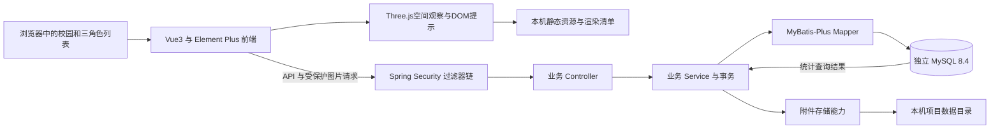
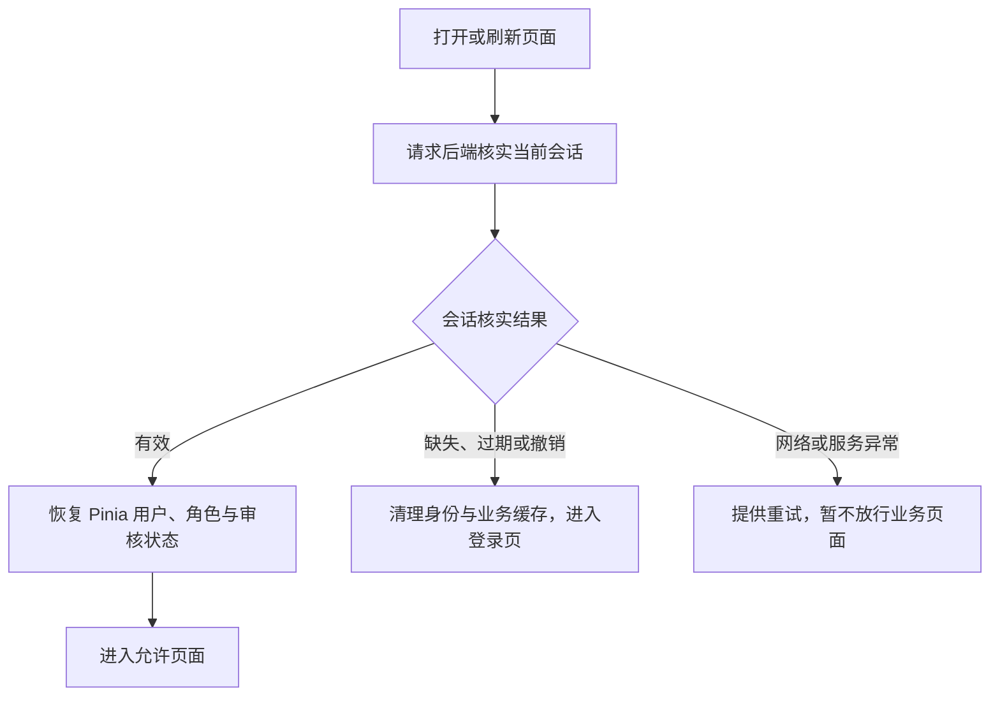
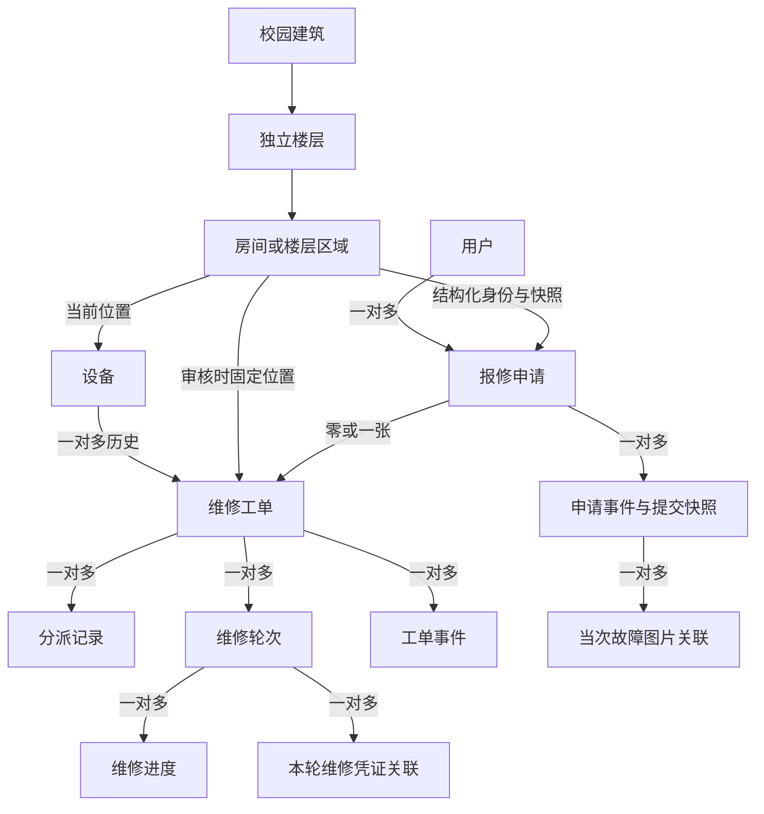

# 基于SpringBoot的设备维护管理系统的设计与实现 — 架构设计

整理日期：2026-10-08  
更新时间：2026-10-11  
版本：校园3D与维修人员推荐架构修订稿 v2.1  
文档状态：按用户2026-10-11“直接开始修正我的架构文档”的授权，以 requirements.md v2.1 为修订依据。十三项旧业务核心决策继续沿用；本轮新增实现设计已整理，等待用户整体审阅，不标记为已通过。需求文件中的新增需求仍保留其原有待审阅状态，本轮授权仅覆盖架构文档修订。

## 0. 文档依据、确认状态与边界

### 0.1 依据与优先级

1. 当前 [requirements.md](requirements.md)：2026-10-11“校园3D与维修人员推荐完整需求草案 v2.1（一致性修订）”，为本轮业务规则、空间配置、交互和验收依据。2026-10-08通过的是旧业务基线，不将其通过状态扩展到新版全部内容。
2. 聊天《继续讨论毕业项目架构》（会话 ID：01a11b7a-9f1f-74b2-8b8e-28ab4304d0fa）：第三至第十三轮的讨论、用户选择及最后的完整性复核。
3. 聊天《继续讨论毕业项目前端界面 (2)》（会话 ID：01a11a0f-bab0-7c32-9b75-66cd637f743f）最后四轮：后端业务分包与前端组织、Pinia 的确认记录。
4. `文件材料/1.温州商学院本科毕业论文（设计）任务书.docx`、`文件材料/4. 温州商学院本科毕业论文（设计）开题报告 - 副本.doc`：正式题名、技术基础、必做功能及成果要求。
5. `提示词.txt`：协作流程、项目目录与分阶段审阅约定。完整流程不代表一次性授权执行后续阶段。

较晚明确确认的决定覆盖早期讨论中的冲突内容。开题报告中的“报修已提交、待分派”等候选流程，以当前需求中申请与工单分开、审核与首次派单一次完成的规则替代；不据此恢复独立的首次待分派阶段。旧选题文本的较早题名不作为正式题名。

### 0.2 十三项已确认决策

| 编号 | 已确认选择 | 本文主要位置 |
| --- | --- | --- |
| A01 | 后端按业务分包，包内分层 | 第 3、4 节 |
| A02 | 前端按业务组织，Pinia 管理少量共享状态 | 第 3、5 节 |
| A03 | HttpOnly Cookie＋MySQL 会话 | 第 6 节 |
| A04 | Spring Security＋业务 Service 权限校验 | 第 7 节 |
| A05 | 当前主表＋按业务拆分历史明细 | 第 8 节 |
| A06 | 数据库约束＋版本条件更新＋必要行锁 | 第 10 节 |
| A07 | 先上传临时附件，业务提交时正式关联 | 第 11 节 |
| A08 | HTTP 状态码＋统一 JSON 响应 | 第 12 节 |
| A09 | 保存关键时间与维修轮次，查询时聚合 | 第 13 节 |
| A10 | 本机运行＋Flyway 版本化迁移 | 第 14 节 |
| A11 | 本机 MySQL 独立测试库 | 第 15 节 |
| A12 | 技术版本基线与依赖固定策略 | 第 2 节 |
| A13 | TypeScript＋基础类型约束 | 第 5 节 |

本文保留上述旧决策并落实新版需求，不新增业务范围。目录、类名、表名、字段名和接口分组中的名称用于说明设计职责；精确 DDL、索引 SQL、完整接口清单留到详细设计，不将示意名称视为此前已逐项确认的接口契约。

### 0.3 本轮新增实现选择与授权边界

以下为本轮根据新版需求形成的架构选择，等待整体审阅；它们不是2026-10-08十三项已确认决定的一部分。

| 编号 | 本轮实现选择 | 主要位置 |
| --- | --- | --- |
| N01 | 固定校园配置＋数据库空间身份＋独立渲染清单 | 第8、14、17节 |
| N02 | Vue内使用Three.js、WebGL2、OrbitControls、GLTFLoader；单一校园渲染实例 | 第2、3、18节 |
| N03 | 后端从业务表生成按权限过滤的位置汇总；前台10秒周期读取 | 第7、12、19节 |
| N04 | 同次登录内存草稿；新申请按用户和位置隔离，补充按原申请隔离 | 第5、20节 |
| N05 | 后端规则推荐、一致快照取数、稳定排序、管理员主动确认 | 第10、12、13、21节 |
| N06 | 总览／目标内容分层加载，有界资源缓存与显式释放，性能预算和证据分开 | 第18、22节 |

### 0.4 当前事实与阶段边界

- 本轮开始时项目目录只有plan，内含requirements.md、architecture.md和tasks.md；本轮只修订本文，没有创建工程、安装依赖、迁移数据库、处理模型或实施业务功能。
- 当前直接授权允许完成本次架构修订，不修改requirements.md的通过状态，也不自动批准本文、旧tasks.md或后续开发。
- 用户明确“架构文档通过”后再修订tasks.md；只有“计划通过，开始Txxx”才执行对应开发。旧任务数量和编号不代表已经覆盖本轮新增架构。
- 版本选定、官方文档核对、模型下载和书面设计分别记录；均不等于项目构建、模型浏览器渲染、数据库行为或性能已验证。

### 0.5 完整校园规模与业务输入

| 建筑 | 楼层实例 | 内景覆盖单位 | 可报修位置 | 初始计划台账 |
| --- | ---: | ---: | ---: | ---: |
| 文博1、文博2、文博3 | 15 | 174间宿舍＋6处公共空间＝180 | 174 | 1392 |
| 致用楼、经世楼、博爱楼 | 15 | 57教室＋15办公室＋30卫生间＋3门厅＝105 | 72 | 402 |
| 一食堂、二食堂、三食堂 | 9 | 9个楼层公共区域 | 9 | 18 |
| 体育馆 | 2 | 首层篮球场、二层看台／观赛回廊，共2 | 2 | 5 |
| 合计：10栋 | 41 | 296 | 257 | 1817 |

数量、设施、首层与标准层差异和示意布局以需求第21节为准。296处不是296间房；1817项是初始演示配置，不是运行时台账上限。文博1为样板，最终范围仍覆盖全部10栋。模板复用只共享几何资源，不共享业务身份、设备、申请、工单或数量。房号是显示标签，不用于推断楼层。具体模型尺寸、网格和资源处理留到对应授权任务。

## 1. 项目目标、范围与约束

系统面向10栋示意校园，在用户本机运行，通过报修用户、维修人员和管理员三个角色完成“报修申请 → 审核并派单 → 接单维修 → 报修人验收”的闭环。校园3D提供空间观察和业务入口，推荐提供人工派单参考；普通列表可独立完成全部已授权业务。最终成果包括可运行系统、源代码、数据库设计、测试材料、素材许可清单与毕业论文，目前均按待实现成果管理。

| 范围 | 架构必须支撑的能力 |
| --- | --- |
| 账号与人员 | 普通账号自行注册、维修人员注册审核及重新申请、预置管理员、资料与密码维护、启停用、动态人员分类及历史查询 |
| 设备台账 | 设备登记、资料维护、启停用、当前与历史工单追溯 |
| 报修申请 | 新申请必选结构化位置，保留自由填写设备信息、原文地址及联系人快照；故障图片、匹配设备、退回补充、撤回、重复关闭、审核并派单 |
| 维修工单 | 接单、带原因拒单、允许阶段的改派、独立追加进度、本轮结果与凭证、验收及原工单返工 |
| 历史与附件 | 提交快照、审核与分派记录、维修轮次、工单事件、图片鉴权访问 |
| 统计与交付 | 真实数据看板、指标与明细核对、三角色本机演示、分层测试和可区分的验收证据 |
| 校园与空间 | 完整10栋外观和简化内景、独立空间身份、楼层选择与进入返回、仅展示空间、旧记录和位置历史兼容 |
| 提示与推荐 | 按角色过滤的位置汇总和事项列表、及时同步与失败反馈、负荷及今日完成量规则推荐、人工选人 |
| 性能与素材 | 分层加载、局部降级、窄屏及可访问性、资源生命周期、可复算性能记录和来源许可 |

首版保留既有异常分支。页面采用需求第10—12、18.2、19节业务基线及第22—26节的校园、提示、草稿和推荐体验。接单后负责人固定，返工沿用原工单；3D动画和推荐刷新不产生业务状态变化。

系统采用前后端分离、单体后端和独立 MySQL 8.4 LTS。首版不扩展为多组织平台，不引入 JWT、Redis、微服务、消息队列、通用工作流引擎、AI、IoT、小程序或对象存储。局域网与云部署不属于当前运行范围。

## 2. 技术基线、依赖与版本管理

### 2.1 后端与数据库基线

以下版本是第十二轮已选择的基线记录，不代表本轮重新完成了在线版本查询或实际构建验证。

| 项目 | 已选版本或管理方式 | 用途 |
| --- | --- | --- |
| Java | 21 | 编译与运行统一目标 JDK |
| Spring Boot | 4.1.1 | 单体 Web 应用与依赖管理 |
| MyBatis-Plus | 3.5.17；`mybatis-plus-spring-boot4-starter` | 数据访问、分页与条件更新 |
| Spring Security | 随 Boot 管理；讨论基线为 7.1.1 | 安全过滤器链、角色限制与 CSRF |
| Flyway | 随 Boot 管理；讨论基线为 12.4.0，包含 MySQL 支持模块 | 版本化数据库结构迁移 |
| MySQL Connector/J | 随 Boot 管理；讨论基线为 9.7.0 | JDBC 连接 |
| MySQL 服务端 | 独立 8.4.11 LTS 社区版实例 | 业务、会话与附件信息持久化；保留 phpStudy |
| 测试、参数校验、日志 | 使用 Boot 管理的配套依赖 | JUnit、Mockito、MockMvc、Bean Validation 及应用日志 |

Spring Security 和 Flyway 是讨论后已选的必要依赖。前者集中提供公共安全机制，后者记录已执行的结构版本；不另行实现一套通用安全框架或手工迁移历史系统。

### 2.2 前端基线

| 项目 | 已选版本或方式 | 用途 |
| --- | --- | --- |
| Vue | 3.5.43 | 页面与组件 |
| Vue Router | 4.6.4 | 路由、角色入口与返回查询状态 |
| Pinia | 4.0.3 | 少量跨页面共享状态 |
| Element Plus | 2.14.7 | 表单、列表、弹窗等组件 |
| ECharts | 6.1.0 | 真实业务统计图表 |
| Vite | 8.3.4 | 开发服务、代理与构建 |
| `@vitejs/plugin-vue` | 6.0.9 | Vue 单文件组件支持 |
| TypeScript、`vue-tsc` | 方案已确认；具体兼容版本搭建前验证并固定 | 类型约束与构建前类型检查 |

### 2.3 固定与验证策略

- 后端固定 Boot 父版本；Security、Flyway、数据库驱动等由 Boot 管理，不单独任意覆盖版本。
- MyBatis-Plus 及分页支持模块使用同版本 BOM，不重复引入另一套 MyBatis starter。
- Maven Wrapper 固定 Maven 版本，明确 Java 21 编译目标；Wrapper 的精确配置在搭建时落地。
- 前端直接依赖使用精确版本，提交 `package-lock.json`，后续通过 `npm ci` 按锁文件安装。
- 不采用 SNAPSHOT、预览版或浮动 `latest`；升级单独说明原因和验证结果。
- 搭建时重新核对包可获取性、依赖管理结果、peer dependencies、Node.js 要求与构建结果。发现基线不可用或冲突时报告并讨论调整，不静默换版本。

前一对话的环境快照为：终端 Java 21.0.11，Maven 3.9.15 实际使用 Java 17.0.5，Node.js/npm 为 24.11.0/11.20.0，PATH 中 MySQL 客户端来自 phpStudy 5.7；独立 MySQL 8.4 安装情况未确认。这些是历史检查记录，实施前须重新检查。优先用项目脚本或 IDE 项目配置统一 JDK；安装、升级和全局配置修改另行取得授权。

### 2.4 本轮3D依赖与能力依据

前端增加Three.js，使用其WebGLRenderer、OrbitControls和GLTFLoader；配套加载器与控制器随同一Three.js包版本固定，TypeScript声明包若实际需要则匹配版本。首版采用WebGL2，模型交换资源使用glTF 2.0／GLB，简单建筑结构和构件允许由参数化几何生成，不要求把整个校园打包为单个GLB。不额外增加Vue专用3D框架、物理引擎、漫游引擎或动画依赖。

2026-10-11核对的官方能力来源：[WebGLRenderer](https://threejs.org/docs/pages/WebGLRenderer.html)、[OrbitControls](https://threejs.org/docs/pages/OrbitControls.html)、[GLTFLoader](https://threejs.org/docs/pages/GLTFLoader.html)；资源释放参考[BufferGeometry](https://threejs.org/docs/pages/BufferGeometry.html)、[Material](https://threejs.org/docs/pages/Material.html)、[Texture](https://threejs.org/docs/pages/Texture.html)。这次只核对WebGL2渲染、轨道观察、glTF加载及资源释放能力，不表示选定了精确Three.js版本或验证了Vue／Vite／TypeScript项目兼容性。精确版本和构建在搭建前按第2.3节锁定；第2.1—2.2节的旧版本记录不因本次修订自动升级。

## 3. 总体架构与目录职责

### 3.1 总体结构



前端负责展示、交互、路由和输入提示，Three.js只承载几何观察、选择和过渡；后端负责空间身份、认证、权限、状态、事务、文件、位置汇总、推荐与统计。业务模块位于同一个Spring Boot应用，通过Service协调；MySQL保存业务、空间与会话，图片二进制保存到本机目录。静态模型不嵌入申请、故障数量或个人资料；数据库事务不能覆盖文件系统写入。3D、业务读取、附件及写操作各自反馈，不以渲染成功替代业务成功。

### 3.2 规划目录

以下目录树表达目标结构，不代表已生成文件。Java 基础包名待搭建时确定，以 `<base-package>` 占位；业务包名为职责示意，各包按需建立分层，不创建空壳层或空目录凑结构。

```text
Graduation_Project/
├─ plan/
│  ├─ requirements.md                    # 已有：新版需求草案及既有业务／前端基线
│  ├─ architecture.md                    # 当前架构修订稿，待整体审阅
│  └─ tasks.md                           # 旧任务基线；架构通过后再修订
├─ backend/                              # 以下均待创建
│  ├─ pom.xml                            # Boot、MyBatis-Plus 与其他依赖
│  ├─ mvnw / mvnw.cmd / .mvn/             # 项目级 Maven Wrapper
│  ├─ src/main/java/<base-package>/
│  │  ├─ Application.java                # 单体启动入口
│  │  ├─ common/                         # 响应、异常、分页等必要公共约定
│  │  ├─ config/                         # 配置绑定、数据库等基础配置
│  │  ├─ security/                       # 过滤器链、认证上下文与安全错误响应
│  │  ├─ account/                        # 账号、会话、审核、人员与密码管理
│  │  ├─ equipment/                      # 台账、启停用与设备历史
│  │  ├─ campus/                         # 固定空间目录、位置汇总及事项查询
│  │  ├─ repairrequest/                  # 报修、补充、撤回、审核与关闭
│  │  ├─ workorder/                      # 分派、推荐、维修、轮次与验收
│  │  ├─ attachment/                     # 图片校验、临时状态、关联、访问与清理
│  │  ├─ statistics/                     # 统计口径、聚合查询与明细
│  │  └─ maintenance/                    # 仅本地执行的管理员初始化与重置
│  ├─ src/main/resources/
│  │  ├─ application.yml                 # 通用配置，不含真实凭据
│  │  ├─ mapper/                         # 按业务组织的复杂 SQL 映射
│  │  └─ db/migration/                   # Flyway 编号 SQL，结构变更唯一来源
│  └─ src/test/
│     ├─ java/<base-package>/            # 按业务组织的单元、集成与接口测试
│     └─ resources/                      # test 配置与隔离测试数据
├─ frontend/
│  ├─ package.json / package-lock.json    # 精确依赖与锁文件
│  ├─ vite.config.ts / tsconfig*.json     # 代理、构建与严格类型检查配置
│  ├─ src/
│  │  ├─ main.ts / App.vue                # Vue 应用入口与根组件
│  │  ├─ views/                          # campus、account、equipment、request、workorder、statistics
│  │  ├─ components/                     # 多页面共用组件，专用组件靠近业务页面
│  │  ├─ layouts/                        # 侧栏、顶部账号区与主内容布局
│  │  ├─ router/                         # 路由、会话恢复检查与角色导航
│  │  ├─ api/                            # 公共请求处理与按业务划分的接口、类型
│  │  ├─ stores/                         # 身份、同次使用草稿等有限共享状态
│  │  ├─ campus/                         # 渲染控制、资源缓存、锚点映射和提示投影
│  │  ├─ composables/                    # 已有复用价值的页面逻辑
│  │  ├─ utils/                          # 时间与格式化等工具
│  │  └─ assets/                         # 样式与小型静态资源，不存业务上传图片
│  ├─ public/campus/                     # 可分发模型、纹理、渲染清单与资源版本
│  └─ tests/                             # 必要前端及浏览器测试
├─ config/                               # 占位配置、固定校园配置及素材许可清单；无真实凭据
├─ scripts/                              # 本机启动、打包与维护命令入口
├─ tests/                                # 跨端流程验证资料与必要脚本
├─ data/                                 # 本机图片等业务文件，不纳入 Git
├─ logs/                                 # 本机运行日志，不纳入 Git
├─ README.md                             # 环境、配置、启动与验证说明
└─ .gitignore                            # 排除秘密、本地数据与构建产物
```

数据库迁移脚本统一放在后端 `db/migration`，不另建第二套结构初始化 SQL。外部配置、上传文件与日志和构建产物分离；演示时收纳前端产物不改变源码职责。

## 4. 后端模块与分层

| 业务模块 | 核心职责 |
| --- | --- |
| account | 自行注册、登录与会话、注册审核及历史、重新申请、人员分类与数量、资料密码与启停用 |
| equipment | 台账编号、名称位置、启停用、关联工单与设备维修历史 |
| campus | 建筑／楼层／位置目录、报修空间校验、权限过滤后的位置汇总和未完结事项列表；不建立第二套业务状态机 |
| repairrequest | 当前申请、提交快照、补充撤回、设备匹配、审核派单或重复关闭 |
| workorder | 当前工单、历次分派、规则推荐、维修进度、维修轮次、结果凭证、验收与事件；推荐作为包内Service能力，不增加独立后端服务 |
| attachment | 上传、文件内容校验、临时记录、正式关联、鉴权读取与清理 |
| statistics | 复用需求口径查询真实业务表，输出指标、分布及可追溯明细 |

每个业务包内部按需设置 `controller/service/mapper/entity/dto/vo`。

| 分层 | 职责与边界 |
| --- | --- |
| Controller | 接收请求、调用 DTO 校验、取得后端当前身份、调用 Service、返回 VO；不直接写表或实现状态流转 |
| Service | 业务规则、数据归属、资格与状态校验、跨模块协调、事务边界及业务时间生成 |
| Mapper | 数据范围内查询、聚合、条件更新及必要行锁；复杂 SQL 放对应业务映射文件 |
| Entity | 数据库表映射；不直接作为所有接口的输入输出 |
| DTO | 每类操作的输入字段与格式约束；不允许客户端任意设置角色、操作者、状态或服务端时间 |
| VO | 前端需要的返回字段，明确当前数据与历史快照；不返回密码哈希、会话摘要或磁盘路径 |

跨模块操作由业务 Service 协调，事务在该业务用例边界内开启。审核并派单须一次提交申请状态、工单与首次分派记录；不能由多个 Controller 请求拼出部分成功。公共目录仅承载实际共用能力，不承载所有业务规则，也不为首版增加通用流程框架。

## 5. 前端页面、状态与类型约束

### 5.1 页面与请求职责

- `views` 按业务分组，相同申请或工单的列表、详情、处理页靠近组织；角色通过路由及操作入口区分，不复制三套公共业务能力。
- `layouts` 承载已确认的侧栏工作台和顶部账号区；登录注册采用需求中的居中表单方案。
- `router` 管理公开页面、登录恢复、校园默认入口、角色业务入口与返回状态；所有已启用账号默认进入校园，未合格维修人员只开放观察及本人审核／允许的账号能力。路由守卫只用于交互，后端仍强制校验权限。
- `api` 集中处理 Cookie 请求、CSRF 发送、统一响应、字段错误与 requestId，再按业务划分调用；不在各页重复异常处理。
- 统计页面实现概览／分析双标签页及共享月份，ECharts 只展示后端结果，不在前端重新定义统计口径。

### 5.2 状态归属

| 状态 | 保存位置与生命周期 |
| --- | --- |
| 当前用户、固定角色、维修人员审核状态 | Pinia；登录与恢复时由后端确认，退出及确定会话失效时清理 |
| Token | 由后端设置 HttpOnly Cookie；不读取、不放入 Pinia 或 Web Storage |
| 普通弹窗、只读加载及错误反馈 | 页面ref/reactive；不把页面卸载作为清空报修草稿的依据 |
| 新报修、补充输入及未提交附件选择 | 内存草稿Store；按当前用户＋位置或原申请隔离，3D／列表共用，生命周期见第20节 |
| 校园当前位置和返回路径 | 位置ID及允许的观察层级；可放路由查询参数，不包含联系人、描述、图片或秘密 |
| Three.js场景、控制器、几何、材质和纹理 | 校园渲染控制器及有界资源缓存；不把大型可变对象放进Pinia深度响应状态 |
| 位置提示、详情与推荐读取状态 | 页面协调器按身份及目标隔离；保存成功时间和新旧请求代次，退出及权限失效清理 |
| 筛选、页码、统计月份及返回位置 | 路由查询参数或必要页面缓存；人员列表与详情查询条件分别维护 |
| 列表、详情与统计数据 | 页面按需查询；操作成功后重新读取，后端与 MySQL 为事实来源 |
| 当前密码、新密码、一次性随机密码 | 仅当前操作的内存状态；结束后清除，不进入持久缓存、URL 或普通日志 |

筛选与返回行为严格沿用需求第 12、18.2、19 节，尤其人员详情不继承列表快捷分类为业务范围。退出与账号切换清除旧身份对应的业务缓存，避免显示前一账号数据。

### 5.3 TypeScript

Vue 组件使用 `<script setup lang="ts">`，为接口输入输出、表单与 Pinia 状态定义明确类型，开启严格检查，避免随意使用 `any` 和复杂泛型封装。区分设备、申请、工单和维修轮次等对象，统计平均时长允许 `null`。

正式构建前执行 `vue-tsc`；Vite 转译不能替代类型检查。TypeScript 不替代后端输入、权限与业务校验。TypeScript、`vue-tsc` 版本按第 2 节在搭建前验证并固定。

## 6. Token 会话、恢复与失效

### 6.1 会话保存

注册成功不自动登录，前往登录时只带入账号、密码留空。登录校验 MySQL 中的账号与密码哈希，后端生成随机 Token，通过 HttpOnly Cookie 交给浏览器。MySQL 会话表保存 Token 摘要、账号、登录时间、固定到期时间与撤销状态；不保存供查询的明文 Token。

有效期自登录成功起固定 8 小时，不滑动续期、不自动刷新。每次请求核对会话与账号启停用，不能只信任 Cookie 尚存在。Pinia中的认证状态仅保存后端确认的身份展示信息，不保存登录Token；草稿状态按第5.2、20节管理。

Cookie 配置 SameSite，写操作配套 CSRF 校验，不能仅依赖 SameSite。Cookie 名称、具体 SameSite 值、CSRF 获取与请求头名称在实现时明确；不把 CSRF Token 当作登录 Token。本机 HTTP 使用适用配置，今后启用 HTTPS 时再设置 Secure，不扩展当前部署范围。

### 6.2 打开或刷新页面



恢复仅核实原会话，不改变到期时间。业务运行中出现网络或服务异常，不直接清除有效登录或显示操作成功。

### 6.3 失效规则

| 事件 | 后端行为与前端反馈 |
| --- | --- |
| 固定 8 小时到期 | 拒绝会话；前端提示重新登录 |
| 主动退出 | 撤销当前会话并清除 Cookie；前端清理身份与业务缓存 |
| 自行修改或重置密码 | 保存密码哈希并撤销该账号全部旧会话；成功后提示用新密码登录 |
| 账号停用 | 禁止登录并撤销全部旧会话；重新启用不恢复旧会话 |
| 角色、资格或数据权限不足 | 返回禁止访问反馈，保留登录状态；待审核人员仍可访问允许的本人审核能力 |
| CSRF 校验失败 | 返回禁止请求反馈，不直接等同于登录过期 |

同一浏览器配置中的标签页共享 Cookie 登录身份。同时演示不同角色须使用不同浏览器或独立浏览器配置；同一配置内通过退出、登录切换账号。

## 7. 认证、角色与数据权限

### 7.1 校验职责

认证过滤器读取 Cookie Token，核对 MySQL 会话与账号状态，建立当前请求身份。Spring Security 配置公开接口、登录要求、角色限制与 CSRF，未明确开放的接口默认拒绝。Service 校验数据归属、审核资格、当前负责人、状态和操作前置条件，Mapper 将数据范围落实到查询与更新条件。

操作者来自后端认证上下文，不信任请求自报的 userId、角色或前端状态。列表先按允许范围查询，再分页及计算 total，不能取全量后交给前端过滤。

### 7.2 数据范围

| 角色或资格 | 可见范围与可执行边界 |
| --- | --- |
| 报修用户 | 本人申请及关联工单、过程与附件；仅原报修用户可验收 |
| 已审核通过维修人员 | 当前分派任务与本人关联历史；只有当前负责人且符合状态、轮次时可处理 |
| 待审核、审核未通过维修人员 | 可浏览示意校园及全部允许内景，访问本人审核状态、历史、规则允许的重新申请与账号能力；无任务提示、维修业务或报修用户权限 |
| 管理员 | 本示意校园范围内设备、人员、申请、工单、空间提示、推荐与统计；遵守改派阶段限制，不替代报修用户验收 |

校园几何与固定位置清单允许已启用账号浏览，当前业务提示和位置事项列表另行按权限查询：报修人仅本人申请及关联工单，维修人员仅当前本人指派任务，管理员为全校园。不可见记录不得影响主颜色、数量、按钮或匿名故障信息；历史业务仍从原列表进入，不混入当前位置未完结提示。

历史关联不等同于当前处理权或完成成果。实际接单承担维修者可只读查看本人负责工单的维修、凭证及验收过程，完结后保留；仅曾分派、随后拒单或接单前改派者，只能查阅本人分派期间可见的原报修信息、当次分派及本人拒单／改派记录和对应附件，不返回关系解除后其他人员新增的进度、结果、凭证或验收。查询以实际维修关系、分派记录及材料归属确定投影，不能用“存在任意历史分派”放行整张详情。附件读取使用同一范围判断，拒单／改派后移除当前提示和操作权。管理员完整追溯不扩大普通角色权限。

停用账号不得继续操作。停用待审核维修人员允许管理员查看申请与历史，须先启用原账号才能提交审核；启用不代表通过。账号启停用、维修审核与工单状态分别管理。

### 7.3 账号管理的业务限制

公开注册只允许报修用户和维修人员，一个账号一个固定角色；管理员不代建普通账号，也不能修改账号角色。账号仅停用、不删除，停用后的登录账号与手机号继续占用唯一性。

报修用户存在未完结申请或工单时不能停用；维修人员存在当前未完结任务时不能停用，判断按全部关联业务执行，不能依赖列表快捷分类。当前登录管理员不提供停用自身入口。重新启用只恢复登录资格，不改变审核状态、不恢复旧会话。

待审核维修人员资料只读；未通过人员从重新申请维护姓名、手机号。已通过维修人员可修改当前姓名、手机号而不重新审核，既有资格、任务和历史快照保留。密码修改仍校验当前密码；确认密码只用于一致性校验，不保存。

## 8. 核心数据模型与历史保存

### 8.1 主表与结构化明细

下表保留旧业务表职责，并加入本轮空间、位置历史及兼容字段设计；新增内容属于第0.3节待审实现选择，名称为示意。精确类型、长度、枚举编码、索引名及DDL后续形成可审阅的数据字典与迁移脚本。

| 表或表组 | 关键内容与关联 |
| --- | --- |
| 用户 | ID、登录账号、姓名、手机号、密码哈希、固定角色、启停用、维修审核状态；并发修改所需版本信息 |
| 登录会话 | 用户 ID、Token 摘要、登录与到期时间、撤销状态 |
| 维修人员注册申请 | 用户 ID、申请次数、姓名与手机号快照、提交时间、审核结果、原因、审核人及时间 |
| 校园建筑 | 稳定ID与配置代码、显示名称、建筑类型；固定10栋 |
| 校园楼层 | 稳定ID、建筑ID、显式层序与名称；共41个实例，不由房号推断 |
| 校园位置 | 稳定ID与配置代码、楼层ID、房间／区域类型、空间用途、名称及是否可报修；296处，257处可报修 |
| 设备 | ID、唯一台账编号、当前名称、结构化locationId及文字位置、范围内设施种类、启停用、初始化配置键及版本信息 |
| 设备位置历史／空间名称记录 | 设备移动或空间名称修正前后内容、操作者、时间；不重建业务身份 |
| 报修申请 | 唯一申请编号、报修人、设备名称、可选自由文本类别、原详细地址、描述、联系人与电话快照、位置模式、locationId及当次位置名称快照、当前状态、首次提交时间、匹配设备及版本 |
| 申请事件 | 申请 ID、事件类型、操作者、时间、前后状态、说明；提交与重提保存当次材料快照 |
| 维修工单 | 唯一工单编号、唯一申请关联、设备、审核成功时固定的申请locationId及名称快照、当前分派责任关系、实际接单人员、状态、当前轮次、关键时间及版本 |
| 分派记录 | 工单、分派对象、分派人及开始／结束时间、当时可见报修材料引用、接单／拒单／接单前被改派结果、原因与时间；支持本人历史投影 |
| 维修进度 | 工单、所属维修轮次、维修人员、进度内容与时间 |
| 维修轮次 | 工单、轮次号、开始与提交时间、本轮结果、验收结果、意见、验收人及时间 |
| 工单事件 | 工单、操作者、时间、前后状态或分派变化、说明 |
| 附件及关联 | 上传人、用途、文件信息、临时状态与到期时间、目标上下文；正式关联到申请提交记录或维修轮次 |

用户表使用固定角色字段，首版不增加动态角色、菜单或权限配置表。当前资料负责展示当前状态，结构化明细负责历史与统计，不以统一 JSON 事件表代替所有业务明细。

位置模式为服务端管理的兼容标识，示意为STRUCTURED／LEGACY_TEXT。新建校园申请强制结构化位置；既有无位置记录迁移为文字模式，不能由客户端伪造旧记录例外。工单位置取申请，不通过台账位置补绑旧申请。提示、故障阶段和推荐分数均从业务表派生，不新增红灯状态表、绩效评分表或设备“故障中”枚举。

### 8.2 主要关系



进度与凭证分别归属工单及轮次，凭证不依赖某条进度记录才存在。申请未通过前可不关联台账设备，由管理员审核匹配；报修原文与台账资料分别保存、展示。结构化申请和工单引用同一独立位置；文字模式旧记录可为空并保留原地址。模型节点及相机锚点通过固定配置映射位置，不作为业务外键或身份来源。

### 8.3 历史与成果归属

- 修改当前姓名、手机号不覆盖此前注册申请快照；补充重提不覆盖此前报修材料及图片。
- 验收退回在原工单中新增维修轮次，保留历次进度、结果、凭证和验收意见。
- 曾分派、拒单、接单前被改派属于历史关系；完成成果归于实际承担维修且最终验收通过的人员。
- 账号仅停用；业务完结、账号停用或退出当前任务均不删除历史，不级联删除业务记录。
- 正式附件按历史保留，临时附件按第 11 节管理；不因每次上传数量限制删除累计历史图片。
- 当次申请保存位置名称、联系人、电话与原文；空间改名、账号资料更新不覆盖历史快照。工单保留审核时申请位置，设备以后移动不改变旧工单位置与提示。
- 原设备仅有文字地址时允许管理员明确维护结构化位置并保留原文；不解析地址，不向旧申请批量补绑。未完结工单期间禁止改变设备结构化位置。

例如“张三拒单 → 李四接单 → 第一轮验收失败 → 第二轮验收通过”，最终仍为一张工单、两次分派、两轮维修，成果归于李四。

### 8.4 约束与索引方向

| 约束 | 目标 |
| --- | --- |
| 登录账号、手机号分别全局唯一 | 跨角色防重复，停用后继续占用 |
| 设备、申请、工单各自业务编号唯一 | 稳定识别业务对象 |
| 工单申请 ID 唯一 | 一张申请最多生成一张工单 |
| 用户＋注册申请次数唯一 | 保留并识别每次申请 |
| 工单＋维修轮次号唯一 | 防止重复轮次 |
| 核心外键 | 保证引用对象存在，禁止级联删除业务历史 |
| 未完结设备生成列的唯一索引 | 同一设备最多一张未完结工单，已完成历史可多张 |
| 新增提交标识唯一约束 | 防止重试产生重复业务记录 |
| 建筑配置代码、建筑＋层序、位置配置代码分别唯一 | 独立识别同名及同房号空间，不共享模板业务身份 |
| 楼层／位置／业务位置外键及位置模式校验 | 确保显式所属关系；新申请有合法位置，旧无位置例外仅由服务端管理 |
| 设备初始化配置键唯一 | 重复初始化不重复生成1817项台账，不覆盖维护后的资料 |

工单未完成时生成列取设备 ID，完成时取 NULL，再建立唯一索引；具体生成表达式随最终状态编码确定，并在真实 MySQL 中验证。

索引围绕权限与实际查询配置：报修人／状态、当前负责人／状态、设备关联、申请／工单关联、历史所属对象与时间、完成时间、工单创建时间、会话摘要与到期时间。复合索引顺序根据实际 SQL 核对，不为每个字段机械建索引。

## 9. 申请与工单状态转换

以下采用已确认业务名称表达状态。具体枚举编码后续统一映射，不增加额外业务状态。

### 9.1 申请

| 当前状态 | 操作者与操作 | 前置条件 | 结果与同事务记录 |
| --- | --- | --- | --- |
| 尚未创建 | 报修用户首次提交 | 结构化位置合法且可报修；设备名称、原详细地址、描述、联系人与电话、首次故障图片及附件条件合格，设备类别可留空 | 创建待审核申请、首次提交及位置／联系信息快照、附件关联，不生成工单 |
| 待审核 | 管理员退回补充 | 当前版本一致，退回原因非空白 | 退回待补充，保存审核事件 |
| 退回待补充 | 原报修用户补充重提 | 原账号、状态与版本正确；结构化申请可修改为另一合法报修位置，旧文字记录沿用兼容流程；资料合格 | 原申请回到待审核，保留编号、首次时间及历次材料；提交成功后才更新位置提示 |
| 待审核／退回待补充 | 原报修用户撤回 | 尚未生成工单，状态与版本正确 | 已撤回并留存撤回事件，不再审核 |
| 待审核 | 管理员重复关闭 | 匹配具体设备、核对重复情况、原因非空白 | 重复关闭，保留关闭依据，不生成新工单 |
| 待审核 | 管理员审核并派单 | 核实设施属于首版范围；设备启用且无未完结工单；结构化申请与台账locationId一致，台账位置不得缺失；旧文字申请不新增缺失位置阻断；人员启用且审核通过；版本一致 | 已审核通过，同时创建待接单工单、固定申请位置快照、首次分派记录及事件 |
| 已审核通过／已撤回／重复关闭 | 查看历史 | 访问权限有效 | 只按允许范围查询，不恢复用户撤回或继续审核入口 |

同名描述不直接等于同一台账设备；重复限制在管理员匹配设备时落实。找不到设备时只可在需求第21节已规定的空间与设施类别内核实补录，再回到审核关联。投影仪无模型不阻止合法报修；模型存在不证明设施属于报修范围。补录失败不能用不存在的设备继续派单。

材料不足、申请位置错误或范围外设施使用退回待补充，并填写原因；位置错误由原报修人在原申请修改重提，管理员只选错台账时重新匹配即可。范围外申请说明不受理范围，允许用户纠正误填或撤回；未撤回时仍为未完结事项。管理员不代撤回，不按重复关闭，不自动完结，不补录范围外设备以派单。申请仅有待审核、退回待补充、已审核通过、已撤回、重复关闭五种状态；“审核未通过”仅用于维修人员注册审核。

### 9.2 工单

| 当前状态 | 操作者与操作 | 前置条件 | 后续状态与记录 |
| --- | --- | --- | --- |
| 待接单 | 当前分派维修人员接单 | 资格有效、版本与当前分派一致 | 处理中，固定实际维修负责人，写接单时间并开启第一轮 |
| 待接单 | 当前分派维修人员拒单 | 原因非空白、当前分派及版本一致 | 待重派，保留拒单记录，不再计入原人员当前任务 |
| 待接单 | 管理员更换维修人员 | 原因非空白，新人员符合资格，尚未接单 | 仍待接单，结束旧分派、记录新分派与事件 |
| 待重派 | 管理员重新分派 | 新人员符合资格、版本一致 | 待接单，保留原工单与全部分派历史 |
| 处理中 | 当前维修负责人追加进度 | 当前轮次与状态正确 | 状态不变，保存独立进度记录 |
| 处理中 | 当前维修负责人提交本轮结果与凭证 | 本轮结果必填、本轮新凭证至少一张，状态、版本与轮次正确 | 待验收，保存结果、关联凭证与本轮提交时间 |
| 待验收 | 原报修用户验收不通过 | 原因非空白，版本与待验收轮次一致 | 原工单回处理中，保存本轮验收并开启下一轮，负责人不变 |
| 待验收 | 原报修用户验收通过 | 核对本轮材料，版本与轮次一致 | 已完成，保存本轮验收及最终完成时间 |

接单后不能在处理中、待验收或返工时改派；管理员不代替报修用户验收。旧轮次凭证不替代新轮次必传凭证，旧页面不能因状态再次相同而提交成功。已完成工单保留只读过程，不重新生成工单或追加返工数量。

## 10. 事务、并发与重复操作

### 10.1 事务边界

| 用例 | 同一数据库事务内完成 |
| --- | --- |
| 注册与维修人员重新申请 | 账号资料与资格状态、当次申请快照、申请次数等必要记录 |
| 注册审核 | 检查当前申请与启停用，写审核决定、原因、人和时间，更新当前审核状态 |
| 首次报修／补充重提 | 重新校验位置及账号资格，保存当前申请、位置／联系人和原文快照、事件、提交标识与本次正式图片关联 |
| 审核派单 | 复核申请版本、设备位置／启停用／未完结工单和人员资格；申请通过、设备关联、工单位置快照、首次分派与事件 |
| 接单／拒单／改派 | 工单与分派结果、状态事件；接单同时写时间和第一轮 |
| 提交验收 | 本轮结果、凭证正式关联、提交时间、工单状态与事件 |
| 验收退回／通过 | 本轮验收、下一轮或最终完成时间、工单状态与事件 |
| 密码修改／重置 | 新密码哈希与该账号全部旧会话撤销 |
| 账号停用 | 重新检查未完结业务、更新启停用并撤销旧会话 |
| 设备位置维护 | 锁定设备并检查未完结工单，校验新位置与范围，更新设备当前位置及版本、保存位置变更历史；既有申请／工单位置不改写 |
| 空间名称修正 | 使用原稳定身份更新名称并保存修正记录，不改所属楼层、不重建位置、不覆盖提交快照 |

失败则数据库修改整体回滚，不留下已通过却没有工单、状态已变却没有历史等部分结果。业务事件记录随业务提交，普通运行日志用于诊断，不能代替事务内历史。文件与数据库的边界按第 11 节处理。

### 10.2 版本条件更新

申请、工单等可修改对象使用 version。关键操作携带读取时版本，更新同时检查版本、当前状态、操作者或负责人以及维修轮次，成功后递增版本；受影响行数不符合预期即停止，并回滚本次相关写入，返回冲突反馈。

版本号不能独立代替状态和数据归属校验。接单与改派、撤回与审核、同轮验收通过与退回，只能有一个有效分支成功；跨轮次旧页面即使看到相同状态也应被拒绝。

### 10.3 必要行锁

跨对象规则使用短事务与共同记录上的行锁，锁定后重新检查：

- 人员停用与派单共同协调人员记录；报修用户停用与新申请等产生未完结业务的路径也须共同协调，不能只有停用方检查一次。
- 设备停用与新工单生成共同协调设备记录；停用设备仍允许处理既有工单，不因此阻断已确认的后续维修流程。
- 设备移动与审核派单共同协调同一设备记录；锁内再次检查位置和未完结工单，不能分别在锁外检查后各自成功。人员资格与派单共同复核；推荐读取不预留人员或设备，也不锁住全部候选。
- 临时附件正式绑定与清理共同协调附件记录，按第 11 节互斥。

各流程采用一致加锁顺序，避免长事务和锁内文件传输。精确加锁顺序和异常处理在对应详细设计与并发测试中落实。

### 10.4 重复提交与不确定结果

首次报修、追加进度等纯新增操作使用一次提交标识及数据库唯一约束。相同标识与相同内容重试返回原结果；不同内容复用标识则拒绝。标识作用域应区分操作者与操作，不能向另一账号返回原记录。

状态操作结合版本与状态条件防止重复执行；会新增历史、轮次或验收事件的提交也保留一次提交标识及原结果引用，放在相应提交／事件记录中。标识、内容摘要、业务结果与事件同事务提交，相同操作重试先按当前身份及可见范围核对原结果，不再次增加事件。旧版本和旧轮次不能借新标识绕过状态条件。

网络超时或响应丢失不等于事务失败，前端显示“结果待确认”，保留草稿、原提交标识和待核对状态，不允许同时宣称成功或失败。支持查询原操作结果或以同标识同内容重试；确认成功才清理已提交草稿并刷新，确认未成功才允许修正后生成新的提交标识。成功反馈以数据库提交结果为依据，不以按钮动画或前端状态变化代替。

## 11. 图片与维修凭证

### 11.1 上传与正式关联

沿用需求第 17 节：仅 JPG／JPEG／PNG，单文件不超过 5 MB，每次提交最多 5 张。首次报修至少一张故障图片，每轮提交验收至少一张本轮凭证；补充已有历史故障图片时不强制重复上传。

1. 选择图片后本地预览，上传请求校验身份、业务资格、大小、扩展名与实际图片内容。
   仅选择、改选位置或切换3D／列表不自动上传；用户主动上传或业务提交中的明确上传步骤才创建临时附件。未提交File选择由内存草稿持有，不上传为3D截图替代首次故障照片。
2. 文件保存后登记临时附件，返回附件 ID；记录上传人、用途、上传时间、到期时间与必要目标上下文。
3. 首次报修尚无申请 ID 时按上传批次管理；补充与维修凭证记录目标申请／工单及轮次，防止跨业务复用。
4. 提交业务字段和附件 ID 后，重新检查归属、有效期、用途、目标业务、轮次及未被占用状态。
5. 同一数据库事务内保存业务、建立正式关联并转为正式附件；失败回滚，仍合格的临时附件可在有效期内重试。

### 11.2 文件与数据库边界

上传即使用稳定随机存储名，正式关联只改变数据库记录，不搬动文件。原文件名只用于展示，实际路径由后端生成，不接受客户端路径。

文件写入失败不能返回上传成功；数据库登记失败时尝试删除残留文件，清理机制处理遗留。数据库事务不假设文件也能自动回滚。上传写入与清理的具体执行顺序须保证不会把尚在使用的文件当作残留删除，并通过故障场景验证。

临时附件 24 小时过期，期限可配置；仅上传人可取消自己的临时附件。清理只处理过期、未关联文件，与绑定互斥，物理删除前须确认该附件不能再被正式绑定；具体状态与重试实现后续细化。正式历史附件不按临时期限删除。

### 11.3 存储与访问

图片放在本机项目数据目录，避开前端public和后端静态资源目录，不入Git。通过附件ID请求后端，由Cookie完成认证，再校验临时上传人或正式关联业务的访问权；URL不携带登录Token，也不暴露磁盘路径。历史关联附件按第7.2节区分实际维修者和仅曾分派者，不用整张工单的粗粒度历史关联放行所有图片。受保护图片采用private／no-store缓存策略，身份或记录权限失效时清除页面预览和对应Object URL。公开模型资源与这些业务附件分开，模型清单不引用受保护的业务图片。

上传、取消临时附件与业务提交均纳入 CSRF 防护。读取成功直接返回图片内容；错误遵守统一接口约定。前端限制和 Visualize 原型只提供交互，实际文件校验与权限由后端执行。

## 12. 接口、校验与错误处理

### 12.1 请求与能力分组

API统一以`/api`为入口，按账号、校园、设备、申请、工单、附件、统计组织。输入使用DTO，查询使用明确筛选条件；写操作需要的version、轮次和提交标识按相应用例传递，身份与业务时间由后端生成。只读校园和推荐能力不提交业务；所有最终写操作仍调用原业务Service并重新复核条件。

| 接口能力组 | 必须覆盖的操作 |
| --- | --- |
| 认证与本人账号 | 注册、登录、当前会话、退出、本人审核与重新申请、资料与密码修改 |
| 管理员人员管理 | 列表筛选、动态分类数量、完整业务历史、注册审核、启停用、普通账号随机密码重置 |
| 设备 | 台账查询、新增与编辑、独立启停用、当前与历史工单 |
| 校园 | 固定建筑／楼层／位置目录和可报修标识；当前身份可见的位置汇总、指定位置未完结事项列表及当前查询时间 |
| 申请 | 首次提交、列表详情、补充、撤回、审核派单、退回补充、重复关闭 |
| 工单 | 当前与历史范围查询、接单拒单、允许阶段改派、进度、本轮结果、验收与历史轮次 |
| 派单推荐 | 根据首次审核／待接单改派／待重派上下文获取推荐顺序、完整合格人员、拒单参考、W/I/R/A、L、D、最近分派信息与取数时间；最终选择由原审核／分派接口提交 |
| 操作结果核对 | 当前操作者按提交标识查询已授权业务的原操作结果；不暴露他人结果，不以未确定结果清空草稿 |
| 附件 | 临时上传、取消、鉴权读取；正式绑定随业务提交 |
| 统计 | 月度指标、每日分布、设备频次、全部当前状态及对应明细 |

这里规定能力覆盖，不伪装为已经实现的接口清单。管理员本地初始化与本地重置不提供公开 HTTP 入口。

### 12.2 响应

普通响应使用 `code、message、data、requestId`；字段错误额外返回 errors。code 是稳定业务标识，message 用于展示，requestId 关联日志。以下为约定示例，不是实际请求结果：

```json
{
  "code": "OK",
  "message": "查询成功",
  "data": {
    "records": [],
    "total": 0,
    "page": 1,
    "pageSize": 20
  },
  "requestId": "example-request-id"
}
```

| HTTP 状态 | 场景及前端处理 |
| --- | --- |
| 200／201 | 查询或操作成功／创建成功；随后重新查询需要更新的业务数据 |
| 400 | 缺少参数、格式或字段校验失败；保留输入并展示错误 |
| 401 | 登录凭据错误或会话失效；登录页显示错误，业务页清理身份并提示重新登录 |
| 403 | 权限、审核资格不足或 CSRF 失败；按 code 提示，不直接清除登录 |
| 404 | 请求资源不存在；提示返回列表核对 |
| 409 | 状态／版本冲突、唯一性或重复操作冲突；修正输入或核对最新数据 |
| 413 | 文件或请求体超限；提示调整文件 |
| 500 | 未预期服务异常；提示稍后重试并提供 requestId |

图片成功响应直接返回文件，不套 JSON。网络异常与请求超时不直接判定业务操作失败，重试策略遵守第 10.4 节。

### 12.3 分页与校验

- page 从 1 开始，默认 pageSize 为 20，最大 100，非法参数返回 400。
- total 仅指当前权限及筛选范围的记录总数；人员快捷分类数量、业务摘要等单独返回，不混用。
- 排序沿用需求，主排序相同补充 ID 顺序，数据库排序字段使用白名单。
- DTO 用 Bean Validation 校验必填、长度、格式；Service 校验资格、数据归属、状态、唯一性与关联关系；数据库约束兜底。
- MVC 全局异常处理与 Spring Security 的认证、权限、CSRF 错误采用同一错误结构。
- 不回传 SQL、堆栈、内部路径或敏感输入；密码、明文 Token 和一次性随机密码不进入普通日志。
- 新申请DTO强制合法locationId，不接受客户端指定LEGACY_TEXT、位置快照或联系人归属；联系人／业务联系电话是当次联系信息，不修改账号、不检查账号手机号全局唯一性。
- 校园业务汇总、事项、详情及推荐响应使用私有且不存储的HTTP缓存策略；只在当前身份内存中保留上次有权结果。模型资源可按内容版本缓存，但不缓存跨账号业务快照。

## 13. 时间、人员分类与统计

### 13.1 业务时间

| 时间 | 写入时机与用途 |
| --- | --- |
| 申请 firstSubmittedAt | 首次成功提交；补充重提不覆盖，作为响应时长起点 |
| 工单 createdAt | 审核派单生成工单；确定设备故障频次月份 |
| 工单 acceptedAt | 实际接单；拒单改派不写入，返工不覆盖 |
| 轮次 startedAt | 第一轮接单／后续轮次验收退回 |
| 轮次 submittedAt | 结果与凭证正式提交、转待验收 |
| 轮次验收时间 | 本轮通过或不通过，保留追溯 |
| 工单 completedAt | 最终验收通过；确定完成量与效率样本月份 |
| 分派 assignedAt | 每次成功首次派单、改派或重派；用于推荐最近分派时间，不以接单时间替代 |

业务时间由后端生成，与状态变化在同一事务写入；一次状态转换共用同一时间值。数据库使用 DATETIME(3)，应用与数据库访问统一按 UTC 写入读取；该类型本身不携带时区。接口输出带时区的 ISO 8601 时间。

统计月份与每日归属使用 Asia/Shanghai。查询范围为包含月初、不包含下月月初，先换算对应 UTC 边界；时长按毫秒计算，聚合平均后再转换单位与舍入。

### 13.2 计算与样本

```text
单张工单响应时长 = acceptedAt − firstSubmittedAt
单张工单维修时长 = 各轮次（submittedAt − startedAt）之和
```

响应时长包含审核、补充、拒单重派等待；维修时长累计处理中时段，扣除待验收。例如首轮 1 小时、待验收 3 小时、返工 1 小时，维修时长为 2 小时。不需要后台持续计时器。

| 指标 | 样本与查询口径 |
| --- | --- |
| 月度维修数量 | 所选月份最终验收通过的工单，每张计一次 |
| 平均响应／维修时长 | 与月度维修数量同一批已完成工单；未完成不计入 |
| 每日完成分布 | 所选月份按最终验收通过日分组，合计与月度完成量一致 |
| 设备故障频次 | 所选月份生成的工单，按设备 ID 聚合；重派返工不增加计数，同名不同设备不合并 |
| 工单状态分布 | 全部已生成工单的当前状态，独立于月份筛选 |
| 指标点击明细 | 复用对应指标的权限、时间字段和筛选条件 |

直接聚合业务表，首版不增加后端统计汇总表或统计结果缓存。先按工单汇总轮次，再做指标聚合，避免关联进度或附件后重复计数。同一次看板请求在 REPEATABLE READ 只读事务内读取一致快照；之后点击明细是新请求，可能有业务变化，展示查询时间并允许刷新。

无样本时数量为 0，平均值为 null，前端显示“—”；关键时间缺失或负时长须标记异常，相关平均值暂不展示并记录排查日志，不按零计算或静默剔除。切换月份后不能将上次结果显示为新月份数据；刷新失败保留结果时注明原月份及状态。

### 13.3 人员分类与归属

人员分类与角色数量复用需求第 5、6 节，按账号或独立业务去重。报修用户的已通过申请改按关联工单归类，不重复算待处理申请；拒单后待重派不算原维修人员当前任务；仅曾分派不算本人完成。同一人可同时有未完结和已完成业务，分类人数不能相加当作人员总数。

人员快捷分类人数不随列表组合筛选变化，列表 total、详情业务分类总数及筛选条数分别表达，人员详情摘要不因详情分页变化。统计看板维修量不与人员分类数量混用。

### 13.4 推荐与空间阶段的独立口径

推荐使用第21节的当前负荷和Asia/Shanghai自然日完成量，不把负荷积分当成第13.2节正式工作量或平均时长。旧无3D位置工单仍按真实任务和完成关系参与负荷、完成量及正式统计。返工依据当前轮次与验收记录识别，工单枚举仍为处理中；空间阶段计数及推荐I/R均互斥。一个已完成工单不因多轮维修或多次曾分派增加完成量。

## 14. 本地运行、配置与初始化

### 14.1 开发与演示

开发时前端通过 Vite、后端通过 Spring Boot 分别启动，独立 MySQL 运行。浏览器访问前端入口，Vite 将 `/api` 及受保护附件请求代理到后端，沿用 Cookie 认证，减少跨域配置。

本机演示时将前端构建产物收纳到 Spring Boot 发布包，通过统一浏览器入口访问；源码仍前后端分离，不另增服务器。前端页面刷新与 API 路径须在实际打包时验证。

数据库、上传文件和日志独立于构建产物，重新构建不清除业务数据。数据目录解析为明确路径，不能随启动工作目录变化。当前不规定尚未落地的端口、启动脚本参数或声称已有可运行命令，后续 README 按实际实现提供。

可分发的校园模型、纹理及渲染清单随前端构建产物本机提供，不依赖外部CDN。原始素材及未核实许可的参考图片保留在素材目录，不能自动进入发布包。启动时核对数据库校园配置版本与渲染清单兼容关系；不匹配时明确标记3D不可用，保留普通业务列表，不自动重置空间或业务数据。

### 14.2 配置

仓库仅保存通用配置与占位示例。真实数据库地址、账号和密码通过环境变量或明确加载的本地外部配置提供，本地秘密不提交 Git；前端仅保存公开 API 路径等配置。

配置区分开发、演示和 test 的数据库与附件目录。端口、数据目录、临时附件期限等可配置；不因切换配置自动清库、重置账号或改动 phpStudy。

### 14.3 Flyway

维护者先创建项目专用数据库与账号。后端启动时检查 Flyway 历史并执行未应用的编号 SQL；已执行脚本不直接修改，变更新增迁移。不混用另一套自动建表或数据库结构初始化机制。

禁止自动清库；有业务数据而无迁移历史的库不自动接管。迁移失败停止启动并报告，不自动删库、重建或跳过。MySQL 结构变更不能一概假定可随普通业务事务整体回滚，升级需备份与明确恢复步骤。

### 14.4 预置管理员与密码

管理员初始化由维护者显式执行本地命令，与正常启动及结构迁移分开，不提供网页初始化或公开管理员注册。首次创建随机密码，符合需求密码规则，保存哈希成功后仅在本次本地操作展示一次，不写普通日志。

检测到已有预置管理员则跳过，不覆盖账号、密码与历史。遗忘时执行独立本地重置，保留原身份及历史，更新哈希并撤销全部旧会话；不能通过重复初始化、删除重建恢复密码。

普通账号由管理员通过授权接口随机重置，数据库提交后仅在本次结果页临时展示，由管理员线下转交，不提供事后明文查询；关闭后清除。不强制首次登录改密，不重新引入管理员创建普通账号。

### 14.5 固定校园与演示初始化

以版本化固定配置保存建筑、楼层、位置、可报修空间和初始设备分组，数据库为运行时身份与业务事实来源。结构仍只通过Flyway迁移；空间及1817项初始设备由维护者显式执行的本地初始化能力导入，不在普通启动时重建，不增加公开校园管理后台。

初始化按稳定配置代码和设备初始化键幂等写入，首批写入在事务内核对10／41／296／257／1817及分项数量；记录初始验收快照。重复执行遇到已有配置时核对兼容并跳过已导入项，不覆盖设备当前名称、启停用、后续位置或业务历史。演示账号、1000条性能用业务记录另行显式准备并标为演示，测试种子仅进入隔离测试库。已有业务而配置不一致时报告冲突，不删除重建或自动接管。

## 15. 测试分层与验收证据

### 15.1 隔离环境

采用独立 MySQL 8.4 实例中的本机专用测试库，不增加 Docker 或 Testcontainers。使用仅覆盖测试库的受限账号、test 配置及独立附件目录；执行与项目相同的 Flyway 结构迁移，测试数据单独准备，不进入正常初始化。

清理前核对实际连接数据库、当前配置与文件目录，不匹配即停止，不回退到开发或演示库。普通用例可事务回滚，真实 HTTP、并发事务和文件写入须单独清理，不能假设测试结束全都回滚。

### 15.2 分层职责

| 层次 | 主要证据 |
| --- | --- |
| 单元测试 | 状态条件、参数边界、轮次与时长计算等独立规则 |
| 后端集成测试 | 真实 MySQL 迁移、唯一与关联约束、事务回滚、版本冲突、分派轮次、附件关联及统计 |
| 认证与接口测试 | 真实 Cookie 登录、会话到期与撤销、CSRF、角色及数据越权、统一响应与分页 |
| 浏览器验证 | 刷新恢复、三角色闭环、图片预览与访问、失败保留输入、筛选返回与窄屏布局 |

后端使用 Spring Boot 测试支持、JUnit、Mockito、MockMvc，版本按第 2 节管理；浏览器工具在实施时检查现有可用能力，不预先安装。

### 15.3 重点场景

- 审核派单、退回补充与撤回、拒单重派、验收退回再通过；核对原申请、工单数量、历史与实际成果归属。
- 使用独立连接与事务同时接单和改派、撤回和审核、停用和产生新任务，核对只有允许的最终结果。
- 真实登录取得 Cookie，验证固定过期、退出、密码变更、停用和重新启用；模拟登录身份不作为完整认证通过的证据。
- 有效、缺失、错误 CSRF Token，角色越权、他人数据与附件访问。
- 非法文件、过期或他人临时附件、跨业务跨轮次复用、重复绑定、绑定与清理冲突及文件／数据库失败补偿。
- 跨月、拒单与多轮返工数据，人工列出预期值后核对指标、每日合计与明细，检查异常时间处理。
- 固定空间和设备配置逐项核对；同名房间不串数据，模板共享不共享身份，投影仪无模型仍可报修，展示空间和范围外设施不得派单。
- 新旧位置审核、补充成功迁移提示、设备移动与派单并发、改名快照、旧无位置申请不生成提示。
- 两报修人共享位置、维修人员拒单／改派、未合格人员观察权限，核对汇总颜色／数量、详情、历史材料和附件均无越权。
- 推荐W/I/R/A和L、跨日D、同分顺序、曾拒单、无优先推荐与无资格、选择保留及资格失效；手算与真实数据库取数一致。
- 10秒刷新、后台恢复、读取失败、权限失效、草稿切换、响应丢失与同标识重试；核对没有覆盖编辑或重复创建事件。
- WebGL2不支持、总体／局部失败、15秒超时、旧加载迟到、连续切换、窄屏及资源释放；性能测量详见第22节。

会话过期与月份边界使用可控制的测试时钟，不必实际等待 8 小时。浏览器验证连接真实接口和隔离测试数据，示例交互不代替实际功能。

### 15.4 报告与用户验收

分别记录构建与类型检查、自动化测试、实际接口与数据库／文件核对、浏览器操作、未执行或受环境限制事项、用户手工反馈。每项结论只覆盖对应证据范围，不以单项通过声称整个系统验收完成。

每完成一个已授权开发任务即停止，说明修改、实际验证、手工测试与风险，状态为待用户验收；用户测试通过后按其指令处理下一步。本次仅为架构文档整理，不包含上述系统构建或运行验证。

## 16. 一致性核对与后续审阅

### 16.1 需求覆盖对应

| 需求章节 | 本文支撑位置 |
| --- | --- |
| 0：目标、范围与技术约束 | 第0.5、1—3、14、17、22节 |
| 1–4：账号、资料、登录审核与管理员 | 第 5–8、10、14 节 |
| 5–8：人员分类、数量、历史与停用 | 第 7、8、10、13 节 |
| 9、20：阶段边界、交付与验收 | 第 0、15、16 节 |
| 10–12、19：业务页面、导航与交互 | 第3、5—7、12、18—21节；具体界面继续引用需求 |
| 13：权限与数据范围 | 第 6、7、10–12 节 |
| 14：设备台账 | 第 4、8–10 节 |
| 15：申请、审核与设备关联 | 第 8–12 节 |
| 16：分派、维修与验收 | 第 8–13 节 |
| 17：图片与凭证 | 第 8、10–12 节 |
| 18：真实数据统计与看板 | 第 5、12、13 节 |
| 21：校园范围、设施、示意布局 | 第0.5、1、8、14、17、18、22节 |
| 22：校园导航、观察、角色和可访问性 | 第3、5—7、18、20、22节 |
| 23：提示聚合、状态与同步 | 第7—10、12、19、20节 |
| 24：结构化位置、草稿和历史兼容 | 第5、8—12、14、17、20节 |
| 25：管理员规则推荐 | 第4、10、12、13、19、21节 |
| 26：加载、降级、性能、素材 | 第2、3、14、18、22节 |
| 27：REQ-01—20与交付证据 | 第15、22节 |
| 28：保留、替换、排除与文档状态 | 第0、1、16节 |

核心不变量：一申请最多一工单；同设备最多一张未完结工单；审核与首次派单同事务；接单后负责人固定；返工仍为原工单；仅原报修用户验收；历史与正式附件保留；权限由后端执行；数量按独立业务去重；会话固定到期且可撤销。

新增不变量：结构化位置身份显式配置；新申请派单位置一致；旧文字记录不补绑3D；提示先过滤权限再聚合；工单位置不随设备移动；I/R互斥；推荐不自动提交；模型失败不改变业务结果；不同用户和位置草稿不串用。

### 16.2 后续细化与待验证项

| 项目 | 当前边界 |
| --- | --- |
| 精确表字段、枚举编码、索引 SQL、完整接口清单 | 后续详细设计补全，不以尚无 DDL 误判核心架构未讨论完 |
| 基础包名、具体类名、Cookie／CSRF 参数、维护命令及端口 | 依本文职责实现时明确；涉及业务或选型变化须重新确认 |
| TypeScript、vue-tsc 与 Maven Wrapper 配置 | 搭建前核对并固定，不使用未验证版本冒充已选精确基线 |
| 所选依赖和本机环境 | 旧版本基线及新Three.js精确版本在搭建前核对可获取性、类型兼容、JDK、MySQL与实际构建；本轮仅核对官方3D能力说明 |
| 数据库并发、附件清理、UTC 与统计快照 | 必须通过真实数据库与文件行为测试验证，文档约定不等于运行保证 |
| 渲染清单、模板文件、相机锚点和资源参数 | 第18、22节确定职责及初始预算；副本处理与实测调优只在对应授权任务执行 |
| 书面架构整体确认 | 旧十三项已确认；本修订稿根据直接授权整理，等待整体审阅，不更新tasks.md或执行开发 |

本文保留旧架构决策并补齐新版需求的实现设计。本轮完成标准是需求覆盖、跨章节一致、状态准确及可审阅；文档修订不等于新增架构已通过，也不等于系统已经实现或运行验证通过。

## 17. 固定空间、设施分组与历史兼容

### 17.1 身份、配置与渲染映射

采用建筑、楼层、位置三层结构。位置区分ROOM／AREA，并保存空间用途、显式所属楼层、显示名称和reportable。目录区分空间固有报修范围与当前角色能否新建申请：可报修房间不因此给维修人员报修用户权限；仅展示空间明确提示“仅供观察，本区域不提供报修”。同一楼层只有一个食堂或体育馆区域时，选择器可省略单选步骤，数据库仍保留独立区域ID。宿舍门厅／值班室、教学楼卫生间／门厅均纳入观察目录，reportable为false；厨房仓储没有可进入位置，只保留封闭区域标识。走廊、楼梯和环境装饰不计入296处覆盖单位。

固定配置作为初始身份清单，代码、ID及所属关系显式列出；导入数据库后API提供运行时位置清单和名称。前端渲染清单引用同一稳定配置代码，映射建筑实例、楼层组、门或区域入口、提示锚点、相机目标及内景模板。配置代码与数据库ID通过明确字段关联，不解析房号、不搜索模型名称来猜业务位置。渲染清单只存几何信息，数据库不保存临时相机状态。

模型替换不改变业务ID或所属关系。空间名称拼写修正使用原身份，保存前后名称和操作记录；新提交采用当前名称，历史仍保留当次快照。首版没有新增楼栋、删楼层、重新编号、拖拽布置或校园编辑后台。几何模板、贴图和公共构件可以共享，实例变换、门动作和位置选择状态分别持有。

### 17.2 展示数量与台账粒度

| 位置用途 | 展示与台账边界 | 初始计数 |
| --- | --- | ---: |
| 宿舍 | 两组上床下桌各1项；马桶、淋浴、洗手盆各1项；空调1项；两灯合1照明组；两桌面插座合1插座组 | 174×8＝1392 |
| 教室 | 30桌30椅合1桌椅组；1空调组、1照明组、1插座组；电脑、投影仪各1项；投影仪无需模型，讲台不报修 | 57×6＝342 |
| 办公室 | 4套桌椅合1组；空调、照明组、插座组各1项 | 15×4＝60 |
| 食堂楼层区域 | 每层4立式空调合1组、12灯合1组；12四人桌、48座、4窗口只展示 | 9×2＝18 |
| 体育馆首层 | 两篮球架合1组；12灯合1组；4立式空调合1组 | 3 |
| 体育馆二层 | 6灯合1组；2立式空调合1组；32看台座椅只展示 | 2 |
| 仅展示空间与环境 | 门窗、走廊、楼梯、公共空间和装饰不因模型存在成为设备；教学楼卫生间／门厅不配置空调 | 0 |

教学台账342＋60＝402；教学空调57＋15＝72台；食堂实体空调36台登记为9个组；体育馆6台登记为2个组。组内不再登记单体台账，不能以同一模型实例数推导设备记录数。初始设备使用稳定初始化键，同位置允许后续合法补录不同设备，不对“位置＋名称”建立阻止正常新增的唯一约束。

台账设施种类使用与空间用途相容的内部限定码，服务端校验其属于需求第21节范围；它与报修表单的可选自由文本设备类别分别表达。用户填类别不决定资格、范围或台账绑定。实际设施范围由管理员审核核实，后台补录仅使用当前位置已允许的设施类别，不增加用户逐物件选择流程。

### 17.3 新申请、旧记录与设备位置

- 新申请无论从3D或列表发起，必须提交可报修locationId。地址按建筑＋楼层＋位置预填并允许补充，原文、联系人和电话分别保存；姓名非空、电话按11位手机号格式校验，不修改账号资料或校验业务电话全局唯一性。
- 结构化申请审核时设备locationId必须存在且一致；差异返回明确双方位置和冲突反馈，不生成工单、不静默覆盖原文。台账缺少位置时先由管理员维护台账再返回审核；申请位置错则退回原申请补充。
- 旧无位置申请和工单保留文字模式，仅在原列表按原权限处理。旧待审核申请可匹配设备并派单，不因缺少位置阻断；工单继承旧申请的无位置属性，不通过设备当前位置生成提示。补充旧记录不暗中转为新位置记录，不提供管理员旧申请批量绑定能力。
- 设备有未完结工单时禁止修改结构化位置；完结后维护新位置并留历史。工单始终按审核成功时申请位置提示，完成历史不迁移。型号或模型替换不改变身份和归属。

## 18. 3D视图、资源组织与加载生命周期

### 18.1 前端组成与观察状态

校园页由位置选择器、Three.js画布、DOM标签／汇总提示、按需业务面板及普通列表入口组成。共用原申请／工单表单、图片、详情和业务API，不复制一套3D专用审核或维修实现。左右面板按需求第22节组织；320—767像素时折叠导航并改为上下或底部面板，业务入口不等待3D初始化。

校园渲染控制器负责场景、相机、OrbitControls、拾取、门动作、锚点投影与资源释放；页面协调器负责身份、当前位置、读取代次和业务面板。单次校园视图只维护一个渲染实例，Three.js对象不进入Pinia深度响应。位置选择与返回路径只保存稳定位置ID和观察层级；不同用户／位置的表单由第20节草稿管理。

观察链为校园总览→建筑→显式楼层→门口或区域入口→内景，可返回楼层和校园。宿舍／教学房间先定位门口，再由用户点击房门开门进入；食堂／体育馆通过区域入口进入，不强造房号。层组及外墙按渲染清单独立控制可见性，上方遮挡层隐藏，楼梯保持相邻楼层连贯展示。鼠标和触控拾取仅解析配置中的位置目标，装饰不产生报修对象。

OrbitControls提供室外旋转、平移、缩放及室内轨道观察；相机目标、观察距离和门轴来自模板锚点。运镜与开门分别采用不超过1秒的短过渡，减少动态效果时直接切换；不依赖动画完成提交业务。键盘通过DOM级联选择、位置列表和进入／返回按钮操作，不要求键盘操控全部几何；焦点可见，触控关键按钮有效面积至少44×44像素。标签使用安全文本渲染，不把业务描述拼入HTML或模型。

### 18.2 资源层次与加载策略

资源分为校园总览外观与环境、建筑／楼层上下文、可复用内景模板与家具、实例配置四类。总览只加载10栋简化外观、名称和道路环境；当前建筑／楼层按需提供上下文；只为选中目标加载内景模板，不在首屏遍历加载296处内景。标准层和重复家具共享几何／材质，实例的业务映射独立。

选中位置后可预取该目标内景，不能借预取强制进入。用户点击门或进入按钮后计入所有后续排队、下载、解析、GPU准备及过渡，按需求5秒目标测量；此前停留不计。资源路径只从本机版本化渲染清单读取，不接收用户上传的模型路径，不依赖第三方CDN。资源版本与内容哈希明确记录，模型可按版本缓存，业务数据不混入模型缓存。

模板声明门、外墙、楼梯、入口和观察锚点；原始素材处理副本后适配模板。缺少某个设备网格不影响位置报修与台账；投影仪无模型使用原业务入口。样板文博1验证模板与身份映射后复用到其余实例，最终清单和视觉验收仍覆盖10栋及全部空间。

### 18.3 缓存、并发结果与释放

只保留总览、当前上下文及有限近期目标的资源。初始策略为当前内景模板＋最多一个近期非当前内景模板，共最多两个内景模板条目；总览及当前楼层公共资源单独计入总预算，离开旧上下文即释放无引用实例。模板共享资源按引用计数释放，不因卸载一个位置提前释放其他实例所用几何或纹理。缓存预算见第22节，禁止无界积累每次加载的场景副本。

每次目标选择和重试递增加载代次，完成回调同时核对当前身份、目标、观察层级和代次。主动取消不再需要的请求或动画；加载器不能实际取消时仍丢弃旧回调并释放不再使用的结果。旧加载、旧运镜、旧重试及旧业务请求不能覆盖新选择，换到列表后不能由迟到结果跳回3D。

离开校园页停止动画循环、控制器、尺寸／指针／可见性监听和超时计时器，释放页面所拥有的渲染资源；关闭或淘汰模板显式释放无共享引用的geometry、material、texture。纹理图片与Object URL按归属释放，不能只从场景移除对象。业务草稿按第20节独立保留，渲染卸载不清空File选择。连续切换验证资源占用趋于有界，不能仅凭调用dispose声称无泄漏。

### 18.4 失败、超时与低性能反馈

| 情况 | 处理 |
| --- | --- |
| WebGL2不支持、初始化失败或整体资源失败 | 显示明确原因、普通列表入口和可用的重试；由用户选择列表，不自动跳转 |
| 某建筑／楼层／内景失败 | 保留其他可用内容和位置身份，仅标记失败目标；提供局部重试与该位置列表入口 |
| 实际开始加载15秒未完成 | 显示超时和重试／列表入口；排队未开始不计15秒，但进入内景5秒验收仍包含点击后的排队 |
| 超时后迟到成功 | 仅用户仍在同一目标且代次未被新重试替换时显示；移除超时提示，不改变业务结果 |
| WebGL上下文丢失 | 保留位置、草稿和普通业务入口，停止故障渲染；恢复后重建当前目标，重新读取可见业务状态，不恢复旧权限快照 |
| 连续10秒观察低于20 FPS | 提示可主动切换简洁显示或普通列表；简洁显示减少装饰／阴影，仍保留10栋、位置及业务提示 |

只有用户正在稳定观察、页面在前台且渲染实际运行时进行低FPS判定；不把后台暂停或无交互时的按需停止渲染当作低性能。模型、业务读取、附件和业务写入分别显示状态；任何失败都不能伪装为“暂无故障”。

## 19. 空间提示、聚合查询与更新

### 19.1 提示来源与阶段

提示来源为有结构化位置、未完结且当前身份可见的申请／工单。后台先过滤角色和归属，再分阶段计数、聚合并分页事项。已审核通过申请由关联工单代表，只计一次；旧文字记录和完结事项不进入空间提示。故障灯不校验模型节点存在，也不写入设备启停用状态。

| 业务阶段 | 提示类别／颜色 | 计数和访问边界 |
| --- | --- | --- |
| 待审核申请 | 待审核／灰蓝 | 报修人本人、管理员；维修人员不显示 |
| 退回待补充申请 | 待补充／琥珀 | 仍为未完结，报修人本人、管理员；不亮故障红灯 |
| 待接单工单 | 故障处理中／红 | 报修人本人、当前指派人、管理员 |
| 待重派工单 | 故障处理中／红 | 报修人本人、管理员；无当前指派，不向原拒单人提示 |
| 处理中且非本轮返工 | 故障处理中／红，处理中数量 | 报修人本人、当前负责人、管理员 |
| 验收不通过后再次处理 | 故障处理中／红，返工数量 | 原负责人继续；与普通处理中互斥，不增加工单枚举 |
| 待验收工单 | 待验收／蓝 | 原报修人验收，当前负责人只读，管理员不代验收 |
| 已完成、已撤回或重复关闭 | 不再计入该事项提示 | 保留历史及原权限，同位置其他可见事项继续显示 |

同一位置一个汇总，主类别为故障处理→待验收→待补充→待审核。故障处理统一主标题“故障处理中”，待接单、待重派、处理中、返工分别保留数量，不再设置它们的主标题优先级。正常位置不显示红绿“无故障”灯；同楼栋／楼层／位置身份才聚合，不按显示名称合并。

### 19.2 查询投影与展示

汇总返回locationId、主类别、各阶段数量、当前可见总数及取数时间；数据来自一致快照内的业务聚合，不关联进度／图片后直接count而重复计数。点击汇总打开该位置可见未完结事项列表，显示业务类型、ID／编号、名称、阶段、时间、允许入口；再选记录进入共用详情，不默认提交或选第一条执行。

事项查询按权限过滤后计算total和分页；通过locationId访问同位置不能获得他人记录、数量、联系人或图片。合法读取结果为空时显示“当前没有可查看的未完结记录”，不推断他人有无报修。普通历史从原列表读取。DOM提示使用与3D锚点关联的按钮与文字，颜色同时有阶段、数量或图形，不闪烁；位置列表提供键盘／触控等价入口。

### 19.3 前台刷新与操作同步

采用前台10秒周期读取作为首版同步方案，不引入WebSocket、SSE、消息队列或Redis。页面只读取当前需要的汇总、已打开位置列表、详情只读状态及可用操作；派单面板打开时同步刷新推荐参考数据。相互独立的读取可并行，同一目标不堆叠请求；单次只读超时初始设为8秒，正常服务条件下留出30秒更新余量，最终按需求实际测量。

页面后台暂停周期读取和无意义渲染；恢复前台立即读取，成功后才标为最新。本人业务经服务端确认成功后立即使相关汇总、事项、详情、推荐及普通列表失效并重新读取，不等待下次周期。补充修改位置时只在成功重提后迁移对应申请提示，旧位置其他事项不清除；提交验收变蓝，验收不通过恢复红色返工，完结只移除该工单事项。

所有读取带身份代次、目标及读取代次，旧响应不得覆盖退出、切换账号、改选位置或较新读取。自动刷新只更新只读内容和允许操作，不写入编辑草稿、不自动替换已选人、不自动提交。仍可查看但原操作失效时保留草稿、提示变化并停止提交；用户核对最新版本后再执行合法操作，后端仍复核版本、状态、权限及轮次。

### 19.4 错误分类与缓存边界

网络／服务读取失败保留上次成功且仍有权查看的结果，显示可能过期、上次成功时间和重试；初次失败显示加载失败。失败不更新成功时间，不填充全零或假“暂无故障”。

401确定会话失效时清理身份、业务缓存及草稿，停止相关读取和操作；退出或账号切换同样清理。403依据稳定code区分记录权限失效、维修资格不足和CSRF失败：前两类清理对应无权内容／草稿及操作，保留仍有效登录和校园观察；CSRF失败不直接视为登录或记录权限失效。服务端确认记录不再属于当前任务时移除其当前提示和操作，历史读取仍依第7节范围。私有业务数据不能保留为跨账号或持久化缓存。

## 20. 同次使用草稿、附件选择与提交结果

### 20.1 草稿键与内存生命周期

| 草稿类型 | 内存键 | 行为 |
| --- | --- | --- |
| 新报修 | 当前userId＋独立locationId | 每位置一份，保留字段、联系信息、File选择／预览和已主动上传的临时附件引用；不为设备另建多份 |
| 原申请补充 | 当前userId＋requestId | 保留原申请编辑内容、已读取版本、本次位置选择及新增附件；改位置仍是原申请草稿 |
| 维修、验收或派单编辑 | 当前userId＋业务ID＋操作／轮次 | 共用3D面板与普通处理页的编辑状态，避免刷新覆盖或跨轮次复用 |

切换3D／列表复用同一草稿；新报修改选位置展示该位置草稿或空表单，返回原位置继续原输入，不自动搬运描述或照片。补充改位置仅修改该申请草稿，不生成其他位置的新申请。历史故障图片只读保留，新选但未提交图片可以移除；每轮验收重新要求本轮结果和新凭证。

草稿仅保存在同次登录内存，不写localStorage、IndexedDB、URL或日志；不恢复刷新、关闭页面、退出后的输入，不做跨设备同步。正常路由切换保留，明确取消修改按对应页面约定放弃该草稿；刷新／关闭在浏览器允许范围内提示未提交内容。确定登录／记录权限失效立即清除无权草稿，退出／切换清除该账号全部草稿、预览Object URL及临时引用。

### 20.2 提交、上传与清理

预览不等于上传，选择位置、打开内景和切换页面均不上传或提交。业务提交先完成必要且明确的临时上传步骤，再以对应附件ID和一次提交标识提交原API；临时附件24小时期限及正式绑定校验继续按第11节。

成功只清理本次已提交草稿和未提交附件选择状态，保留其他位置草稿；正式申请、已关联图片和历史不删除。明确失败保留输入和仍有效临时引用，过期或失效附件提示重新上传，不拿旧轮次凭证替代本轮。响应丢失时按第10.4节保留草稿、冻结该次待核对提交并查询原结果；同标识重试不得增加重复申请、工单、进度或验收事件。

刷新返回的只读位置、业务状态和版本与编辑字段分开保存；不会将服务器新值直接覆盖已填写描述、意见或File选择。仍有查看权但不再能执行原操作时，保留草稿并禁止旧提交；没有查看权时按第19.4节清除相应内容。

## 21. 管理员维修人员推荐

### 21.1 场景、资格与人工选择

推荐能力位于workorder业务包内，由管理员在首次审核派单、待接单接单前改派、待重派重派时读取。读取复核管理员身份及对应申请／工单状态，不在处理中、待验收或返工提供改派推荐。读取不改变状态、不预留人员、不默认提交选人，也不新增AI、技能认证、排班、距离或最大接单数规则。

资格候选为维修人员角色＋账号启用＋注册审核通过，首版视为可承接全部已确认设备类别。待接单改派时当前负责人只在现有资料中展示，不能作为同人改派目标。同工单曾拒单者不进入优先推荐，但仍可在完整合格名单中主动选择；展示拒单原因并要求确认曾拒单提示，不取消其资格。

无合格人员时说明原因并阻止审核／派单，原申请或待重派工单状态不变。有合格人员但优先名单为空时显示“暂无优先推荐”，保留完整合格名单及人工选择；负荷高不等于不合格。默认展示前5名，展开、搜索和分页可查看其余候选，不用前5名作为提交资格限制。

### 21.2 取数、负荷与稳定排序

| 量 | 服务端口径 | 权重 |
| --- | --- | ---: |
| W | 当前指派给本人的待接单工单数 | 1 |
| I | 当前本人负责，处理中且尚非本轮返工的工单数 | 2 |
| R | 当前本人负责，本轮由验收不通过开启、尚未再次提交验收的处理中工单数 | 3 |
| A | 当前本人负责的待验收工单数 | 0.5 |
| D | Asia/Shanghai今日最终验收通过、归属于本人实际维修的独立工单数 | 不计负荷，作为同负荷排序项 |

L＝W＋2I＋3R＋0.5A。数据库取数可使用等价整数2L＝2W＋4I＋6R＋A排序，再转换展示，避免浮点比较。同一工单仅进入一个阶段，I／R互斥；待重派、完成和仅曾分派不计当前负荷。当前返工由当前轮次和前轮不通过记录判断，不新增工单状态，也不以曾经返工过认定当前仍是返工。

完整顺序为L升序→D升序→最近一次成功分派时间升序（从未分派者优先）→稳定人员ID升序。最近分派时间取该人员全部成功首次派单／改派／重派记录的最新值，历史拒单不删除其曾分派时间。今日范围使用后端时钟计算上海00:00至次日00:00并转UTC，D按最终验收时间计算，不按浏览器时间、结果提交时间或轮次数计数。旧无3D位置工单同样参与这些业务取数。

同次推荐在REPEATABLE READ只读事务中取资格、当前任务、今日完成及最近分派的一致快照，以一个服务端时点确定日期边界。先按每个工单汇总，再按人员聚合，避免关联进度、凭证和历史分派导致计数膨胀。候选完整排序后再取前5／分页，查询时间、业务日期和排序理由随结果返回；不随机同分，不维护额外绩效表。

可复算例：甲W＝1、I＝0、R＝0、A＝0，L＝1；乙W＝0、I＝1、R＝0、A＝2，L＝3，甲优先。两人L相同且甲今日完成5单、乙1单时，乙优先；再同分才比较最近成功分派时间和ID。示例不代表学校绩效或实测数据。

### 21.3 面板、时效与提交复核

每行展示姓名、资格／启用标识、W/I/R/A、L、今日D、最近分派信息、曾拒单参考及简短理由，明确取数时间。按第19节前台10秒刷新，在正常联网条件下30秒内更新参考数据；跨上海自然日由后端重新计算D，恢复前台立即读取。

刷新不替换已选维修人员。人员仍有资格时保留选择并更新指标，排序变化不阻断合法人工选择；失去资格时明确提示、取消无效选人并禁止提交，保留其他编辑内容。最终通过原审核／分派API重新复核人员资格、申请／工单版本与状态、设备、位置、同设备未完结限制及改派阶段；曾拒单目标需携带明确确认。推荐排名不是提交前置资格。

推荐读取失败显示不可用和重试；完整合格人员列表能成功读取时仍可人工选人。资格名单也无法确认时不根据缓存提交，恢复读取后再核对。参考数据与资格列表读取反馈分别表达，不把“推荐失败”“暂无优先推荐”“无人具备资格”合为一种空状态。资格和数据权限始终由最终事务复核，不锁定全体候选来维持排序。

## 22. 性能预算、完整验收与交付证据

### 22.1 需求性能目标与测量口径

以下是需求目标，均尚未运行验证。验收使用用户本机Windows 10／11、至少8GB内存、支持WebGL2与硬件加速的Chrome或Edge，记录CPU／GPU、内存、浏览器完整版本、视口、服务配置、资源版本和数据规模。桌面1366×768以上；320像素窄屏另验关键业务操作。

| 对象 | 正式条件与目标 | 计时或取证 |
| --- | --- | --- |
| 业务入口 | 连续5次登录后位置选择和普通列表入口各次≤2秒 | 不等待3D，记录入口可操作时点；失败要有明确反馈 |
| 校园首屏 | 本机资源冷缓存，连续5次各≤8秒 | 从校园导航开始至10栋外观、名称可观察且可交互；每次记录缓存条件 |
| 冷缓存内景 | 宿舍／教室／办公室／食堂／体育馆代表目标合计至少10次，各≤5秒 | 从点击房门／进入观察到可观察，包含之后的排队、加载和过渡；不计此前停留 |
| 热目标过渡 | 已加载位置选择定位、开门进入分别≤1秒 | 各从对应操作开始；减少动态时直接切换 |
| 稳定观察 | 校园和代表内景各旋转／缩放60秒，平均≥30 FPS，95%帧间隔≤100ms | 记录帧时间序列；加载另记，不删除正常观察卡顿 |
| 读取接口 | 最多5个并发演示会话、至少1000条业务记录；选定列表／详情／状态／推荐各20次，p95≤1秒 | 记录端到端API响应、请求和业务分布；不用离线JSON替代 |
| 业务写入 | 同条件，不含附件上传，各20次，p95≤2秒 | 验证实际事务结果及幂等，上传时间单独记录 |
| 切换与异常 | 连续至少30次切换后原位置仍能操作，无旧覆盖、重复提示、崩溃或增长导致卡死 | 保留操作记录及资源变化，单次截图不足 |
| 反馈与刷新 | 实际开始加载15秒超时；前台他人变化≤30秒；本人确认成功立即同步；连续10秒低于20 FPS提示 | 故意延迟、权限变化和正常服务分别验证，反馈阈值不替代正常性能目标 |

浏览器使用单调计时记录加载／交互，后端业务时间仍使用服务端UTC。冷缓存测试在隔离验证浏览器中明确设置条件，记录是否发生预取及资源开始时间；不能把热缓存结果标成冷缓存。接口p95注明样本数、百分位计算方式和失败请求，正常条件之外的故障场景另列，不靠剔除失败宣称达标。列表可用不能替代3D性能通过。

### 22.2 初始实现预算与调优边界

以下是本轮提出的初始工程预算，服务于上表需求目标，不是新增验收指标或已测结论；实测不达标时先查资源／渲染／查询瓶颈，再记录合理调优，不静默降低10栋、全部内景或业务覆盖。

| 部位 | 初始策略／预算 |
| --- | --- |
| 首屏资源 | 10栋简化外观和环境首屏所需模型／纹理总传输量目标≤12 MiB，不带全部内景 |
| 单目标新增资源 | 代表内景新增传输量目标≤6 MiB，普通贴图优先≤1024×1024；共享家具和材质复用 |
| 当前画面复杂度 | 可见三角形目标≤30万、draw calls目标≤250；重复静态装饰按需合并或实例化 |
| 模板缓存 | 最多两个近期内景缓存条目；未压缩CPU文件／几何／图像数据可追踪估算量目标≤96 MiB，不把它称为精确GPU显存 |
| 渲染选项 | 像素比上限初始为1.5；简洁显示减少装饰／阴影，保持建筑、位置、提示及可访问操作 |
| 生命周期与可观测性 | 唯一资源引用、请求队列、失败代次、frame time和renderer.info分别跟踪；释放后检查趋势 |
| 数据读取 | 位置、责任关系、状态、最终完成时间和分派时间按实际SQL建立索引；一次聚合覆盖当前需要位置，避免逐房间逐人员N＋1查询 |

需求未规定单GLB面数或内存固定值，上述预算允许在实际样板测试后调整并说明原因。首版不为压缩默认添加远程解码器；已有压缩素材是否可读、是否需要本机解码模块或副本重导出，在对应素材任务中核对并记录，不擅自修改原始文件。未装环境、未加载实际模型时不宣称这些预算已达成。

### 22.3 REQ-01—20验收对应

| 需求用例 | 架构支撑与主要证据 |
| --- | --- |
| REQ-01 账号、审核、密码 | 第6—8、10、14、15节；真实Cookie、CSRF、会话撤销、资料与密码保存后重查 |
| REQ-02 人员分类和历史 | 第7、8、13、15节；独立业务去重、分类重叠、曾分派与实际完成区分 |
| REQ-03 校园完整清单 | 第0.5、14.5、17节；10／41／296／257／1817逐项配置和数据库初始快照 |
| REQ-04 宿舍教学设施 | 第17、18节；8／6／4项粒度、72教学空调、投影仪无模型、展示设施边界 |
| REQ-05 食堂体育馆 | 第17、18节；区域身份与分组、两层挑空、楼梯和设施观察 |
| REQ-06 身份与模板 | 第8、17、18、20节；同房号实例隔离、两入口位置必选、可选类别和原文保留 |
| REQ-07 申请补充撤回 | 第9、10、19、20节；原申请重提、范围外退回、五种申请状态及单条提示移除 |
| REQ-08 审核台账 | 第8—10、17节；位置一致性、启停用、合格人员和设备未完结唯一约束 |
| REQ-09 维修验收 | 第8—11、15节；原工单返工、原人负责、本轮新凭证与仅原报修人验收 |
| REQ-10 提示聚合 | 第19节；阶段、主类别、申请转工单去重、I／R互斥和同位置剩余事项 |
| REQ-11 空间权限 | 第7、11、19节；同位置两用户、任务移除、历史材料截止及附件越权测试 |
| REQ-12 刷新与编辑 | 第5、12、19、20节；30秒、本人立即、恢复前台、过期时间和编辑不覆盖 |
| REQ-13 草稿与待确认 | 第10、11、20节；内存键隔离、附件选择、响应丢失及同标识重试 |
| REQ-14 旧记录与移动 | 第8、10、14、17节；文字模式、旧流程不补绑、改名快照、移动与审核并发 |
| REQ-15 推荐资格排序 | 第13、21节；手算W/I/R/A／L／D、同分顺序、前5以外及曾拒单选择 |
| REQ-16 推荐并发 | 第10、19、21节；资格变动、状态冲突、选择保留、推荐失败人工选择 |
| REQ-17 附件与统计 | 第11、13、15节；类型／数量／轮次及鉴权、跨月／返工时长和真实数据核对 |
| REQ-18 加载降级 | 第18、20、22.1节；总体／局部失败、15秒、迟到回调、主动列表和草稿保留 |
| REQ-19 窄屏观察 | 第5、18、19节；320像素、键盘、非颜色状态、44×44像素触控目标及减少动态 |
| REQ-20 性能素材证据 | 第2.4、14、18、22节；冷／热计时、FPS／p95、连续切换、许可与分层报告 |

每条用例记录环境、种子规模、操作、预期、实际、证据及未验证原因；页面、模型、接口、数据库和文件证据分别保存。模型文件可读与数量正确不代替浏览器渲染或性能通过，模拟身份和离线示例不代替真实后端权限及业务测试。

### 22.4 素材、隐私与最终交付

正式资源清单记录来源链接、作者／发行者、获取日期、许可及分发条件、原始文件、处理副本、内容版本、模板用途和检查结果。原始素材不覆盖；未核实许可的用户图片只作本地参考，不自动公开分发。历史684个GLB结构检查不能替代当前校园模型、许可、渲染及性能验收。

示意校园使用真实楼栋名称和演示布局标识，不声称学校实测、真实房号／设备存量或建筑规范审查。示例账号、姓名、电话和业务记录使用演示数据；报告、日志、资源清单和截图不包含明文密码、Token或真实个人信息。未核实来源的外部页面和原型指令不能成为安装、下载或发布授权。

最终交付包含本机可运行包、源码、数据库迁移与初始化说明、空间／设备配置、渲染及素材许可清单、三角色和异常分支演示、推荐可复算示例、权限／附件／统计／性能报告与论文。运行验证和用户验收尚未执行；本轮只完成架构文件修订，tasks.md和requirements.md保持原文件。
