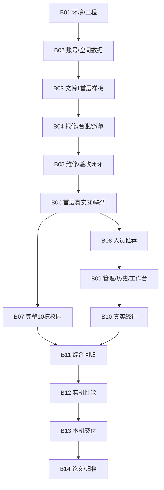

# 设备维护管理系统项目实施批次计划 — Implementation Plan

> **For agentic workers:** 后续使用 `superpowers:executing-plans`，连续执行用户已授权批次内的关联任务，完成内部测试和批次交付后统一等待用户验收。按用户2026-10-12的新要求，执行与手工验收单位改为批次，72项T编号保留为实施和证据追踪单位。

**Goal:** 将72项技术任务组织为14个可运行、可验收的批次，完成本机三角色设备维护、完整3D示意校园、空间提示、人工维修人员推荐和毕业交付。  
**Architecture:** Vue3/TypeScript/Three.js承担页面和空间观察；Spring Boot单体/MyBatis-Plus/独立MySQL8.4承担权限、状态、历史、事务、附件及统计。先形成普通业务与文博1首层真实闭环，再复用模板到10栋，完善管理统计，完成回归、性能与交付。  
**Tech Stack:** 沿用architecture.md技术基线和tasks.md工具清单；精确依赖在B01的T003核对锁定，搭建前不宣称兼容已实证。  
**Spec:** [requirements.md](requirements.md)、[architecture.md](architecture.md)、[tasks.md](tasks.md)。本文件负责执行编排，tasks.md负责72项技术细节。  
**日期与状态:** 2026-10-26，Asia/Shanghai。B01—B09已通过用户验收；最新直接反馈“B09已经验收成功，请你开始执行B10”，来源tests/evidence/B09-user-acceptance.json。B10（T058—T059）已整批授权，待绑定项目的新对话通过交接门禁后实施；B11—B14未授权。历史回归与AI浏览器证据保留原时点和边界。未建仓、提交、推送或部署；现有数据与V001—V006保留。

## 1. 执行方式与项目目标

每次授权一个批次，助手在该批中按依赖实现关联任务、完成定向测试和联调，交付一个你能操作的成果。你在批次结束时统一手测；批内完成一个T编号后可直接推进下一依赖就绪项。

本次“按批次完成”的要求覆盖旧文件中的“每完成一项停止、每项前置均须用户单独验收”。业务范围、权限、会话、数据、安装规则及需求/架构当前审阅状态保持各自事实依据；批次计划编写本身不代表需求/架构已通过。后续开始某批时，以你明确授权的基线与范围为准。

批次控制规则：

1. **授权范围：** “开始Bxx”授权该批列出的全部T项；不因一项完成反复要求“继续”。计划编写不代表实施授权；当前已根据用户后续直接要求“根据本计划开始项目搭建”启动首批B01，具体未知安装仍按第5条处理。
2. **前置条件：** 同批前置任务实际验证通过即可继续；跨批前置必须完成对应批次验收。表中的“直接前置批次”由72项原依赖推导，未删任何原依赖。
3. **内部检查点：** 先确认核心规则测试失败，再最小实现、测试成功；文档/环境/低风险布局按读取、构建或浏览器证据核查。B04/B09等较大批次分段联调，各段内部自验后连续推进。
4. **遇到问题：** 在本批授权范围内调查并修复，不把问题带到下一批。只有缺必要环境/信息、具体安装未授权、范围/选型要改变或需要危险操作时才暂停相关工作；说明阻塞和解除办法，其他独立工作可继续。
5. **安装授权：** 先列工具名、精确版本、来源、目录、配置影响、成本/Key、验证和替代；已有明确批准的清单不重复询问。批次授权不能被解释为批准未知的新工具或全局变更。
6. **批次结束：** 报告Changed、Verified、请我测试、Remaining Risk，状态“待用户验收”。只说“通过”记录该批验收；“Bxx通过，继续下一批”才开始依赖就绪的下一批。
7. **代码与状态：** 各T项保留实际命令、结果、证据和状态；批内可记“内部验证通过，所属批次待验收”，批次经你确认后才标相应项已验收。未运行项写未验证。
8. **并行边界：** 默认按批次编号顺序推进；独立只读核对/隔离测试可并行。迁移、锁文件、安全配置、接口类型和共享源码顺序维护；共享测试库的写入回归按隔离条件执行。Git提交/推送/部署保持另行明确授权。

**完整规模：** 10栋、41楼层、296处内景覆盖单位、257报修位置、1817初始台账。174宿舍×8＝1392，57教室×6＋15办公室×4＝402，食堂9层×2＝18，体育馆3＋2＝5。样板交付后仍完成全部范围。

## Global Constraints

- 普通列表与3D共用身份、API、表单、草稿和后端规则，后端/MySQL为业务事实来源。
- 一申请最多一工单，同设备最多一未完结工单；审核与首次派单同事务，接单后负责人固定，原报修人验收，返工原工单。
- 随机Token+HttpOnly Cookie+MySQL摘要，固定8小时无续期，写操作CSRF；资料/密码保存真实数据库，旧会话按规则撤销。
- 显式building/floor/location身份，不解析房号/文字/模型名；新申请位置与台账一致，旧文字申请不补绑3D。
- 后端先过滤权限再聚合/分页/计数；同位置不泄露他人数据，曾分派者历史材料受范围限制。
- JPG/JPEG/PNG，单图≤5 MB、每次≤5张，首次故障图和每轮新凭证≥1；临时附件24小时，正式历史保留，图片鉴权访问。
- 推荐为规则排序与管理员主动选人；L=W+2I+3R+0.5A，I/R互斥，D按上海自然日最终验收完成计算。
- 前台10秒读，正常他人变化≤30秒，本人确认成功立即刷新；草稿仅同次登录内存，不因只读刷新覆盖。
- 模型副本处理、许可追溯、本机资源、单渲染实例及有界资源释放；完整校园为示意，演示数据不是学校真实数据。
- 单体/本机/独立MySQL8.4，不默认增加JWT/Redis/消息队列/SSE/WebSocket/AI/云部署/Docker等。
- 目标、计划、示例、格式读取、实际渲染、DB行为、性能和用户验收分别记录，不互相替代。

## Review Focus

| 跨模块条件 | 应有结果 | 批次责任 |
| --- | --- | --- |
| 同位置两用户、原分派人访问后续材料/附件 | 数量/颜色/详情/图均按后端权限投影，有限历史只读 | B04—B06，B11矩阵回归 |
| 状态操作交错、旧version/round、写成功丢响应 | 原标识重试返回原结果，冲突只有一个合法分支，记录不重复 | B04—B06，B11并发回归 |
| 旧文字申请、设备移动/名称修正 | 旧单无3D提示，工单位置固定，未完结设备不移动，快照不覆盖 | B04、B09，B11复核 |
| 目标切换、重试迟到、只读刷新和身份变化 | 最后有效目标生效，有权旧读标过期，失权清理，编辑不覆盖 | B03、B06、B11 |
| 上海日/月边界、返工/多附件聚合 | 推荐I/R及完成数量去重，统计可手算，p95样本和失败清楚 | B08、B10、B12 |

## 2. 14批总览与依赖

| 批次 | 所含任务 | 项数 | 可验收成果 | 直接前置批次 | 状态 |
| --- | --- | ---: | --- | --- | --- |
| [B01](#b01) | T001—T006 | 6 | 环境、契约与可构建工程 | 无 | 已通过用户验收（2026-10-12） |
| [B02](#b02) | T007—T014 | 8 | 账号、维修资格与空间数据底座 | [B01](#b01) | 已通过用户验收（2026-10-13） |
| [B03](#b03) | T015—T018 | 4 | 文博1外观、单房间与完整首层样板 | [B01](#b01)、[B02](#b02) | 已通过用户验收（2026-10-13） |
| [B04](#b04) | T019—T029 | 11 | 真实图片、报修、台账与审核派单 | [B01](#b01)、[B02](#b02)、[B03](#b03) | 已通过用户验收（2026-10-15） |
| [B05](#b05) | T030—T036 | 7 | 接单、维修、验收及异常闭环 | [B04](#b04) | 已通过用户验收（2026-10-18，含数量增量） |
| [B06](#b06) | T037—T040 | 4 | 文博1首层3D业务、提示与同步联调 | [B03](#b03)、[B04](#b04)、[B05](#b05) | 已通过用户验收（2026-10-23） |
| [B07](#b07) | T041—T046 | 6 | 从样板扩展到完整10栋校园 | [B06](#b06) | 已通过用户验收（2026-10-24） |
| [B08](#b08) | T047—T048 | 2 | 可解释维修人员推荐与人工选人 | [B05](#b05)、[B06](#b06) | 已通过用户验收（2026-10-25） |
| [B09](#b09) | T049—T057 | 9 | 账号、人员、历史兼容与待办工作台 | [B02](#b02)、[B04](#b04)、[B05](#b05)、[B08](#b08) | 已通过用户验收（2026-10-26） |
| [B10](#b10) | T058—T059 | 2 | 真实数据统计看板与明细下钻 | [B05](#b05)、[B09](#b09) | 已授权；待新对话交接后开始 |
| [B11](#b11) | T060—T064 | 5 | 综合安全、并发、故障与端到端回归 | [B06](#b06)、[B07](#b07)、[B08](#b08)、[B09](#b09)、[B10](#b10) | 未开始 |
| [B12](#b12) | T065—T067 | 3 | 实机性能数据、测量与调优 | [B11](#b11) | 未开始 |
| [B13](#b13) | T068—T069 | 2 | 本机统一入口和软件交付 | [B12](#b12) | 未开始 |
| [B14](#b14) | T070—T072 | 3 | 论文、证据整合与归档 | [B13](#b13) | 未开始 |

默认顺序为B01→B02→…→B14。B07完整校园与B08推荐在B06后都已满足各自前置，**没有相互依赖**；你可明确选择先B08再B07，或授权两批并行。默认保持编号顺序，不自行越过尚未验收的批次。



该图是依赖的简化呈现，直接前置以总表为准。72项均只归一个批次，无遗漏和重复；任务详细文件白名单、DTO/VO、固定测试断言及命令继续见tasks.md。

## 3. 如何实现与联调

一条业务链贯穿各批：

`B02身份/目录 → B03位置几何映射 → B04报修/图片/审核派单 → B05维修/验收 → B06按权限空间提示 → B07全校园实例复用`

后续B08补人工选人建议，B09补完整账号/人员/历史管理，B10复用同一业务时间与关系作统计。业务写操作统一经过Cookie/CSRF、安全过滤、DTO校验、Service权限/状态/版本/轮次复核与事务、Mapper/数据库约束，成功后返回结果，再重读显示。相机、门动画和提示颜色只反映观察/授权业务结果。

先做到B05的普通业务闭环和B06的首层真实3D闭环，再复制全校园模板。开发过程中逐批补规则和错误场景，B11做全系统组合回归；B12再用实际硬件/数据测性能。

## 4. 每批实施步骤、交付与手测

路径根目录R＝`D:/快速访问/Desktop/毕业项目文件/Graduation_Project`；以下核心文件相对R，其精确文件及接口白名单见每项T任务。这里归并执行范围，不另建一套实现。

<a id="b01"></a>

### B01：环境、契约与可构建工程

**范围与前置：** T001—T006，6项；直接前置无。  
**交付目标：** 前后端能在本机启动，JDK21与独立MySQL8.4测试环境可用，后续开发有固定接口和依赖基线。  
**合并理由：** 版本、配置、迁移、响应和请求类型共同决定后续代码能否联调，应在同一批确定并验证。

**本批任务：** [T001 只读核对环境、素材目录和工具状态](tasks.md#t001)；[T002 冻结数据字典、状态与接口衔接](tasks.md#t002)；[T003 制定可批准的安装与版本锁定清单](tasks.md#t003)；[T004 配置JDK21、独立MySQL与隔离运行环境](tasks.md#t004)；[T005 建立后端、统一响应和真实数据库测试底座](tasks.md#t005)；[T006 建立Vue TypeScript工程与公共请求能力](tasks.md#t006)。

**实施顺序与内部检查：**

- [x] 1. T001—T003：只读核查环境与素材目录，冻结数据/接口/锁顺序，形成精确安装清单。
- [x] 2. 确认本批具体缺项的安装/配置授权；复用已有可用工具，按清单处理JDK、MySQL、Node等缺口。
- [x] 3. T004—T005：区分dev/demo/test数据库及附件目录，搭后端与V001迁移、Clock和测试守卫。
- [x] 4. T006：搭Vue/TypeScript工程、精确锁文件、API类型/错误处理和测试命令，联通开发代理。

**核心文件与边界：** plan/environment.md、api-contracts.md、data-dictionary.md、dependency-lock.md；backend/pom.xml、Wrapper、基础配置；frontend/package.json/锁文件、api/client.ts；scripts/use-jdk.ps1和README。  
**输入输出与衔接：** 提供统一ApiResponse/PageResult、CurrentUser、UTC Clock、数据库测试守卫、前端read/mutation区别和项目启动方式；V001结构先就绪。  
**环境/工具：** 必需：JDK21、独立MySQL8.4、项目Wrapper、Node/npm、已有Chrome/Edge及后前端依赖；Three/TS/vue-tsc等精确版本在T003固定。Context7、Three.js skills和浏览器MCP保持可选。  
**助手验证：** 运行BootstrapIT、client.test.ts、依赖树、后端verify及前端typecheck/build；确认错误test库/目录被拒绝、实际MySQL版本、Maven实际使用21。包可下载仅记可获取。

**你统一手测：**

1. 按README启动开发入口，确认页面、后端和数据库连接。
2. 核对独立实例、三个库/目录与实际JDK；现有phpStudy仍可用。
3. 看安装/版本清单和可复制启动命令。

**完成标准：** 启动与构建/类型/基础测试均有实际记录，缺项安装范围与配置已处理；本批交付工程底座，账号功能在B02验收。

**2026-10-12执行记录：** A01—A04已直接批准，T001—T006均有内部实证：独立8.4.11三库受限账号/JDK21、dev/test的V001、最终BootstrapIT15/15、后端verify与依赖树、前端锁文件/ci/14项请求测试/typecheck/build均通过。独立审阅3项Important均RED→GREEN修复（错误码、未知JSON字段、测试目录），无Critical/Minor；Windows JAR占用导致的一次打包失败已通过停止专用进程后重建/重启解决。浏览器验证真实代理401、重读、普通列表路由及刷新/窄屏；demo库连接已测、未启动演示应用迁移。原需求/架构哈希未变，凭据精确扫描无匹配泄漏，未建仓/提交或开始B02；用户2026-10-12直接反馈“B01已经验证完成”，已记录B01验收通过。证据见[执行记录](../tests/evidence/B01-progress.md)、[审阅修复](../tests/evidence/B01-code-review.md)、[核验汇总](../tests/evidence/B01-verification.json)、[运行入口](../README.md)。

<a id="b02"></a>

### B02：账号、维修资格与空间数据底座

**范围与前置：** T007—T014，8项；直接前置B01。  
**交付目标：** 真实三角色账号来源和登录恢复可用，维修资格审核可操作，完整空间目录和初始台账正确。  
**合并理由：** 管理员初始化、注册、Cookie会话、资格和目录一起组成所有后续业务的入口。

**本批任务：** [T007 建立空间和设备结构与目录接口](tasks.md#t007)；[T008 固定校园配置与幂等本地初始化](tasks.md#t008)；[T009 预置管理员本地幂等初始化](tasks.md#t009)；[T010 公开注册与全局唯一性](tasks.md#t010)；[T011 Cookie会话、CSRF和认证权限入口](tasks.md#t011)；[T012 注册登录页、角色导航和会话恢复](tasks.md#t012)；[T013 维修人员审核、拒绝与原账号重新申请](tasks.md#t013)；[T014 本人审核状态和管理员审核详情页面](tasks.md#t014)。

**实施顺序与内部检查：**

- [x] 1. T007—T008：迁移V002，显式导入10栋/41层/296观察单位/257报修位置/1817项台账；重复执行核对幂等。
- [x] 2. T009—T011：本地初始化管理员，完成公开两角色注册、密码哈希、8小时Cookie会话、CSRF和撤销。
- [x] 3. T012—T014：接真实注册登录/刷新恢复及审核页，完成拒绝→原账号重提→审核通过。
- [x] 4. 核对资格不足维修人员可浏览目录并查看本人审核状态，当前业务权限由后端限制。

**核心文件与边界：** campus/account/security/maintenance业务包；V002；config/campus.json；账号页面、auth store、router；本地初始化脚本。  
**输入输出与衔接：** 提供GET /api/campus/catalog、认证/CSRF及本人审核/管理员审核接口；目录ID/code是后续模型和业务共同身份。  
**环境/工具：** 使用B01环境与已有工具；本地随机管理员密码由你妥善保存，证据中脱敏；无短信或外部身份服务。  
**助手验证：** CampusInitializationIT、RegistrationIT、SessionSecurityIT、TechnicianReviewIT及auth/review前端测试；真实Cookie验证到期/不续期，数据库逐项计数而非只比总数。

**你统一手测：**

1. 注册报修用户和维修人员，并使用预置管理员登录。
2. 拒绝维修申请→本人修改资料重提→管理员通过；查看历史快照。
3. 刷新/退出/重登，检查停用或未合格账号的反馈和菜单。

**完成标准：** 真实注册/登录/资格审核与目录数据可重查，初始化幂等；几何浏览入口及后端权限边界明确。

**2026-10-12执行记录：** B01已验收、用户直接授权B02整批；T007—T014连续实施。V002新增且V001未改；dev显式校园/管理员首次及重复初始化通过，test逐项核验及精确清理通过，demo尚未迁移/初始化。最终后端verify 42/42、前端33/33及typecheck/build通过；真实HTTP与浏览器两轮审核/刷新/320px取证完成。一次独立审阅无Critical、3项Important已各以失败回归修复，1项非默认浏览器fixture失败清理Minor记录待后续处理。未建仓/提交/推送/部署、未开始B03，B02等待用户验收。证据见[执行记录](../tests/evidence/B02-progress.md)、[审阅](../tests/evidence/B02-code-review.md)、[核验](../tests/evidence/B02-verification.json)、[验收入口](../README.md#b02验收入口)。

**2026-10-13用户验收：** 用户明确反馈“B02验收通过”，T007—T014同步标记已验收，见[B02验收记录](../tests/evidence/B02-acceptance.md)。当前仅记录验收并准备新对话提示词，未执行B03；新对话中须收到B03明确授权再开始。

<a id="b03"></a>

### B03：文博1外观、单房间与完整首层样板

**范围与前置：** T015—T018，4项；直接前置B01、B02。  
**交付目标：** 可旋转/平移/缩放文博1，定位101房门、开门进入宿舍，再覆盖首层10宿舍和2公共空间。  
**合并理由：** 外观、门轴、相机锚点、房间模板和整层映射是同一个样板链，在批内逐层验证后统一交付。

**本批任务：** [T015 核查素材、许可和最小副本处理路线](tasks.md#t015)；[T016 文博1单栋外观与渲染控制器](tasks.md#t016)；[T017 文博1首层101宿舍可进入样板](tasks.md#t017)；[T018 文博1完整首层与空间实例隔离](tasks.md#t018)。

**实施顺序与内部检查：**

- [x] 1. T015：只读原素材、核对许可和格式，确定参数化路线及允许输出路径；未知源许可不分发。
- [x] 2. T016：制作文博1单栋外观、单渲染实例、名称/复位和失败反馈。
- [x] 3. T017：完成101宿舍设施、门轴与门前/室内锚点，验证各≤1秒热目标过渡。
- [x] 4. T018：扩首层10宿舍+门厅/值班室，检查两侧编号、走廊、两端楼梯、独立门状态和位置选择。

**核心文件与边界：** frontend/src/campus/控制器、加载/缓存、宿舍模板；campus视图/选择器；public/campus/manifest.json；素材许可清单和模型检查报告。  
**输入输出与衔接：** CampusRenderer和manifest仅管理几何/锚点，稳定code与B02目录明确关联；提供进入/返回和业务面板容器。  
**环境/工具：** Three.js及同版本OrbitControls/GLTFLoader；Blender/3ds Max与对应MCP只有选定副本路线需要时才提出具体安装。参数化路线可直接实施。  
**助手验证：** renderer-generation、door-state、floor-mapping测试与FV；实际WebGL2画面、门/内景/返回、重复卸载；源素材hash和许可记录。

**你统一手测：**

1. 选择101→到门口→开门→室内观察→返回楼层/校园。
2. 检查首层全部10宿舍和2公共内景，公共空间显示仅供观察。
3. 快速切目标并调整视角，核对房号、门动作、锚点和反馈。

**完成标准：** 样板比例/布局/交互可用，全部首层身份不串；本批形成几何样板，B06完成真实3D业务闭环。

**2026-10-13执行记录：** 用户明确授权整批B03，T015—T018连续实施，参数化几何未分发外部模型，221源文件hash未变；五层外观、首层12处真实进入/返回、输入/减少动态/窄屏、加载与身份代次、失败/恢复及六轮卸载分别取证。关键逻辑和独立审阅问题均先失败再修复；最终前端60/60、typecheck/build通过，B02目录/会话test-local定向10/10。热定位/进入≤1秒，10次新页面、无预取冷进入≤5秒；完整FPS/全校园性能、实体触屏和真实第二账号切换未测。用户重启电脑后仅启动既有MySQL/JAR/Vite，重新核对账号可见字段/目录/迁移未变。审阅、限制及证据见[B03账本](../tests/evidence/B03-progress.md)、[独立审阅](../tests/evidence/B03-code-review.md)、[内部核验](../tests/evidence/B03-verification.json)、[验收入口](../README.md#b03验收入口)。该内部交付时B03待用户验收，B04未开始。

**2026-10-13用户验收：** 用户直接反馈“B03验收通过，我需要新开一个对话，给我执行B04的提示词。”，据此确认B03及T015—T018整批通过，见[B03验收记录](../tests/evidence/B03-acceptance.md)。当前仅准备[B04新对话执行提示词](B04-handoff-prompt.md)，不在本对话开始B04，也不追加用户未报告的逐项手测或性能结论。

<a id="b04"></a>

### B04：真实图片、报修、台账与审核派单

**2026-10-15用户直接修订：** 正常审核通过首次派单仅需主动选择合格维修人员，不依赖设备台账或设备读取成功；原文/位置/图片保留，无台账工单按V006存NULL。以下首次交付时的设备必选、设备停用/位置阻断正常审核描述由本修订覆盖；明确传入设备的旧API操作保留校验/幂等，重复关闭仍需具体设备及原因。新增迁移/空值投影及页面边界见B04-progress.md；V006已用于本修订，后续T067索引迁移使用执行时下一未用版本。B04已于2026-10-15通过用户验收，直接反馈“B04审核通过”；B05执行提示词已准备，未开始。

**范围与前置：** T019—T029，11项；直接前置B01、B02、B03。  
**交付目标：** 报修用户能上传图片并提交申请，管理员能匹配/补录设备，审核和首次派单一次生成待接单工单。  
**合并理由：** 附件、申请、设备和工单关联跨表跨界面；单独结束其中一项无法验证完整审核路径。本批11项分三段内部联调。

**本批任务：** [T019 临时附件上传、取消、正式绑定及鉴权读取](tasks.md#t019)；[T020 临时附件过期清理和绑定互斥](tasks.md#t020)；[T021 图片选择、预览与明确上传步骤](tasks.md#t021)；[T022 首次报修、申请模型及本人查询](tasks.md#t022)；[T023 退回补充、原申请重提、撤回与历史](tasks.md#t023)；[T024 报修表单、我的申请及内存草稿](tasks.md#t024)；[T025 工单结构、查询及历史权限投影](tasks.md#t025)；[T026 设备台账维护、范围与位置变更限制](tasks.md#t026)；[T027 设备列表、表单、详情与维修历史入口](tasks.md#t027)；[T028 审核并首次派单和重复关闭事务](tasks.md#t028)；[T029 管理员申请审核与人工首次派单页面](tasks.md#t029)。

**实施顺序与内部检查：**

- [x] 1. 内部检查点A：T019—T024，完成V003/V004、临时图片/清理、申请/快照/事件、退回补充/撤回、共用表单和内存草稿。
- [x] 2. 内部检查点B：T025—T027，先V005工单/分派/轮次和权限投影，再设备维护、当前/历史查询与可运行只读详情。
- [x] 3. 内部检查点C：T028—T029，接管理员审核面板；在一事务里复核资格、启停用、位置及未完结唯一限制，写申请通过/工单/分派/事件。
- [x] 4. 跑范围外退回、位置错补充、重复关闭、缺资格/停用设备阻断及响应丢失重试；检查每一段编译/定向测试后继续下一段。

**核心文件与边界：** attachment/repairrequest/workorder/equipment业务包；V003—V005；图片、申请、台账、审核与共用只读工单页面；draft store和API。  
**输入输出与衔接：** 新申请locationId必选、类别可空、原文和联系快照保留；绑定临时附件在业务事务中；approve-and-assign返回原工单结果，operationId幂等。  
**环境/工具：** B01/B02环境，真实图片测试目录和授权演示账号；无需推荐服务、公开图床、Postman或新MCP。  
**助手验证：** AttachmentIT/CleanupIT、CreateRepairRequestIT/TransitionIT、WorkOrderQueryIT、EquipmentMaintenanceIT、ApproveAndAssignIT、草稿/表单测试及FV；DB/文件重查与回滚。

**你统一手测：**

1. 在文博1房间提交带图申请，管理员匹配同位置启用台账并选合格人派单，核对只生成一张待接单工单。
2. 位置不一致、范围外设施、同设备未完结重复申请分别测试对应阻断/退回/重复关闭。
3. 两位置各填草稿，切3D/列表、提交一份，另一份继续保留；失败保留输入。

**完成标准：** 申请—图片—台账—首次派单真实贯通；终态/历史保留和单设备唯一约束有证据；维修/验收由B05完成。


**2026-10-15内部交付：** 三个检查点完成，后端test-local verify 103/103、前端129/129与类型/构建退出0。真实Cookie/CSRF、MySQL/图片文件、普通及3D草稿、补充撤回、台账维护补录返回、审核/重复关闭/人工首次派单到待接单及历史权限有证据；新增固定栏与申请/待审人员红标按用户直接要求实现。独立审阅及修复闭环。dev当前8账号/1817设备/2申请/1待接单工单及2图片以最新用户状态保留；隔离fixture精确清理为0。证据见B04-verification.json、B04-runtime.json、B04-code-review.md和B04-acceptance.md。尚未收到本批验收通过，不启动B05；实体触屏/正式FPS及全校园压力仍未测。

<a id="b05"></a>

### B05：接单、维修、验收及异常闭环

**用户验收（2026-10-18）：** 用户直接确认“B05验收通过，我要新开一个对话，请你给我执行B06的提示词”。原三角色闭环及三端导航数量增量验收通过，最新后端132／前端159、typecheck/build证据见B05-admin-order-count-verification.json；反馈见B05-user-acceptance.json。以下为原内部交付时点，不替代最新结果。B06已启动，当前进度见下节。

**内部交付（2026-10-18）：** 用户授权整批续接，三个检查点完成；最终后端verify128/128、前端21文件143/143及typecheck/build退出0。真实五账号浏览器闭环、数据／图片保护、精确清理及独立审阅见B05-verification.json、B05-runtime.json、B05-code-review.md、B05-acceptance.md（tests/evidence）。状态待用户验收，未进入B06。

**范围与前置：** T030—T036，7项；直接前置B04。  
**交付目标：** 三个角色通过普通业务页面完成接单→维修→本轮结果/凭证→原报修人验收，并能拒单重派和原工单返工。  
**合并理由：** 工单状态、责任关系、轮次、凭证和角色页面共同组成可验收的业务闭环。

**本批任务：** [T030 接单、带原因拒单及责任固定](tasks.md#t030)；[T031 接单前改派与待重派重新分派](tasks.md#t031)；[T032 独立追加进度与本轮结果/凭证提交](tasks.md#t032)；[T033 原报修人验收与原工单返工](tasks.md#t033)；[T034 维修任务、有限历史及维修处理页面](tasks.md#t034)；[T035 我的工单、本轮核对及验收页面](tasks.md#t035)；[T036 管理员工单管理和重新分派页面](tasks.md#t036)。

**实施顺序与内部检查：**

- [x] 1. T030—T031：接单/拒单、接单前改派和待重派，记录有限历史范围并固定实际维修者。
- [x] 2. T032—T033：独立追加进度、本轮新结果/凭证、验收通过或带原因退回原人开启下一轮。
- [x] 3. T034—T036：维修任务、报修人验收及管理员工单页面接真实接口，复用只读详情/分派面板。
- [x] 4. 正常/拒单/改派/两轮验收逐一联调，验证旧版本和旧round不能重复提交。

**核心文件与边界：** workorder状态/分派/维修/验收Service、DTO/VO及测试；维修/验收/管理页面；workorder API及按操作轮次隔离的草稿。  
**输入输出与衔接：** 同workOrderId多轮历史；acceptedAt首次固定，最终验收才completedAt；当前负责人和原报修人来自后端身份。  
**环境/工具：** 实际三角色Cookie会话、图片和独立浏览器配置；可控Clock用于规则测试。  
**助手验证：** AcceptRefuseIT、ReassignmentIT、RepairProcessingIT、AcceptanceIT及前端草稿/确认测试；数据库工单/事件/轮次和附件归属。

**你统一手测：**

1. 按普通页面完整完成一张工单，核对待验收与已完成区别。
2. 另做拒单→重派，以及第一轮退回→第二轮新凭证→验收通过。
3. 原被改派人员只能查本人阶段材料，尝试接单后改派应被阻止。

**完成标准：** 业务闭环及异常分支通过真实接口和页面，统计归属/时间所需记录完整；3D提示接入在B06验收。

<a id="b06"></a>

### B06：文博1首层3D业务、提示与同步联调

**范围与前置：** T037—T040，4项；直接前置B03、B04、B05。  
**交付目标：** 样板首层的提示、事项列表、表单和详情与真实业务同步，三角色各看允许数据，3D/列表共用草稿。  
**合并理由：** 后端权限聚合、DOM标记、刷新协调和编辑保护必须一起验证，才能证明3D入口可用于实际业务。

**本批任务：** [T037 按权限的位置汇总与事项列表](tasks.md#t037)；[T038 DOM空间提示、事项面板与共用业务入口](tasks.md#t038)；[T039 10秒读取、草稿保护与不确定结果核对](tasks.md#t039)；[T040 文博1首层真实三角色闭环联调](tasks.md#t040)。

**实施顺序与内部检查：**

- [x] 1. T037：权限过滤后以一致快照聚合，申请转工单去重，普通处理中/返工互斥。
- [x] 2. T038：锚点DOM提示和事项列表接共用表单/详情，颜色同时有文字/数量。
- [x] 3. T039：前台10秒读取、后台暂停/恢复即时、本人成功立即刷新、8秒只读超时、身份/目标代次和操作结果核对。
- [x] 4. T040：样板首层真实三角色流程/拒重派/返工/位置补充、多用户同位置与多设备事项联调。

**核心文件与边界：** campus汇总/事项Mapper/Service/VO；DOM标记/面板、刷新和待确认composables；campus视图及共用draft store。  
**输入输出与衔接：** 空间提示源于已提交且有权业务；操作仍调用B04/B05API。故障→待验收→待补充→待审核优先级固定，完结只移除对应事项。  
**环境/工具：** 已有浏览器、实际后端/数据库及至少两用户；故障注入只限隔离验证环境。  
**助手验证：** CampusSummaryIT、summary-view、campus-refresh、mutation-confirmation测试与真实同步计时；响应丢失后同标识重试记录数不变。

**你统一手测：**

1. 不同用户在同房间报修，各账号只看到本人事项；管理员看到完整允许范围。
2. 派单→红提示、提交验收→蓝、返工→红、完结→移单项，正常联网变化≤30秒。
3. 编辑中另一端变状态，输入保留而旧操作被阻止；退出/失权清旧账号内容。

**完成标准：** 文博1首层真实3D闭环、权限与同步有证据，取得本批验收后才扩大校园模板。

**本轮交付（2026-10-19）：** 最新源码后端verify141／前端27文件195及typecheck/build通过；独立审阅无开放Critical／Important。原Canvas、多角色及异常闭环、7组同步证据保留，新增三角色单条标识直达／多条选择、目录同色与108室内普通报修返回实测，四组跨端上界均≤17.094秒。按用户最新批注，单条经新读核对唯一才直达详情，不触发业务写入；多条选择。图片／身份／数据保护／精确清理与服务恢复见B06-verification.json。B06待用户验收，B07／B08不开始。

<a id="b07"></a>

### B07：从样板扩展到完整10栋校园

**范围与前置：** T041—T046，6项；直接前置B06。  
**交付目标：** 交付三宿舍、三教学楼、三食堂和体育馆的全部确认外观与简化内景，目录/台账/提示身份保持独立。  
**合并理由：** 通过已验收样板复用模板和实例配置，可集中检查所有建筑覆盖和资源预算，避免重复业务实现。

**本批任务：** [T041 文博1五层覆盖与首层/标准层差异](tasks.md#t041)；[T042 三栋宿舍复用与跨楼栋隔离](tasks.md#t042)；[T043 三教学楼、教室/办公室及公共内景](tasks.md#t043)；[T044 三食堂九层公共区域内景](tasks.md#t044)；[T045 体育馆两层挑空、看台与分组设施](tasks.md#t045)；[T046 完整10栋总览、环境与配置版本对齐](tasks.md#t046)。

**实施顺序与内部检查：**

- [x] 1. T041—T042：文博1五层/58宿舍+2公共，再复制到其他两栋；房号来自显式配置。
- [x] 2. T043：三教学楼57教室/15办公室/30卫生间/3门厅，教室/办公室设施分组及72空调。
- [x] 3. T044—T045：9食堂楼层区域和体育馆两层挑空/看台，按楼层分组台账；厨房仓储封闭。
- [x] 4. T046：10栋总览/道路环境/名称/级联定位与manifest兼容检查；各类内部自验后统一覆盖验收。

**核心文件与边界：** 各建筑/楼层/内景Three.js模板、CampusLayout/Renderer；manifest、许可清单和空间覆盖报告；既有API不另复制。  
**输入输出与衔接：** 全部10/41/296/257位置映射复用B02身份；1817为初始化数量，后续合法补账可变化；模型缺投影仪不影响合法业务。  
**环境/工具：** 既有Three.js和已批准副本；新增资源须先记录来源许可；默认不增加物理/漫游/动画引擎。  
**助手验证：** dorm-building/instance、teaching/cafeteria/gym/full-campus测试；逐项目录/映射/设施数和跨栋同号真实业务；性能目标待B12实测。

**你统一手测：**

1. 10栋依次选择/观察/返回，抽首层和标准层、各代表内景检查入口。
2. 核对宿舍174间、教学72报修空间、食堂9区域、体育馆2区域及仅展示公共空间。
3. 两栋同号房间分别操作，检查门/提示/草稿不串；配置不兼容时3D明确反馈而列表可用。

**完成标准：** 全部确认校园覆盖正确且可观察，模板复用不共享业务；许可资源可分发，性能实测结论由B12给出。

**实际交付状态（2026-10-23）：** B07待用户统一验收。后端141项、前端212项、typecheck/build通过；全41层代表进入、296映射、真实跨栋与分组设备业务、配置失配降级、独立审阅与精确清理见tests/evidence/B07-verification.json。B08未开始。

<a id="b08"></a>

### B08：可解释维修人员推荐与人工选人

**范围与前置：** T047—T048，2项；直接前置B05、B06。  
**交付目标：** 三个合法派单场景看到同快照推荐Top5及完整合格名单，并能稳定保留人工选择及处理资格失效。  
**合并理由：** 后端规则和前端选择状态是同一功能，合并后才能验证推荐与最终事务复核的一致性。

**本批任务：** [T047 规则推荐、一致快照与完整合格名单](tasks.md#t047)；[T048 推荐面板、选择保留及资格变化](tasks.md#t048)。

**实施顺序与内部检查：**

- [x] 1. T047：资格过滤，按工单预聚合W/I/R/A及今日D，在上海自然日同快照稳定排序。
- [x] 2. T048：原AssignmentPanel加入Top5、展开/搜索/分页、负荷明细/理由/取数时间及周期刷新。
- [x] 3. 测曾拒单不入优先但仍在完整合格名单，无优先和无资格分别反馈。
- [x] 4. 测指标重排保留合法选人、资格失效清选人/禁提交；推荐失败但资格名单可读时可人工选择。

**核心文件与边界：** workorder推荐Service/Mapper/VO及SQL；既有AssignmentPanel、候选列表和刷新协调；不增独立后端服务。  
**输入输出与衔接：** L=W+2I+3R+0.5A，等价2L整数；L→D→最近成功分派时间(null优先)→ID。最终仍由原审核/分派事务复核。  
**环境/工具：** 真实DB、可控Clock和合格账号；规则算法不需要模型、Key或外部推荐工具。  
**助手验证：** AssignmentRecommendationIT及assignment-selection测试；手算同负荷今日5/1、多于5人、返工/拒单/跨日例，与DB一致。

**你统一手测：**

1. 选第6名完成合法派单，验证Top5不限制资格。
2. 选人后改变负荷/资格，检查合法选择保留、无资格立即阻止。
3. 看首次、改派、待重派三个场景和无推荐/无资格/读取失败反馈。

**完成标准：** 推荐可复算、稳定且不自动派单；任意合格人工选择受最终事务校验，接单后不开放改派推荐。

2026-10-24实际实施：T047—T048完成，最终证据见tests/evidence/B08-verification.json、B08-acceptance.md和B08-code-review.md。真实三场景/第6名/负荷与失资格/两类失败/上海跨日已取证；原夹具超时和正常补验分列。完整回归与保护结果以核验索引为准。用户尚未验收，B09不开始。

<a id="b09"></a>

### B09：账号、人员、历史兼容与待办工作台

**范围与前置：** T049—T057，9项；直接前置B02、B04、B05、B08。  
**交付目标：** 资料/密码、人员分类/历史、启停用/随机重置、本地管理员恢复、旧文字记录及工作台完整可用。  
**合并理由：** 这组能力共享账号身份、当前/历史业务关系和去重口径，可在同一批校验资料维护不会改变业务资格与历史。

**本批任务：** [T049 本人资料保存与自行修改密码](tasks.md#t049)；[T050 账号设置、资料取消与改密确认页面](tasks.md#t050)；[T051 动态人员分类、数量与完整历史查询](tasks.md#t051)；[T052 账号启停用限制与普通账号随机重置](tasks.md#t052)；[T053 完整人员列表、详情与查询返回](tasks.md#t053)；[T054 普通账号一次性重置密码结果页面](tasks.md#t054)；[T055 管理员专用本地密码重置](tasks.md#t055)；[T056 旧文字记录、位置维护与名称修正兼容](tasks.md#t056)；[T057 三角色待办工作台与普通入口](tasks.md#t057)。

**实施顺序与内部检查：**

- [x] 1. 内部检查点A：T049—T050，真实资料/密码保存，资格限制、全旧会话撤销与前端确认/清理。
- [x] 2. 内部检查点B：T051—T055，动态分类/完整历史，未完结停用阻止、恢复、普通随机重置页面、本地管理员reset。
- [x] 3. 内部检查点C：T056，旧无位置申请正常原流程且不补绑3D；位置/名字变更留历史，未完结设备不可移动。
- [x] 4. T057：三角色真实待办工作台，概览→列表→详情与校园/普通入口统一；关联返回/角色权限回归。

**核心文件与边界：** account人员/设置/管理Query/Service、maintenance重置/名称命令、位置维护规则；人员/账号/工作台页面及查询返回状态。  
**输入输出与衔接：** 分类按账号去重、业务按独立申请/工单去重；完成只归实际维修者；资料/密码更新MySQL，历史快照不覆盖。  
**环境/工具：** 已有运行和浏览器工具；本地维护者权限用于管理员reset；密码结果只在成功操作内临时显示。  
**助手验证：** AccountSettings/PersonnelQuery/AccountAdministration/AdminReset/LocationCompatibility/WorkbenchQuery集成测试及页面返回/密码清理测试，真实Cookie全会话撤销。

**你统一手测：**

1. 改资料、改密、随机重置后重登；看停用/恢复与未完结阻断。
2. 查看无业务/停用/曾拒单/本人完成/分类重叠账号，逐层返回保筛选和页码。
3. 旧文字单走原闭环；设备完成后移动，旧工单原位置/快照保持；从普通工作台独立完成业务。

**完成标准：** 完整管理和历史兼容闭环可用，账号角色/资格/业务状态分别表达，历史成果与数目可复核。

2026-10-25执行记录：最终后端167/167、前端284/284，类型/构建通过；普通入口在3D实际失败下完成报修→派单→接单→进度→两轮结果/凭证→验收，设备移动/旧位置、分类/完整历史/双层返回、启停用/多会话和故障分支已取证。A/B凭据UI步骤仍请本人输入/提交；其DB/HTTP/组件和真实本地命令验证通过。整批未获用户验收，B10未开始。详见tests/evidence/B09-verification.json与B09-acceptance.md。

2026-10-26用户验收记录：用户在源对话01a171d9-d187-76d2-a53e-2ba7b16615f0直接反馈“B09已经验收成功，请你开始执行B10”。B09整批T049—T057验收通过；B10整批T058—T059已授权，交接新对话执行，B11及以后未授权。随机重置400修复及历史验证见tests/evidence/B09-reset-fix.md；本次用户验收不补造AI密码变更浏览器证据。

<a id="b10"></a>

### B10：真实数据统计看板与明细下钻

**范围与前置：** T058—T059，2项；直接前置B05、B09。  
**交付目标：** 管理员概览/分析展示可复算的月度完成量/均时、每日分布、设备频次、全部当前状态与对应明细。  
**合并理由：** 聚合口径、图表与明细属于同一结果，应一起验收。

**本批任务：** [T058 真实统计聚合、时间边界和下钻](tasks.md#t058)；[T059 概览/分析看板、图表与返回下钻](tasks.md#t059)。

**实施顺序与内部检查：**

- [x] 1. T058：UTC保存、上海月边界，工单/轮次先聚合，RR同快照计算；异常时间明确处理。
- [x] 2. T059：双标签共用月份、null均值显示—、错误/旧月份反馈、图表和详情返回。
- [x] 3. 用跨月、多轮、拒重派、多附件、同名设备数据手算并对照。

**核心文件与边界：** statistics业务包和Mapper XML；StatisticsView/Details/Charts、API及scope测试；既有工单详情复用。  
**输入输出与衔接：** 完成量按最终completedAt，故障按createdAt；响应acceptedAt-firstSubmittedAt；维修累计处理中各轮；全部状态不受月份筛选。  
**环境/工具：** 既有ECharts和真实DB；无额外统计平台或结果缓存服务。  
**助手验证：** StatisticsIT：1h维修+3h待验收+1h返工的维修时长断言7200000ms；每日合计=月量，空样本null；statistics-scope及FV。

**你统一手测：**

1. 切月份/标签，核对当前状态独立于月份。
2. 点完成量/设备频次/状态→明细→工单→返回，保留原范围。
3. 测试暂无完成样本、刷新失败/旧月响应及无权限。

**完成标准：** 指标、每日合计和明细可追溯到真实工单/时间，未完成或多轮不误计。

2026-10-28：B10已获用户统一验收，B11已授权并交接新对话实施；B12未授权。B10历史审查中断及验证限制保留。

<a id="b11"></a>

### B11：综合安全、并发、故障与端到端回归

**范围与前置：** T060—T064，5项；直接前置B06、B07、B08、B09、B10。  
**交付目标：** 完整功能通过真实DB/HTTP/浏览器安全与竞态回归，窄屏和故障场景可用，REQ-01—20有证据责任。  
**合并理由：** 单模块通过后需在完整系统里验证同事务/权限/异步/界面组合风险。

**本批任务：** [T060 跨模块事务、锁顺序与幂等并发回归](tasks.md#t060)；[T061 会话、CSRF、数据和历史附件安全回归](tasks.md#t061)；[T062 加载超时、迟到结果与资源释放回归](tasks.md#t062)；[T063 320px、键盘、触控和减少动态效果](tasks.md#t063)；[T064 真实浏览器端到端REQ-01—20回归](tasks.md#t064)。

**实施顺序与内部检查：**

- [ ] 1. T060：独立连接/事务测试接单vs改派、审核vs撤回、停用/移动vs新业务、绑定vs清理、改密vs登录及幂等。
- [ ] 2. T061：真实Cookie/CSRF/到期/撤销、共享位置和历史材料/附件访问矩阵、日志/缓存秘密检查。
- [ ] 3. T062—T063：总体/局部加载、15秒、迟到/重试、上下文恢复、两模板缓存和释放趋势；320px/键盘/44px/减少动态。
- [ ] 4. T064：实际后端/测试库E2E主闭环及异常、权限、草稿/同步、推荐、旧记录、统计；性能另由B12出结论。

**核心文件与边界：** 后端Concurrency/Authorization/Cookie测试；渲染生命周期/加载代次测试；可访问性案例；Playwright或已有等价E2E脚本；REQ矩阵和证据。  
**输入输出与衔接：** 复用已冻结接口/版本/轮次/锁顺序，无第二套业务状态；错误、读失败、权限失效和不确定写结果分别反馈。  
**环境/工具：** 先检查现有浏览器能力；如确缺稳定回归能力，按已批准具体清单安装Playwright Test或MCP，避免重复工具/无关浏览器下载。  
**助手验证：** 后端相关verify、FV、定向前端测试、真实Cookie E2E；Canvas门/内景通过实际画面和操作取证；未测性能/实机触控明确列出。

**你统一手测：**

1. 按REQ代表用例复核三角色主流程及两轮返工/拒单重派。
2. 共享位置、多账号猜ID/附件、编辑状态冲突/网络丢响应各核对。
3. 320px和键盘操作；故意局部模型失败仍能主动使用普通列表。

**完成标准：** 功能/权限/事务/故障/可访问性回归有真实记录，问题修复后本批复测；性能验收仍待B12。

<a id="b12"></a>

### B12：实机性能数据、测量与调优

**范围与前置：** T065—T067，3项；直接前置B11。  
**交付目标：** 以真实演示电脑、资源和1000条以上业务数据完成3D/API性能测量，保留样本和未达标记录。  
**合并理由：** 数据条件、测量脚本和优化复测共同构成性能结论。

**本批任务：** [T065 性能验收数据与测量脚本](tasks.md#t065)；[T066 3D加载、交互与切换性能实测调优](tasks.md#t066)；[T067 接口性能、聚合SQL与必要索引](tasks.md#t067)。

**实施顺序与内部检查：**

- [ ] 1. T065：显式准备test/demo种子、最多5会话、CPU/GPU/浏览器/视口/资源版本和冷热缓存条件，固定p95算法。
- [ ] 2. T066：业务入口5次≤2秒、冷校园5次≤8秒、五类内景≥10次各≤5秒、热过渡各≤1秒；稳定观察60秒/30切换/低FPS反馈。
- [ ] 3. T067：列表/详情/状态/推荐读各20次p95≤1秒，非附件上传写各20次p95≤2秒；定位SQL/N+1/资源瓶颈。
- [ ] 4. 必要调优只改明确瓶颈文件，必要索引新增V006，复测受影响正确性与原始样本；工程预算与正式目标分列。

**核心文件与边界：** tests/performance测量脚本/种子；performance-protocol/report；必要Mapper/XML/V006或清单资源；各次原始时间和帧序列。  
**输入输出与衔接：** 内景计时从点击房门/进入起，含排队/加载/过渡；95%帧间隔≤100ms且平均≥30FPS；冷/热预取条件明确。  
**环境/工具：** 本机Windows10/11、≥8GB、WebGL2/硬件加速Chrome或Edge、≥1366×768；现有Node/Java测量，Python仅所选脚本确有需要。  
**助手验证：** >=1000真实业务记录，最多5有效会话；nearest-rank p95及失败比例原始数据；完整FPS序列、每次首屏/内景和30切换资源趋势。

**你统一手测：**

1. 按protocol重做代表冷/热内景和连续切换。
2. 打开5会话并查看推荐/列表/提交，核对数据库真实结果。
3. 看性能报告的目标/实测/失败/调优对照。

**完成标准：** 正式条件与测量完整，可达标项有证据；未达标如实列修复工作，不以列表可用代3D性能通过。

<a id="b13"></a>

### B13：本机统一入口和软件交付

**范围与前置：** T068—T069，2项；直接前置B12。  
**交付目标：** 按README即可启动正式本机包，页面刷新/模型/图片/API正常，数据库和数据目录独立，交付材料可复现。  
**合并理由：** 打包路径、SPA回退、安全/资源加载和操作文档需要在实际产物中一起检查。

**本批任务：** [T068 本机统一入口打包、启动与恢复验证](tasks.md#t068)；[T069 软件交付、数据库设计和完整证据材料](tasks.md#t069)。

**实施顺序与内部检查：**

- [ ] 1. T068：前端构建产物入Boot包，测试深层路由/API404/受保护图片、模型版本与明确外部配置。
- [ ] 2. 从两个工作目录启动，核对数据/日志/图目录稳定；在明确隔离的新库/目录验证恢复过程。
- [ ] 3. T069：整理源码/迁移/数据字典/初始化/操作/测试/性能/许可/空间覆盖及三角色演示。
- [ ] 4. 按README独立复现统一入口，并核对秘密/原素材/开发调试桥排除。

**核心文件与边界：** build/start/backup脚本、Boot打包和SPA配置、README/demo配置例；delivery checklist/user guide/test report及资源许可清单。  
**输入输出与衔接：** 统一同源入口仍走Cookie/CSRF/业务权限；静态校园资源本机提供，业务图片保持鉴权；迁移不接管无历史业务库。  
**环境/工具：** 已有JDK/MySQL/浏览器；原生DOCX/PDF若列入交付，先检查对应文档技能/运行时/渲染能力和缺项安装条件。  
**助手验证：** npm ci/FV、后端verify/PackagedApplicationIT、实际包三角色/深页刷新/图片/模型/恢复验证；REQ证据及hash/许可清单核对。

**你统一手测：**

1. 仅按README启动统一入口并演示完整三角色流程。
2. 刷新深层页面、更换启动工作目录，图和模型仍可读。
3. 解压交付包核对源码/迁移/配置示例/许可/测试性能报告齐备。

**完成标准：** 软件交付包可运行与复现，秘密排除，完整功能/性能/未测项报告清楚；正式上传/部署另行授权。

<a id="b14"></a>

### B14：论文、证据整合与归档

**范围与前置：** T070—T072，3项；直接前置B13。  
**交付目标：** 按照当前学校模板形成需求设计、实现测试和整合稿，论文中的图/数据/结论与软件实际证据一致。  
**合并理由：** 三个章节任务共享模板、术语、图表和证据，适合统一撰写核对后交付。

**本批任务：** [T070 论文需求分析与系统设计章节稿](tasks.md#t070)；[T071 论文系统实现与测试章节稿](tasks.md#t071)；[T072 论文整合、交付归档与最终核对](tasks.md#t072)。

**实施顺序与内部检查：**

- [ ] 1. 确认现行学校论文模板/任务书与已有稿，保留已写内容。
- [ ] 2. T070：需求/架构/ER/状态/空间/权限/推荐设计，引用当前真实数据字典和软件。
- [ ] 3. T071：实现/三角色/推荐手算/统计/并发权限/性能章节，用已取得的证据，未达标与未测如实说明。
- [ ] 4. T072：整合、目录/图表/术语/引用一致性、DOCX逐页渲染，归档源码/本机包/迁移/许可/报告并列官方提交待办。

**核心文件与边界：** 论文章节稿/整合稿、图表源、thesis-evidence-map与final-archive-checklist；原始材料保留。  
**输入输出与衔接：** 论文版本与交付源码/迁移/资源/验收报告同基线；正式题名不变，示意/演示和真实学校数据身份分清。  
**环境/工具：** 按实际格式使用现有documents/docx/pdf等技能；先核对原生生成/渲染运行时。查重/官方提交由后续明确授权决定。  
**助手验证：** 图表数值复算、源代码/迁移/证据对应、DOCX结构与逐页渲染、归档文件可读和hash；不能把预期写成实测。

**你统一手测：**

1. 审阅正式题名/模板/图/章节与引用，复算一个推荐例/返工时长/性能表。
2. 打开整稿与软件/源码包，对照最终归档清单。
3. 核对查重/签字/学校提交等由你办理的事项。

**完成标准：** 论文与软件证据一致，文件可读且完整归档；本批只完成获准材料，不自动外传/查重/生成新增答辩成果。

## 5. 工具准备与安装时机

工具详情和版本清单见[tasks.md第1节](tasks.md#1-工具mcpskills环境与安装顺序)，这里按批安排使用时机：

| 时机 | 必须准备 | 条件可选与处理 |
| --- | --- | --- |
| B01 T001—T003 | 只读版本/路径/端口/实例/工具清单，数据和接口契约，精确安装提案 | 前一轮查到终端Java21而Maven用17、8.4未确认，只作为历史快照；本批重查 |
| B01 T004—T006 | 获准JDK21/独立MySQL8.4/Wrapper/Node与前后端精确依赖，测试库/附件目录 | 具体缺项批准一次后连续实施；已有可用工具直接复用，保留phpStudy |
| B02 | 专用DB/本地初始化脚本/演示账号和真实Cookie/CSRF | 不接短信，不把CLI初始化暴露网页 |
| B03 | 已安装Three.js、同版本addons、固定空间/manifest和许可清单 | Three.js社区skills/Context7可选；需转换.max时先确认源软件/许可/插件；Blender MCP不是.max转换器 |
| B04—B10 | 真实DB与附件、隔离角色浏览器配置、现有单元/集成/前端工具 | 沿用现有工具，无必须新增的MCP |
| B11 | 实际端到端回归和故障/权限/并发取证能力 | 已有浏览器工具优先；能力不足再按具体清单装Playwright Test/MCP或场景调试工具，保持测试隔离 |
| B12 | 实机GPU/硬件加速、原始帧序列/API测量与显式演示种子 | 优先已有Node/Java；Python仅已选脚本需要时使用，不默认加全局包 |
| B13—B14 | 打包/复现工具、学校模板与现有稿、所需原生文档生成/渲染能力 | 按格式调用已可用文档技能；缺运行时先说明安装方案，正式提交另行授权 |

**MCP全部是开发辅助选项。** 项目运行包的用户不需要安装MCP或skills。没有Context7/Blender MCP/Three.js专项技能时，使用官方文档、参数化几何、已有浏览器和本地验证方法仍能按原功能范围推进。

## 6. 验证方法与证据管理

以下命令由B01实际生成工程/脚本后按任务中的具体测试名执行，本轮尚未运行：

```powershell
# R/backend，目标测试使用真实test-local数据库与附件目录
.\mvnw.cmd -Ptest-local '-Dtest=ApproveAndAssignIT' test
.\mvnw.cmd -Ptest-local verify

# R/frontend
npm.cmd run typecheck
npm.cmd run build
npm.cmd run test -- src/stores/drafts.test.ts
# B11在所选回归工具就绪后
npm.cmd run test:e2e
```

批内改一个规则时先跑该规则的定向测试；关键数据/接口连接起来后跑相关回归；批次结束验证完整成果。数据库并发、文件清理和真实HTTP事务单独取证，不能以Mock、编译或单张截图代替。

- 单项证据仍在`tests/evidence/Txxx/`，沿用tasks.md索引。
- 批次汇总可在`tests/evidence/Bxx/summary.md`，引用本批各T记录，写实际环境/版本、自动化、接口/DB/文件、浏览器、未测原因。
- tasks.md记录T项状态，批次总表记录B状态；两者一致，未验收项不标已验收。
- 正式判定分开记录：文档一致性、模型格式/许可、浏览器渲染、业务接口/DB、权限/附件、推荐/统计、性能、用户验收。
- 若批内中断，下次从本批最后一个实际验证通过的检查点继续；先核对现有文件、迁移和进程，不重装/重复初始化、不从头重写已完成部分。
- B04/B09较大，可保存内部检查点后继续同批，不因会话结束或单项编译通过就把整批写成通过。

## 7. 每批交付文稿与操作方式

批次完成时统一交付：

```text
当前批次：Bxx — 批次目标
包含任务：Txxx—Tyyy

Changed:
- 本批文件、修改及原因

Verified:
- 实际命令/操作、退出码、环境与结果
- 接口/数据库/文件/浏览器证据索引
- 未执行项及原因

请我测试:
- 启动方式
- 3—5个代表操作与预期结果

Remaining Risk:
- 已知问题、未验证范围及处理办法

批次状态：待用户验收
```

你可以使用以下指令：

```text
需求、架构和批次计划通过，开始B01。
按批次连续完成关联任务，内部自验后统一交付。
先核查环境并给出具体安装清单；已有明确批准的项无需重复确认。
```

```text
B01测试通过，继续B02。
```

```text
B04测试未通过：描述现象/错误/操作。
继续修复本批，验证后再交付我测试。
```

建议你投入的主要工作：B01核对/填写本地配置并批准真实缺项；B02保存初始管理员密码；B03确认样板比例/门/布局；B04—B10测试业务规则和界面；B11—B12核对实机证据；B13复现软件包；B14核对学校模板与论文。批内测试和联调由助手连续完成。

## 8. 阶段里程碑与进度预期

| 达到批次 | 应能实际看到的成果 |
| --- | --- |
| B01 | 可启动、可构建的前后端与隔离数据环境 |
| B02 | 真实注册/登录/资格审核，完整初始空间/设备数据 |
| B03 | 文博1首层可进入观察样板 |
| B05 | 普通页面三角色维修验收与异常闭环 |
| B06 | 文博1首层真实3D权限/提示/同步闭环 |
| B07 | 完整10栋/全部确认内景及独立身份 |
| B10 | 完整推荐、人员/账号/历史/工作台、真实统计功能 |
| B11—B12 | 完整组合回归与实机性能结果，未测/未达标如实记录 |
| B13 | 统一入口本机包、源码/迁移/许可/验证材料可复现 |
| B14 | 论文整合稿与完整归档 |

批次表示交付范围，不预设每批一天或未经环境/样板验证的工期。B01取得环境条件、B03/B06取得样板实测后再估算剩余时间。任务书“初稿/第一次查重”2026.12.28—2027.02.28属于材料时间要求，不作为目前已实现进度。

## 9. 文稿核对与当前停止点

本计划以现有72项任务的实际标题/依赖划分14批，全部T项恰好出现一次；原依赖仍有效，批次依赖无环。范围覆盖账号/空间/素材/附件/报修/维修/提示/完整校园/推荐/管理/统计/安全/性能/交付/论文。

计划编写阶段同步tasks.md的批次执行条款和前置验收表达，保留72项编号、技术范围、步骤、接口、文件白名单、验收标准与实际记录；requirements.md和architecture.md未修改。当时所有批次/任务尚未开始；当前状态由后续实际执行和用户验收记录更新。

**当前执行点：** B01—B06已通过用户验收；用户已授权B07整批执行，完成后统一待用户验收。B08—B14未开始。


