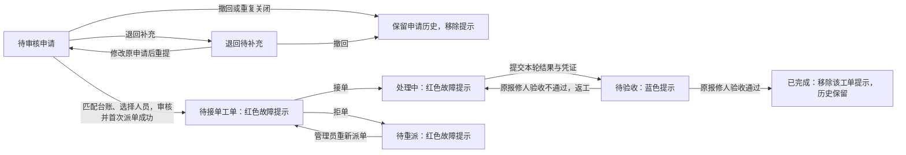

# 基于SpringBoot的设备维护管理系统的设计与实现 — 需求记录

更新时间：2026-10-11
版本：校园3D与维修人员推荐完整需求草案 v2.1（一致性修订）

## 文档状态与范围

- 正式题名保持“基于SpringBoot的设备维护管理系统的设计与实现”；“3D校园报修与维修人员推荐系统”为本次扩展的使用场景与功能描述。
- 2026-10-08通过的账号、人员、设备维护闭环及前端方案保留为旧业务基线；其通过状态不自动覆盖本轮新增方案。
- 2026-10-11已完整分页读取两个来源聊天（较早64轮、续聊88轮），结合当前聊天的台账匹配及退回待补充决定、辅助报告第1—157节与JSON核对需求。最新明确决定优先；旧候选、助手建议、原型状态和历史摘要不作为当前授权。
- 用户本轮授权“一小时内结束讨论，不再提出更多需求，由助手依据现有文档及审美直接创建requirements.md”，并授权助手判断冲突及最适合的功能。本次据此停止逐项提问、直接合并正式需求文件；未逐项确认的细节由助手代定，来源与替换汇总见第28节。
- 当前状态：需求讨论已收敛；本文件已整体修订，尚待用户明确“需求文档通过”。architecture.md、tasks.md与旧协作提示词本轮不修改，新方案功能未实现、运行未验证。
- 第1—20节保留并修正既有业务与界面基线；第21—27节规定校园配置、交互、提示、表单兼容、推荐、异常及验收；第28节汇总保留／替换／新增／暂缓与阶段状态。同一业务不另造第二套状态机。
- 快速阅读：第0.3节查看总规模；第21节查看建筑与设施；第22—24节查看使用体验和状态；第25节查看推荐；第27节查看验收；第28节查看所有替换关系。

## 0. 项目目标、使用场景与技术约束

### 0.1 项目依据与交付目标

- 正式题名：**基于SpringBoot的设备维护管理系统的设计与实现**，以任务书和开题报告为正式材料依据；旧选题文本的较早题名不作为当前项目名称。
- 以10栋示意校园的报修与维修管理为需求和验收场景，包括宿舍、教学楼、食堂和体育馆；采用真实楼栋名称和参考素材，不冒充学校实测资料。旧院系／实验室局部场景由本次校园范围替换，不扩展为企业、多组织或多校平台。
- 首版覆盖报修、审核派单、接单维修、报修人验收闭环，以及设备台账、人员管理、附件、过程追溯和真实业务统计；新增完整10栋3D校园定位、按权限的空间提示与管理员人工维修人员推荐，保留已确认异常分支。
- 最终交付目标包括可运行系统、源代码、数据库设计、测试材料和毕业论文；这些是待完成成果，不代表目前已实现。
- 用户已修正任务书日期，并于 2026-10-08 核对当前任务书确认：“撰写论文初稿，第一次查重”阶段为 2026.12.28～2027.02.28，原结束日期笔误已解决；此材料进度不替代后续待确认的具体开发任务计划。

### 0.2 运行方式与技术选型

| 项目 | 已确认约束 |
| --- | --- |
| 运行与演示 | 前端、后端、MySQL 均运行在用户本机，通过浏览器切换账号演示三个角色；局域网和云部署不属于已选首版运行方式 |
| 系统形态 | 前后端分离、单体后端 |
| Java | 统一使用 Java 21，构建与运行使用同一目标 JDK，优先采用项目级配置 |
| 后端 | Spring Boot、MyBatis-Plus |
| 数据库 | 独立 MySQL 8.4 LTS 社区版实例，保留现有 phpStudy 环境 |
| 前端 | Vue3、Element Plus |
| 图表 | ECharts |
| 认证 | Token；具体会话规则统一见第 3.1 节 |

- 具体依赖版本待架构阶段核对并锁定；不因参考开源项目而引入 Redis、微服务、消息队列、通用工作流引擎、AI、IoT 或微信小程序。
- 需求讨论时的环境检查曾发现 MySQL 8.4 尚未安装、Maven 与终端 JDK 不一致、项目依赖尚未安装。这是历史检查结果，不作为当前环境已就绪的证明；实施前须重新核对。
- 安装、升级或全局配置变更须先说明并取得授权；选择技术版本不等于批准安装。

### 0.3 校园规模与示意边界

| 建筑 | 数量与楼层 | 内景与报修配置 |
| --- | --- | --- |
| 文博1、文博2、文博3 | 3栋，每栋5层 | 每栋首层10间宿舍＋门厅＋宿管值班室，2—5层各12间；三栋174间宿舍＋6处公共内景，仅174间房内报修，共1392项计划台账 |
| 致用楼、经世楼、博爱楼 | 3栋，每栋5层 | 三栋57教室、15办公室、30卫生间、3门厅，共105处内景；仅教室办公室72处报修，共402项计划台账 |
| 一食堂、二食堂、三食堂 | 3栋，每栋3层 | 9层公共区域有内景，按楼层报修空调组和照明组，共18项台账；厨房仓储封闭且不报修 |
| 体育馆 | 1栋，2层，总高约相当于5层教学楼 | 首层篮球场、二层看台／观赛回廊均有内景，篮球架组、两层照明组和空调组共5项台账 |

- 最终10栋、41个楼层实例、296处内景覆盖单位、257个可报修位置、1817项初始计划台账。详细空间、设施数量和布置以第21节为准；不将整层区域改称虚构房间。
- 校园为示意，文博1为首栋样板，模板可复用但业务身份和数据独立，不根据房号推断楼层。历史9层宿舍、6床、60教室、教学楼102台空调等口径已替换，不能作为当前数量依据。
- 场景定位与几何浏览不扩大数据权限；第22—24节统一规定交互、提示、结构化位置、台账和旧记录兼容。模型或正式业务尚未实现。

## 1. 账号来源与角色

1. 报修用户、维修人员统一通过公开注册入口自行注册。
2. 注册时仅可选择“报修用户”或“维修人员”，不提供管理员选项。
3. 管理员端不再提供创建普通账号的入口。
4. 系统管理员使用预置账号，不通过公开注册产生。
5. 每个账号只对应一个角色，注册后角色固定；用户和管理员均不能切换角色。
6. 维修人员审核未通过后的重新申请仍使用原账号、原角色。

## 2. 注册资料与唯一性

| 字段 | 已确认要求 |
| --- | --- |
| 登录账号 | 必填，2–30 位，允许中文、英文字母、数字、下划线，在所有角色之间全局唯一 |
| 姓名 | 必填，允许重名 |
| 手机号码 | 必填，仅支持中国大陆 11 位手机号码，在所有角色之间全局唯一；仅作为联系方式 |
| 密码 | 必填，8–32 位，至少包含英文字母和数字，允许特殊字符；以安全哈希形式保存，不保存明文 |
| 确认密码 | 必填，必须与对应密码完全一致，仅用于输入一致性校验，不作为用户资料保存 |
| 角色 | 必选，仅允许报修用户或维修人员 |

- 手机号校验格式及唯一性，不接入短信验证码；填写手机号不代表已验证其归属。
- 注册成功后，用户资料与密码校验所需信息保存至数据库。
- 个人资料修改、用户自行修改密码及管理员重置密码均须由后端实际更新 MySQL 数据库，并以保存成功作为成功反馈的依据，不能仅修改前端显示或浏览器缓存。姓名、手机号更新原账号资料；密码更新原账号的安全哈希，不保存明文密码或确认密码。保存失败不改变原已保存数据，重新查询或登录须使用数据库中的最新结果；历史申请快照按第 11.3 节保留。
- 停用后的唯一性占用与恢复统一见第 8 节。

## 3. 登录与注册审核

### 3.1 登录规则

- 用户后续输入登录账号和密码即可登录，不需要重新注册或短信验证码。
- 登录依据数据库中的账号及密码哈希进行校验，不能仅凭前端保存的注册资料判断登录成功。
- 账号启停用对登录的影响沿用第 8 节。
- 登录成功与获得维修业务权限分别判断。
- 使用服务端随机 Token，由后端保存并校验登录会话；不采用 JWT 方案。
- 会话自登录成功起固定有效 8 小时，不自动续期，到期须重新登录；有效期由后端控制。
- 退出登录使对应会话失效；修改或重置密码使该账号旧登录失效。停用与恢复规则统一见第 8 节。

### 3.2 报修用户

- 注册成功后无需管理员审核，登录即可提交报修。
- 报修提交条件、补充与撤回规则统一见第 15 节。

### 3.3 维修人员

- 注册后进入待审核状态，管理员审核通过后才进入可分派名单、接收工单并参与维修。
- 待审核、审核未通过的已启用维修人员可以登录、浏览示意校园及全部简化内景，并查看审核状态和原因；不能查看任务故障提示、执行维修业务或获得报修用户权限。
- 管理员审核未通过时必须填写原因。
- 已停用但仍待审核的维修人员账号，管理员可查看本次申请及历次记录，但不能提交通过或未通过结果；须先重新启用原账号，再进行注册审核。重新启用本身不代表审核通过。
- 申请人可修改姓名、手机号后，以原账号重新提交审核；手机号仍须满足全局唯一性。
- 重新提交后再次等待审核，历次审核记录保留。
- 已审核通过的维修人员可在账号设置中维护姓名、手机号，修改后不重新审核，既有维修资格、现有任务及历史申请快照保留；待审核与审核未通过人员的资料修改入口沿用第 11 节，不从账号设置绕过审核流程。
- 审核状态、账号启停用状态、工单状态分别表达，不相互替代。
- 注册或审核通过不会自动分派工单；工单仍由管理员分派。

## 4. 管理员账号与密码

- 管理员账号预置，正常登录后允许自行修改密码。
- 由项目维护者部署时在服务器本地初始化预置管理员，实际写入数据库，不提供网页初始化或公开管理员注册入口；已有预置管理员时提示已初始化并跳过创建，不因重复执行覆盖账号、密码或业务数据。
- 初始密码由系统随机生成，符合第 2 节密码规则，不使用写死在代码或 SQL 中的默认密码；数据库只保存安全哈希。初始化保存成功后向维护者一次性展示初始密码，由维护者交给管理员，不提供事后明文查询。
- 首次使用从已确认的统一登录页进入管理员端，后续可在账号设置自行修改密码；初始密码未保留或遗忘时使用下述本地密码重置流程，不以重复初始化覆盖已有密码。
- 忘记管理员密码时，由项目维护者在服务器本地执行专用密码重置操作。
- 密码重置沿用第 3.1 节的会话失效规则，保留原管理员身份及关联历史，不通过删除、重建账号恢复使用。
- 普通账号的密码重置由管理员管理，采用系统随机生成新密码的方式；新密码符合第 2 节规则，成功后由管理员线下告知账号本人，具体界面见第 12.9 节。
- 用户登录后可自行修改密码，界面见第 12.10 节；管理员重置密码后不强制用户首次登录修改密码。原“管理员创建普通账号”的前提已被第 1 节替换，不恢复代建账号入口。

## 5. 人员管理入口与动态分类

### 5.1 统一入口

- 使用“全部人员＋四类业务快捷筛选”。
- 全部人员包含所有已注册账号；无业务的新账号、待审核及审核未通过的维修人员均可查找和管理。
- 支持按角色、维修人员注册审核状态、账号启停用状态筛选。
- 四类业务分类根据关联业务动态计算，不作为用户永久身份或账号状态。
- 同一人员可同时进入未完结和已完成分类；每个分类内按账号去重。
- 分类人数不可直接相加作为总人数；总人数按账号去重。

### 5.2 四类业务人员口径

| 分类 | 纳入范围 | 不计入范围 |
| --- | --- | --- |
| 报修用户：有未完结业务 | 待审核、退回待补充申请；待接单、待重派、处理中、待验收工单 | 已审核通过并关联工单的申请不再重复计为待处理申请；撤回、重复关闭申请不属于未完结业务 |
| 报修用户：有已完成工单 | 至少关联一张验收通过的已完成工单 | 撤回、重复关闭申请不计为已完成工单 |
| 维修人员：有未完结任务 | 当前分派给该人员的待接单、处理中、待验收工单 | 拒单后进入待重派的工单不计入原维修人员当前任务 |
| 维修人员：有已完成工单 | 该人员实际承担维修且验收通过的工单 | 仅曾被分派、接单前改派或拒单，不计为该人员完成的维修 |

- 分类依据第 16 节的工单状态与责任关系；历史记录保留范围见第 7、8 节。
- 同一报修申请审核通过后，按其关联工单状态归类，不重复计入申请与工单的未完结数量。

## 6. 人员列表与数量

### 6.1 公共字段与入口

- 姓名、登录账号、手机号码、角色、账号启停用状态。
- 维修人员另展示注册审核状态；报修用户不显示为需要注册审核。
- 提供人员详情／业务记录入口。
- 列表使用核心业务数量，各工单状态的明细数量在详情中展示。

### 6.2 按角色展示的数量

| 角色 | 核心数量 |
| --- | --- |
| 报修用户 | 待处理申请数、未完结工单数、已完成工单数 |
| 维修人员 | 当前未完结任务数、本人完成工单数 |

- 数量按独立申请、工单统计；多轮维修、验收退回不重复计为新工单。
- 统计以数据库中的真实用户、关联关系及业务记录为依据。
- 原型数据与实际统计的边界见第 19.5 节。

## 7. 人员详情与历史追溯

- 先展示业务摘要列表，通过入口进入相应申请或工单详情，不把全部处理过程堆在人员列表中。
- 报修用户可追溯全部申请及关联工单，包括撤回、退回、重复关闭记录和原因。
- 维修人员可从原业务列表追溯当前任务及本人关联的历史记录；实际接单并承担维修的人员可查看本人负责工单的维修进度、处理结果、凭证及验收过程，工单完结后保留只读查阅权限。
- 仅曾被分派、随后拒单或接单前被改派的人员，可查阅本人分派期间可见的原报修信息、当次分派及本人拒单／改派记录和对应附件；关系解除后其他维修人员新增的进度、结果、凭证及验收过程不在其可查看范围内。历史查阅不恢复当前任务提示或操作权限。
- 清楚区分曾被分派／拒单与实际参与维修，不能将整张历史工单的完成成果错误归于所有曾分派人员。
- 人员详情中的业务范围不受进入页面时所选快捷分类限制。
- 管理员可查看完整关联业务；不因此扩大普通报修用户、维修人员原有的数据权限。

## 8. 停用、恢复与历史保留

- 账号只停用，不提供删除功能。
- 报修用户有关联的未完结申请或工单时不能停用；维修人员有当前未完结任务时不能停用。
- 停用前核对关联业务，不能仅因人员不在某一快捷分类中就认定可停用。
- 停用后禁止登录并使已有登录失效；允许管理员重新启用原账号。
- 业务完结、账号停用、人员退出当前业务列表，均不删除账号、审核记录、历史分派或关联业务过程。
- 已撤回、重复关闭的申请仍保留在历史详情中。
- 账号和手机号的唯一性占用在停用后继续保留。

## 9. 对原方案的替换与阶段边界

### 9.1 被本次调整替换的旧方案

- “普通账号仅由管理员创建”替换为“普通账号统一自行注册”。
- 原登录页“不提供注册入口”的设计已替换为第 10 节确认的登录与注册入口。
- 原人员管理页“新增账号”入口移除，增加注册审核及动态业务分类能力。
- 旧人员管理原型不能直接视为新方案已确认。
- 早期“仅待审核申请可撤回”已扩大为“待审核、退回待补充均可撤回”，以第 15.2 节为准。
- 早期重复报修讨论曾以用户选定设备为前提；最终采用用户自由填写、管理员匹配台账的流程，因此在审核关联设备时阻止生成重复工单，以第 15.3 节为准，不按名称相同直接拦截用户填写。

### 9.2 整体确认与后续阶段边界

- 2026-10-08整体通过属于旧业务与前端基线；2026-10-09宿舍5层同步属于当时的局部修订。本轮依据2026-10-11用户最新授权直接完成校园与推荐完整需求草案，替代此前逐项提问后再整体编辑的流程。
- 最新需求以本文件第21—28节及已同步的业务条款为准。助手代定内容与此前直接确认决定的区别见第28.3节；本轮讨论收敛，不再保留等待逐题回答的停止点。
- 本文件已修订不等于新增需求已通过；明确“需求文档通过”后才能进入architecture.md讨论／修订，明确“架构文档通过”后才使用writing-plans修订tasks.md。
- 只有“计划通过，开始Txxx”才执行对应开发；本轮不安装依赖、创建工程、迁移数据库、制作／转换模型、编写业务代码、提交Git、推送或部署。

## 10. 已确认前端：注册与登录

单页确认时间：2026-10-07。用户当时确认采用注册与登录 Visualize 原型；业务需求与全部已记录前端方案于 2026-10-08 整体复核通过，见第 9.2 节。

### 10.1 入口与布局

- 采用“居中简洁”方案：系统名称位于顶部，登录与注册共用居中卡片，通过“登录／注册账号”入口切换。
- 三类角色统一使用登录账号与密码登录，不在登录表单中手动选择角色；登录后依据账号身份进入对应页面。
- 登录页保留注册入口；注册仅提供报修用户、维修人员，不提供管理员选项，并明确提示管理员使用预置账号。
- 密码及确认密码提供显示／隐藏控制；窄屏时表单字段上下排列。

### 10.2 注册表单与提示

- 必填字段：角色、登录账号、姓名、手机号码、密码、确认密码；具体格式与唯一性要求见第 2 节。
- 注册角色必须主动选择，不默认替用户选定，并明确提示“注册后不可更改”。
- 报修用户提示“无需审核，登录后即可报修”；维修人员提示“管理员审核通过后参与维修”。
- 手机号输入不要求填写国家代码 +86，不发送验证码；填写及格式校验均不代表已验证号码归属。
- 对必填缺失、账号或手机号格式错误、密码不符合要求、两次密码不一致，以及账号／手机号已占用分别提供提示。

### 10.3 注册结果与返回登录

- 注册成功后先展示结果，不自动登录。
- 报修用户提示可以前往登录；维修人员提示账号进入待审核状态，可以登录查看审核状态，但审核通过前不能参与维修。
- 点击“前往登录”后带入刚注册的登录账号，密码留空，由用户重新输入。

### 10.4 登录反馈与密码帮助

- 登录提交中显示处理中状态并限制重复提交。
- 账号或密码错误、账号停用、请求失败分别显示反馈；校验或请求失败保留当前输入，便于修正和重试。
- 各角色登录成功后进入第22节的校园总览，原工作台及普通列表保留；待审核、审核未通过维修人员仅浏览校园，并可进入第11节审核状态页查看原因和重新申请，不获得任务或报修权限。
- “忘记密码”展示联系指引：普通账号联系管理员重置，管理员联系项目维护者执行本地重置；不设置短信找回流程。

### 10.5 原型与实际实现边界

- 登录、注册原型不创建真实账号、不保存用户输入的账号或密码；模拟反馈与真实实现的统一边界见第 19.5 节。
- 实际账号校验以第 2–4 节为准；后续阶段边界见第 20 节。

## 11. 已确认前端：维修人员审核状态与重新申请

确认时间：2026-10-07。用户已确认采用本轮 Visualize 原型；本节仅确认维修人员本人查看审核及重新申请的界面。管理员人员管理列表、注册审核详情及审核操作见第 12 节。

### 11.1 页面结构与状态

- 审核状态、申请资料、申请与审核历史在同一页展示，顶部提供刷新审核状态及退出登录入口。
- 注册审核状态分别显示“待审核”“审核未通过”“审核通过”，账号启停用状态单独表达，不与审核或工单状态混用。
- 待审核时展示当前申请资料及历史记录，提供刷新入口，不提供重复提交或修改申请资料入口；审核通过前不能接收工单或参与维修。
- 审核未通过时突出显示原因、审核时间及审核人，提供“修改资料并重新申请”入口。
- 审核通过后提供“进入我的任务”入口，并提示不会自动分派工单，仍由管理员分派。

### 11.2 修改资料与重新提交

- 始终沿用原账号、原维修人员角色；重新申请仅允许修改姓名、手机号，不提供修改登录账号、切换角色或重新注册入口。
- 姓名必填；手机号沿用中国大陆 11 位格式及全局唯一性要求，不发送验证码。
- 点击“核对并重新提交”后，先展示账号、角色、姓名及手机号供核对，再由用户确认提交审核。
- “返回修改”保留当前填写内容；“取消修改”放弃本次草稿，保留原已提交资料。
- 提交中限制重复操作；提交成功后更新本次申请资料，状态回到待审核，保留原账号及历次审核记录。
- 手机号已占用、请求失败时明确提示，不改变原资料、审核状态或历史记录，并保留已填写内容供修改或重试。
- 提交时若审核状态已变化，停止本次旧状态下的重新申请，提示重新核对，不用旧提交覆盖最新审核结果。

### 11.3 历史记录与权限反馈

- 申请与审核记录按最新在前展示，保留首次提交、历次审核结果及重新提交事件；未通过原因不因重新申请而删除。
- 每次提交保留当次申请资料，可展开查看；后续修改不覆盖此前提交的姓名、手机号。
- 刷新失败时保留当前资料与记录并提示重试；加载失败提供重新加载入口，加载中显示等待状态。
- 登录失效时提示重新登录；账号停用时禁止继续操作并提示联系管理员处理，账号及历史记录仍保留。
- 窄屏时字段、操作按钮及历史记录按上下布局展示。

### 11.4 确认与实现边界

- 本页确认范围为维修人员本人查看审核与重新申请；管理员相关界面见第 12、18 节，统一原型边界见第 19.5 节，整体审阅与后续阶段边界见第 9.2、20 节。

## 12. 已确认前端：人员管理、注册审核与账号设置

确认时间：人员列表、筛选、审核入口及启停用交互于 2026-10-07 确认；注册审核详情与通过／未通过操作于 2026-10-08 确认，包含“先启用再审核”限制；完整人员详情与业务历史列表、管理员随机重置普通账号密码、各角色账号设置及实际数据库更新要求于 2026-10-08 确认。

### 12.1 列表结构与人员范围

- 沿用管理员导航中的“人员管理”统一入口，顶部集中展示待审核维修人员数量及“查看待审核人员”入口，涵盖首次申请与原账号重新申请。
- 使用“全部人员＋四类业务快捷筛选”：报修用户未完结业务、报修用户已完成工单、维修人员未完结任务、维修人员已完成工单；具体纳入范围沿用第 5 节。
- 全部人员包含无业务新账号、待审核及未通过的维修人员、停用账号和预置管理员；不提供新增账号或删除账号入口。
- 分类根据关联业务动态计算，同一人可进入多个分类；每个分类内及人员总数均按账号去重。
- 快捷分类人数按全体人员统计，不随下方组合筛选变化；列表单独展示符合当前条件的人数与全部人员人数，明确提示分类可重叠、人数不可直接相加。

### 12.2 筛选、搜索与字段

- 支持角色、维修人员注册审核状态、账号启停用状态组合筛选，支持按姓名、登录账号或手机号搜索，以及重置、分页。
- 注册审核筛选只适用于维修人员；选择报修用户或管理员时清除该条件并禁用审核筛选，避免将这些账号视为需要注册审核。
- 点击“查看待审核人员”切换至全部人员范围下的维修人员待审核结果，清除其他角色、启停用和搜索条件，避免隐藏待审核申请。
- 切换业务快捷分类时清除角色和注册审核条件，保留当前启停用及搜索条件；选择具体角色时返回全部人员范围。
- 列表展示姓名与账号、手机号、角色、注册审核、账号启停用、角色业务数量及操作入口。
- 报修用户显示“无需审核”，管理员显示“预置账号”；维修人员显示待审核／未通过／已通过，待审核记录区分首次申请或第几次申请。
- 报修用户数量展示待处理申请、未完结工单、已完成工单；维修人员展示当前未完结任务、本人完成工单。沿用第 6 节口径，不把曾分派或拒单计为本人完成。

### 12.3 审核与详情入口

- 待审核维修人员的行内提供“审核申请”入口，进入该账号当前提交的注册申请；原账号重新申请保留此前审核记录。
- 注册审核详情核对姓名、账号、手机号、角色及账号／注册审核状态；审核操作见第 12.5 节。
- 所有人员提供“人员详情”入口，详情范围为该人的完整关联业务，不受进入时选中的快捷分类限制。
- 无业务新账号进入详情时展示暂无关联业务；停用账号仍可查看资料与业务历史。人员详情具体布局与交互见第 12.7–12.8 节。

### 12.4 启停用交互与反馈

- 停用前核对该账号全部关联的未完结业务；存在未完结申请或当前任务时阻止停用，列出相关编号及状态，不因人员所在分类而省略检查。
- 无未完结业务时二次确认停用，提示禁止登录、已有登录失效，以及原账号、手机号占用和历史记录保留。
- 启用恢复原账号登录资格，不自动通过注册审核，不修改角色或删除历史；当前登录管理员通过“账号设置”维护资料，不提供停用自身入口。
- 请求失败保留原账号状态并允许重试；提交时若账号状态或关联业务发生变化，停止旧操作并提示重新核对。
- 加载中、暂无人员、组合筛选无结果、加载失败及无权限分别提供反馈；加载失败可重试，无匹配结果可清除筛选。
- 窄屏将表格行改为带字段标签的上下排列，保留筛选、审核、人员详情及启停用入口。

### 12.5 注册审核详情与通过／未通过操作

- 沿用管理员导航与“人员管理”入口，展示“人员管理／注册审核”位置；桌面并列展示本次申请与申请审核历史，窄屏上下排列。
- 本次申请显示提交次数、提交时间、注册审核状态及申请资料快照；账号启停用状态单独展示，管理员在此页不修改申请资料。
- “返回人员列表”恢复进入前的筛选条件及页码；列表数据与审核状态以最新结果为准。
- 点击“审核通过”先核对本次账号、姓名及提交次数，再确认提交；通过后的业务资格与分派规则沿用第 3.3 节。
- 点击“审核未通过”展开原因输入区；原因必填且不能仅含空白。填写后先核对申请人及原因，再确认提交，不直接保存结果。
- 确认步骤中的“返回修改”保留已填写原因；取消未通过操作则放弃该原因草稿，不改变申请状态。
- 已停用账号显示停用状态及先启用提示，可查看申请与历史，审核提交操作不可用；具体业务约束沿用第 3.3 节，不在审核时自动启用账号。

### 12.6 审核记录与操作反馈

- 历史记录的排序、提交快照与保留口径沿用第 11.3 节，供管理员展开核对历次资料及审核结果，包含审核人、审核时间与未通过原因。
- 提交中限制重复操作；成功后展示结果、更新本次审核状态并追加审核记录，不再允许对同一次已审核申请重复提交决定。
- 提交失败时明确提示，保留已填写原因供重试，不将失败操作显示为已保存的审核结果。
- 提交时若本次申请已更新、被审核或账号已停用，阻止旧操作并提示重新核对最新状态，不覆盖新申请或已有审核结果。

### 12.7 完整人员详情与业务历史列表

- 采用“顶部账号资料＋业务数量摘要＋下方分类记录”布局，沿用管理员导航和“人员管理／人员详情”位置；窄屏将资料、摘要及业务记录上下排列。
- 账号资料展示姓名、登录账号、固定角色、手机号、账号启停用及注册审核标识；报修用户显示无需审核，管理员显示预置账号。停用提示与资料展示独立，不隐藏历史记录。
- 业务摘要沿用第 6 节的角色数量口径，不随详情内的搜索、状态筛选或分页变化；预置管理员不套用普通用户个人报修／维修统计，仍通过对应管理入口查看全局业务。
- 报修用户分为“全部申请”和“关联工单”；维修人员分为“当前任务”和“历史关联工单”，后者包含当前及历次关联的独立工单。记录范围与成果归属沿用第 7 节。
- 每条记录展示申请／工单编号、设备名称、业务创建时间、当前业务状态、与本人的关联关系及相应详情入口；维修人员明确区分当前分派、本人维修、本人完成、曾拒单及接单前被改派，不将工单当前已完成状态等同于本人员完成。
- 分类内展示各业务状态数量；支持业务状态筛选、按编号或设备名称搜索、重置与分页，分别显示分类总数及符合条件的条数，按业务创建时间倒序展示。
- 切换业务分类清除详情内的状态及搜索条件并回到首页；查询、调整状态或重置后回到首页。人员详情不继承人员列表快捷分类作为业务范围限制。

### 12.8 关联详情、返回路径与页面反馈

- 从业务摘要进入对应申请或工单详情，沿用已确认的业务详情流程；支持申请与已生成工单之间的关联入口，不在人员详情页堆叠全部处理过程。
- 可追溯申请退回、撤回、重复关闭的结果与原因；维修人员历史关联详情明确呈现分派、拒单、改派及实际维修归属，相关维修进度、结果、凭证与验收过程仍按第 7、15–17 节查阅。
- 从关联申请／工单详情返回该人员记录时，保留人员、业务分类、已应用的筛选条件与页码；返回人员列表时恢复原快捷分类、组合筛选及页码，不将详情内的业务筛选带回人员列表。
- 无业务新账号展示账号资料及暂无关联业务；筛选无结果时提示调整条件并提供清除筛选入口；停用账号继续展示完整关联业务，启停用操作沿用人员列表交互。
- 加载中、加载失败、无权限及人员记录不存在分别反馈；加载失败可重新加载，人员记录不存在时提示返回人员列表核对。管理员查看范围及后端权限校验沿用第 7、13 节。

### 12.9 管理员随机重置普通账号密码

- 从普通账号人员详情进入“重置密码”，展示目标账号的登录账号、姓名、固定角色及账号状态供管理员核对；不通过该入口重置预置管理员密码，处理方式沿用第 4 节。
- 提交前确认目标账号及影响，管理员不手工填写新密码；取消不执行重置，提交中显示处理中并限制重复操作。
- 重置方式与密码格式沿用第 4、2 节；成功后展示结果，新密码默认隐藏，提供显示／隐藏及复制控制，由管理员线下转交账号本人。
- 自动复制不可用时提示手动复制并选中新密码，保留本次结果供操作，不将复制失败视为密码重置失败。
- 新密码仅在本次成功结果页临时展示，不提供事后明文查询；关闭结果或返回人员详情前再次提示清除显示，可返回继续复制。确认关闭或离开后清除本页密码内容，不撤销已经成功的重置。
- 未保留新密码时可重新发起重置；再次成功重置使上次密码失效，不恢复上次明文。密码哈希保存与原有登录失效沿用第 2、3.1 节，首次登录不强制修改密码沿用第 4 节。
- 重置失败时明确提示并允许重试，不显示可用的新密码或成功结果；管理员登录失效时提示重新登录后操作。
- 返回人员详情恢复原人员及业务查询位置；窄屏将目标账号资料、确认步骤及结果上下排列。原型模拟结果不修改真实账号，也不持久保存生成的密码。

### 12.10 账号设置：个人资料与自行修改密码

- 三类角色从顶部账号区进入本人账号设置，采用“个人资料／修改密码”切换；顶部展示姓名、登录账号、固定角色、账号启停用及适用的注册审核标识，不提供修改登录账号或角色入口。
- 报修用户、管理员及已审核通过的维修人员可修改本人姓名、手机号；姓名必填，手机号格式与全局唯一性沿用第 2 节，维修人员修改后的资格与审核约束沿用第 3.3 节。
- 待审核维修人员的姓名、手机号只读；审核未通过人员从审核状态页的“修改资料并重新申请”维护申请资料。两种状态均保留自行修改密码入口，不因此获得维修业务权限。
- 资料未变化时不提交保存；取消修改恢复上次保存的资料，校验不通过、手机号被占用或请求失败时提示原因并保留草稿供修正。成功后刷新当前资料显示，实际持久化与重新查询要求沿用第 2 节。
- 自行修改密码须填写当前密码、新密码及确认新密码，提供各输入的显示／隐藏控制；后端校验当前密码，新密码格式沿用第 2 节，两次新密码须一致。
- “核对并修改密码”先提示将使该账号原有登录全部失效，再确认提交；“返回修改”保留输入，“清空”清除密码输入。当前密码错误、校验不通过或请求失败时不显示修改成功，允许修正或重试。
- 修改成功须先完成第 2 节约定的数据库密码哈希更新，再按第 3.1 节使该账号原有登录全部失效；清空本页密码输入，提示使用新密码重新登录，并提供“返回登录”入口，登录页密码留空。
- 登录已失效时提示重新登录后操作，不把本次修改显示为已完成；窄屏将资料字段与操作上下排列。原型仅模拟交互，不持久保存用户填写的资料或密码，不代表数据库已更新。

### 12.11 确认与实现边界

- 本节确认人员管理、注册审核、完整人员详情与业务历史列表、普通账号密码重置及各角色账号设置；预置管理员采用第 4 节的本地初始化流程，不新增网页初始化界面。剩余范围见第 9.2 节，统一原型边界见第 19.5 节。

## 13. 角色权限与数据范围

| 角色 | 可访问的数据范围 | 业务职责与入口 |
| --- | --- | --- |
| 报修用户 | 本人提交的申请及其关联工单、附件和过程记录 | 新建报修、我的申请、补充或撤回符合条件的申请、我的工单、维修结果验收 |
| 维修人员 | 当前分派给本人的任务及第7节限定的本人关联历史记录 | 我的任务、接单或拒单、维修进度、处理结果与凭证提交；历史只读，注册审核限制沿用第 3.3 节 |
| 系统管理员 | 本示意校园场景内的申请、工单、设备、人员及统计 | 申请审核、设备匹配与补录、分派与允许阶段的重派、设备台账、人员管理、统计看板 |

- 后端同时校验角色、数据归属和当前业务状态，不能只靠前端隐藏按钮控制权限。
- 切换角色账号应进入相应导航与数据范围；一个账号的角色约束沿用第 1 节。
- 图片权限随关联业务确定，具体访问方式见第 17 节；人员历史追溯不扩大普通角色权限，沿用第 7 节。

## 14. 设备台账与维修历史

### 14.1 登记与维护

- 管理员维护设备台账；设备名称、台账位置必填。新校园设备采用显式结构化位置并保留位置显示文字；旧文字台账及其维护、设备移动和历史定位采用第24.2、24.4节，不从文字或房号推断。
- 设备编号由系统自动生成且不可修改；新增、编辑使用相同核心字段。
- 报修用户填写的名称、位置与管理员匹配的台账资料分别保留、分别展示，不能用台账数据覆盖报修原文。
- 审核时找不到对应设备，可由管理员核实并补建台账后返回申请关联，再进行审核派单。

### 14.2 启停用

- 设备状态仅采用“启用／停用”，由管理员手动维护；维修进展通过关联工单表达，不另设正常、故障、维修中、报废等设备状态。
- 停用后保留设备资料与维修历史，停止受理该设备的新工单；已有关联工单继续处理。
- 启停用采用独立操作；编辑设备资料不自动改变启停用状态，编辑停用设备不等于启用。
- 停用确认需说明对新工单和现有工单的影响；操作失败保留原状态。

### 14.3 查询与追溯

- 台账支持搜索、启停用筛选，分别显示设备启停用状态和未完结工单情况，提供新增、编辑、详情入口。
- 设备详情优先展示当前未完结工单，下方保留历次工单，并可按未完结、已完成筛选、进入关联工单详情。
- 验收退回显示在原工单内，停用设备的维修历史仍可查看。

## 15. 报修申请、审核与设备关联

### 15.1 首次提交

- 报修用户填写设备名称、详细地址和故障描述，原必填要求保留；从3D或普通列表发起的新校园报修还必须选择第24节的结构化位置。3D入口预填位置及地址文字，允许修改位置选择或补充说明，不要求知道设备编号、先选台账、点击模型物品或选择设施清单。
- 设备类别为可选的自由文本描述字段，不预设设施选择清单，留空仍可提交；仅帮助管理员理解故障，不替代必填设备名称，不决定报修范围、位置权限、台账匹配或维修人员资格。实际设施是否在报修范围内，由管理员依据第21节核实，不以用户填写的类别直接放行。
- 首次提交必须至少上传一张故障图片；图片格式、大小与每次上传数量统一见第 17 节。
- 提交成功生成报修申请，进入待审核；此时不生成维修工单。
- 申请与工单是两个业务对象，申请审核状态与工单处理状态分别管理。

### 15.2 补充与撤回

- 管理员可将材料不足、结构化位置填错或实际设施超出首版报修范围的待审核申请退回补充，并填写退回原因；原报修用户根据意见在原申请内修改资料或位置、再次提交。沿用“退回待补充”，不要求新建申请、不新增“驳回关闭”，该阶段空间提示见第23节。
- 范围外申请的退回意见须说明不受理的设施及首版范围，并提供原申请的修改／撤回入口。报修用户可纠正设备名称或位置的误填后重提；实际问题仍在范围外时应撤回，不得仅改写名称或类别绕过范围。用户尚未修改或撤回时，申请保留退回待补充及未完结属性；管理员不代为撤回、不按重复报修关闭、不自动完结，也不补录范围外设备以派单。
- 再次提交沿用原申请编号、保留首次提交时间和历次审核、补充记录，申请回到待审核。
- 历史已提交故障图片保留且不能在补充编辑时直接移除；本次新选但未提交的图片可预览、移除。已有历史故障图片时，不强制重复上传。
- 原报修用户可撤回待审核或退回待补充的申请；撤回后停止审核，申请与撤回记录保留。
- 审核通过并生成工单后，报修用户不能自行撤回。

### 15.3 审核、重复校验与派单

- 管理员先核对原始描述、图片及实际设施是否在第21节报修范围内，再匹配具体台账设备；范围外申请按第15.2节退回，补录台账规则见第14.1、21.6节。
- 重复校验在管理员关联具体设备时执行：同一设备已有未完结工单，不得再次审核通过并生成新工单；不以用户自由填写的同名描述直接认定为同一设备。
- 确认为重复报修时，管理员填写原因、标记为重复并关闭该申请；申请记录及关闭原因保留，报修用户可查看。
- 申请在设备匹配前仍可提交等待审核；禁止重复派单不等于禁止用户填写名称相同的申请。设备原工单完结后可受理新的独立报修。
- 审核通过必须同时关联设备并选择维修人员，一次完成审核和派单，生成一张待接单工单；可选维修人员须满足第3.3节资格，可参考第25节推荐但由管理员主动选择。新申请匹配台账与申请结构化位置必须一致，差异阻止派单；旧无位置申请兼容见第24节，不增加缺失位置阻断。
- 不采用“先审核通过、再另行等待首次分派”的首版流程；待审核、退回待补充、已撤回及重复关闭申请均不生成工单。报修申请仅采用第15.4节的五种状态，“审核未通过”仅用于维修人员注册审核，不作为报修申请状态。
- 已通过申请与生成工单保持关联，可从申请进入工单、从工单追溯原始申请；返工与重派不另生成申请或工单。

### 15.4 申请状态与操作边界

| 申请状态 | 可执行的主要操作 | 记录要求 |
| --- | --- | --- |
| 待审核 | 管理员审核并派单、退回补充、重复关闭；原报修用户可撤回 | 保留首次提交材料及审核事件 |
| 退回待补充 | 原报修用户补充并重提，或撤回 | 保留退回意见、历次材料及重提记录 |
| 已审核通过 | 查看申请、进入关联工单 | 保留设备匹配和工单关联，不提供用户撤回入口 |
| 已撤回 | 查看历史 | 不继续审核 |
| 重复关闭 | 查看历史和关闭原因 | 不生成新工单 |

上述名称为需求层的业务表达，最终数据库枚举与接口字段在架构阶段确定。

## 16. 工单分派、维修与验收闭环

### 16.1 接单、拒单与重新分派

- 工单首次分派后进入待接单；维修人员先查看故障描述、故障图片及设备信息，再接单或拒单。
- 接单进入处理中；拒单必须填写原因，原工单进入待重派，由管理员重新安排，保留拒单及分派历史。
- 管理员可在待接单时更换维修负责人，需填写原因并保留分派记录；待重派时可重新派发。操作均沿用原工单。
- 维修人员接单后负责人固定，不允许在处理中或待验收时改派；验收退回也继续由原维修人员承担。
- 任务已被改派或当前状态已变化时，原维修人员不能继续按旧状态接单、拒单或处理，应提示重新核对。

### 16.2 维修过程与本轮提交

- 维修人员在处理中追加维修进度；进度记录与维修凭证分别关联工单，不能将凭证当作进度记录的唯一载体。
- 追加进度与提交本轮维修结果分开操作。
- 每次提交验收，必须填写本轮处理结果并上传至少一张本轮维修凭证；附件限制统一见第 17 节。
- 提交后进入待验收；历史结果或旧凭证只供追溯，不能替代返工后本轮必填结果与必传凭证。

### 16.3 验收与返工

- 仅原报修用户负责验收；维修人员提交结果和凭证不等于工单已完成，管理员不替代报修用户验收。
- 报修用户先核对本轮维修结果和凭证，再选择通过或不通过。
- 验收通过后工单已完成；验收不通过必须填写原因，退回原维修人员，工单重新进入处理中。
- 返工沿用原工单编号，保留历次进度、维修结果、凭证、验收意见与时间；再次提交后重新验收。
- 本轮待验收材料优先显示，历史轮次折叠保留并可单独查看，避免将上一轮材料误认为本轮成果。

### 16.4 工单状态转换

| 当前状态 | 触发操作 | 后续状态 |
| --- | --- | --- |
| 待接单 | 当前分派维修人员接单 | 处理中 |
| 待接单 | 当前分派维修人员拒单并填写原因 | 待重派 |
| 待接单 | 管理员填写原因并更换维修人员 | 待接单，更新分派关系并留存历史 |
| 待重派 | 管理员重新分派 | 待接单 |
| 处理中 | 原维修人员提交符合条件的本轮结果与凭证 | 待验收 |
| 待验收 | 原报修用户验收不通过并填写原因 | 处理中，原人员继续维修 |
| 待验收 | 原报修用户验收通过 | 已完成 |

人员分类及数量引用本节状态，具体计算仍统一采用第 5、6 节，不因重派或多轮返工增加工单计数。

## 17. 图片、维修凭证与存储访问

| 项目 | 统一规则 |
| --- | --- |
| 支持格式 | 故障图片、维修凭证均仅支持 JPG、JPEG、PNG，不额外支持 PDF |
| 单文件大小 | 不超过 5 MB |
| 每次上传数量 | 最多 5 张；该限制针对每次提交，不据此删除累计历史附件 |
| 必传场景 | 首次报修见第 15.1 节；每轮提交验收见第 16.2 节；补充材料沿用第 15.2 节 |
| 文件位置 | 本机项目数据目录保存图片文件 |
| 数据库内容 | MySQL 保存文件信息及其与申请、工单的业务关联 |
| 访问方式 | 通过后端鉴权访问，权限随关联申请或工单确定，不采用绕过业务权限的直接公开访问 |
| 历史保留 | 已提交故障图片、历次维修凭证保留，用于过程追溯 |

- 前端提供图片预览、未提交图片移除及格式、大小、数量错误提示；后端须实施实际校验，不能以原型或前端限制替代。
- 图片存储采用本机方案，不因本次需求整理引入额外对象存储服务。

## 18. 统计看板与统一口径

统计来源为数据库中的真实申请、工单、设备与业务时间记录，采用 ECharts 展示；原型中的示例数值不能作为实际统计或测试结果。

### 18.1 业务统计口径

| 指标 | 时间归属、样本与计算规则 |
| --- | --- |
| 月度维修数量 | 按最终验收通过时间，统计所选月份已完成的工单；跨月工单归入验收通过的月份 |
| 设备故障频次 | 按工单生成时间归属月份，每张工单计一次，尚未完成的工单也计入；拒单重派或验收退回不重复计数；撤回、退回待补充、重复关闭等未生成工单的申请不计入 |
| 工单状态分布 | 全部已生成工单的当前状态，独立于月份筛选；图表明确标注“全部工单·当前状态”，可反映跨月积压 |
| 单张工单响应时长 | 维修人员接单时间减去申请首次提交时间，包含审核、退回补充、拒单与重新分派的等待时间；不改用再次提交或最后一次派单时间起算 |
| 单张工单维修时长 | 累计处于“处理中”的各段时间，包含验收失败后的继续维修，扣除待验收时间 |
| 平均响应时长、平均维修时长 | 两项均使用所选月份验收通过的工单作为样本，与月度维修数量一致；未完成工单暂不纳入这两项平均值 |

- 示例：首次维修 1 小时、待验收 3 小时、验收退回后再维修 1 小时，则累计维修时长为 2 小时。
- 人员分类人数与业务数量采用第 5、6 节，不能把分类人数相加作为人员总数，也不能把这些人员数量与看板维修量混用。
- 图表数字应能追溯到关联工单及业务事件时间；具体数据结构与查询实现留待架构阶段。

### 18.2 已确认前端：概览／分析双标签页

确认时间：2026-10-08。参考用户提供的 Codex 桌面端“使用情况”概览与分析截图，采用双标签页、留白、浅边框和纵向分组的组织方式；统计业务仍按第 18.1 节执行。

- 沿用管理员“统计看板”独立导航入口，默认进入“概览”，可切换“分析”；两栏共用所选统计月份，切换时保留月份，不额外引入 7 天／30 天口径。
- “概览”展示月度维修数量、平均响应时长、平均维修时长及适用样本说明；单独展示“全部工单·当前状态”，明确其范围不随月份变化。
- “分析”展示所选月份按日排列的维修完成分布、设备故障频次及样本明细；每日完成数量仍按最终验收通过日统计，汇总与月度维修数量一致。
- 设备故障频次按具体台账设备区分，显示设备名称、编号和工单数量，按频次由高到低展示；不因名称相同合并不同设备，时间归属与去重规则沿用第 18.1 节。
- 点击概览指标、设备频次或工单状态可查看对应范围的工单摘要；明细注明所选月份及时间归属，或注明全部工单当前状态范围，不能将两类条件混用。分析中的完成样本明细可核对各工单响应及维修时长。
- 从明细进入关联工单详情，核对申请首次提交、工单生成、接单、最终验收通过时间及累计处理中时长；完整过程和凭证沿用已确认的工单详情，返回时保留统计月份与明细范围。
- 切换月份更新月度指标、每日完成分布、设备频次及相应明细；全部工单当前状态及其状态明细保持独立于月份筛选。
- 所选月份无验收完成工单时，维修数量显示 0，平均时长显示“—”并提示暂无样本；无生成工单时，设备频次显示暂无记录，不影响全部工单当前状态展示。
- 提供刷新数据入口；刷新中或刷新失败时可保留上次成功数据，但须明确提示及对应月份，不将旧结果显示为新月份结果；无权限时隐藏统计内容并提示。
- 窄屏将指标与分组上下排列，保留月份选择、标签切换、图表数值及明细入口；实际统计须由后端查询真实数据库计算，统一原型边界见第 19.5 节。

## 19. 已确认前端：整体导航与业务页面

本节补入指定聊天前半段已由用户逐项回复 A「采用」的方案。账号来源调整影响的登录、人员管理旧方案由第 10、12 节替代；本节不恢复旧方案中的“管理员新增账号”或“登录页无注册入口”。

### 19.1 整体导航、信息层级与视觉方向

- 保留A「侧栏工作台」：左侧角色导航、顶部账号区，账号设置和退出入口不变；新增第22节校园总览作为登录默认入口，原工作台与普通业务列表仍可独立进入。
- 信息层级为“待办概览 → 事项列表 → 详情操作”；采用蓝灰中性色和克制的状态强调。
- 报修用户优先看到待补充、待验收事项；维修人员优先看到待接单、验收退回与维修中任务；管理员优先看到待审核、待重派事项，统计看板保持独立入口。

| 角色 | 已采用的导航范围 |
| --- | --- |
| 报修用户 | 校园总览、工作台、新建报修、我的申请、我的工单 |
| 维修人员 | 校园总览、工作台、我的任务；未通过注册审核者只可浏览校园并使用第11节审核状态界面，不开放维修工作台与任务业务 |
| 系统管理员 | 校园总览、工作台、申请审核、工单管理、设备台账、人员管理、统计看板 |

### 19.2 报修用户页面

| 已采用页面 | 布局、入口与反馈共识 | 业务规则引用 |
| --- | --- | --- |
| 新建报修 | 单页分区，明确建筑／楼层／房间或区域结构化位置，设备信息、故障描述、故障图片依次组织；保留原填写方式与预填地址，提交失败保留输入 | 第15.1、17、24节 |
| 我的申请 | 支持状态筛选、搜索、分页；申请状态与关联工单分别展示，突出待补充事项；撤回前确认，保留历史列表记录 | 第 15 节 |
| 申请详情 | 当前状态及待办操作优先，报修信息与审核时间线并列；展示五种申请状态、退回或关闭原因、图片及关联工单入口；原始填写与匹配台账分别展示 | 第 14.1、15.4 节 |
| 补充材料 | 顶部突出退回意见，可对照上次填写；历史已提交图片与本次新增图片分区，未保存离开时提示放弃修改；重提失败保留输入，状态变化时提示核对 | 第 15.2、17 节 |
| 我的工单 | 突出待验收、维修进展与验收退回原因；支持筛选、分页；“查看并验收”先进入核对页，不直接改变状态 | 第 16 节 |
| 工单详情与验收 | 本轮结果、凭证优先，历史轮次可展开；通过或退回前有确认反馈，提交失败保留填写原因，支持窄屏显示 | 第 16.3 节 |

### 19.3 维修人员页面

| 已采用页面 | 布局、入口与反馈共识 | 业务规则引用 |
| --- | --- | --- |
| 我的任务 | 突出待接单与验收退回，提供快速筛选及分页；按状态展示接单、继续维修或查看入口；待验收、已完成任务进入查看 | 第 13、16 节 |
| 任务详情与接单 | 先展示故障描述和图片供核对，分别展示用户原填位置与台账位置；提供接单、填写原因拒单及任务被改派后的反馈 | 第 14.1、16.1 节 |
| 维修处理 | “追加进度”和“本轮结果与凭证”分区；历史轮次可查，本轮图片可选择、预览；提交失败保留本轮结果与已选图片 | 第 16.2、17 节 |

### 19.4 管理员业务页面

| 已采用页面 | 布局、入口与反馈共识 | 业务规则引用 |
| --- | --- | --- |
| 申请审核列表 | 默认待审核，支持状态筛选、分页；申请状态、关联工单分别显示；仅待审核提供“审核并派单”，待补充、已通过与已关闭记录可追溯 | 第 15 节 |
| 审核详情与派单 | 保留原文及结构化位置，匹配／补录台账、检查位置与重复工单、参考推荐后主动选择维修人员；通过并派单、退回补充、重复关闭区分；失败保留选择 | 第14.1、15.3、24—25节 |
| 工单管理列表 | 待重派、待接单优先；显示拒单原因与原分派人员，支持状态筛选、人员搜索、分页；接单后仅提供查看详情入口 | 第 16.1 节 |
| 工单详情与重新分派 | 展示拒单原因、分派历史、维修与历次验收记录；重派需要确认，失败保留选择；接单后锁定改派入口，维修与验收记录只读 | 第 16 节 |
| 设备台账 | 列表展示编号、名称、位置、启停用与关联工单，提供搜索、筛选及维护入口 | 第 14.3 节 |
| 新增与编辑设备 | 编号只读，核心资料表单；保存失败保留输入，未保存离开需确认；编辑停用设备时提示不会自动启用 | 第 14.1、14.2 节 |
| 设备详情与维修历史 | 当前工单在前、历次工单在后，设备资料放在右侧，窄屏上下排列；提供历史筛选和无记录提示 | 第 14.3 节 |

人员管理列表、维修人员注册审核及完整人员详情与业务历史列表使用第12节基线；本轮校园、提示与推荐的完整需求见第21—27节，不另建等待逐题确认的界面清单。

### 19.5 原型边界与一致性

- 各角色业务页面支持窄屏排列，保留关键操作与字段标识；涉及筛选、分页、空数据、加载或请求失败时，提供对应反馈。
- 页面操作需体现所属业务章节的状态与权限边界；提交失败保留可修正的输入，不能通过界面演示绕过后端校验。
- Visualize 的布局与示例交互检查只证明讨论原型表现，不证明真实账号、接口、图片存储、数据库、权限或统计已实现。
- 原型中的人员、数量、审核资料、状态切换、提交与启停用结果均为示例或模拟反馈，不连接真实账号、会话、数据库或业务接口；实际数据与校验应遵循各业务章节。

## 20. 交付、验收与后续阶段边界

- 在第0节的本机场景中，以真实后端及数据库演示三个角色的完整流程，业务与界面基线分别见第1—19节；新增校园、推荐及完整验收见第21—27节。
- 测试材料区分文档一致性、原型交互、模型读取／渲染、权限、持久化、状态流转、附件、推荐、统计和性能，不将示例数据或单项检查当成整个系统验收。
- 交付仍包括系统、源代码、数据库设计与初始化说明、测试材料、素材许可清单和论文；正式题名与任务书日期沿用第0.1节。
- 开发阶段每完成一个已授权任务即停止，说明修改、验证、手工测试和剩余风险，等待用户测试通过。当前未执行任何开发任务。
- Atlas CMMS、OpenCMMS、RuoYi-Vue-Plus仅保留为历史参考方向，不将其全部能力或框架自动纳入本项目；本轮未引用外部实时事实作需求依据。
- 本轮根据用户最新授权完成正式需求草案整体修订，结束逐项需求讨论；文档确认及后续授权严格按第28.5节区分，未修改architecture.md和tasks.md。

## 21. 校园总体范围与示意空间配置

### 21.1 范围、数量和数据身份

本节汇总此前明确确认的校园与设备范围。第21.7节的空间细节及第22—27节中此前未确定的细节，根据用户于2026-10-11授权助手结束逐项讨论、直接裁定冲突并补齐需求的指令定稿为本轮需求草案；不冒称用户曾逐项选择，也不表示功能已实现。

| 建筑类型 | 建筑名称 | 楼层 | 可观察的简化内景 | 首版可报修位置 | 初始计划台账 |
| --- | --- | --- | ---: | ---: | ---: |
| 宿舍 | 文博1、文博2、文博3 | 每栋5层 | 174间宿舍＋6处公共空间＝180处 | 174间宿舍 | 1392项 |
| 教学楼 | 致用楼、经世楼、博爱楼 | 每栋5层 | 57教室＋15办公室＋30卫生间＋3门厅＝105处 | 57教室＋15办公室＝72处 | 402项 |
| 食堂 | 一食堂、二食堂、三食堂 | 每栋3层 | 9个楼层公共区域 | 9个楼层公共区域 | 18项 |
| 体育馆 | 体育馆 | 2层，总高约相当于5层教学楼 | 首层篮球场、二层看台／观赛回廊，共2处 | 对应2个楼层区域 | 5项 |
| 合计 | 10栋建筑、41个楼层实例 | — | 296处内景覆盖单位 | 257个可报修位置 | 1817项 |

- 上表296处是内景覆盖清单的计数单位，不将食堂整层或体育馆区域改称房间；走廊、楼梯及环境装饰不混入此统计。体育馆挑空顶部灯具不增加第三层。
- 1817项是首版初始配置的计划台账，数量验收针对初始演示配置。管理员按原业务规则后续补录台账时，实际数量可以变化，不把计划数量当成运行时上限。
- 校园采用真实楼栋名称＋参考素材搭建的示意空间，不代表温州商学院实测布局、真实房号、真实设备存量或建筑规范审查结论。校园页及空间说明均提供“示意校园”标识。
- 文博1为首栋样板；样板只是验证方式，最终10栋及全部内景、业务覆盖不缩减。
- 楼栋、楼层、房间／区域均有独立身份及显式所属关系。编号仅作显示标签，不根据房号、名称、文字地址或模型坐标推断楼层或业务位置。
- 同类外观、楼层和内景模板可复用；位置、设备、申请、工单和故障数量不跨模板实例共享。相同房号和显示名称须结合楼栋、楼层识别。

### 21.2 宿舍配置

三栋统一：首层各10间宿舍＋门厅＋宿管值班室；2—5层各12间宿舍，中央走廊两侧各6间。每栋58间，三栋174间；门厅与值班室各3处另计，全部有可进入观察的简化内景。

| 每间宿舍的展示设施 | 数量 | 台账登记与报修 |
| --- | ---: | --- |
| 上床下桌床桌组合 | 左、右各1组，共2床2桌面 | 每组独立登记，共2项 |
| 独立卫浴：马桶、淋浴、洗手盆 | 各1 | 分别登记，共3项 |
| 空调 | 1台 | 1项 |
| 照明 | 宿舍区1盏、卫浴1盏，共2盏 | 1个照明组 |
| 桌面插座 | 左、右桌位各1处，共2处 | 1个插座组 |
| 门窗 | 简化展示 | 不纳入报修或计划设备台账 |

- 每间8项、每栋464项、三栋1392项计划台账；照明与插座组内不另登记单体设备。床桌组合不拆成床架与桌面两个台账。
- 首层宿舍标签101—110；2—5层分别201—212、301—312、401—412、501—512。公共空间使用“门厅”“宿管值班室”。标签与楼层关系来自配置，不采用房号解析。
- 6处门厅和值班室仅展示、不报修、不配置公共空间报修台账；值班室展示1桌1椅，门厅展示服务指示与简化公告板，不增加电脑、空调等未确认报修设施。

### 21.3 教学楼配置

三栋首层均为3间标准教室＋1间教师办公室＋门厅＋男女卫生间各1处；2—5层均为每层4教室＋1办公室＋男女卫生间各1处。每栋19教室、5办公室、10卫生间、1门厅；三栋105处均有简化内景。

| 空间 | 每间展示配置 | 每间计划台账 |
| --- | --- | ---: |
| 标准教室，57间 | 30桌30椅，5列×6排，每桌1椅；前方讲台及讲台上1电脑；1空调、6灯、4处插座 | 桌椅组、空调组、照明组、插座组、电脑、投影仪，共6项 |
| 教师办公室，15间 | 4套办公桌椅、1空调、2灯、4处插座 | 办公桌椅组、空调、照明组、插座组，共4项 |
| 男女卫生间，30处 | 简化隔间、洗手盆及名称标识 | 0项，仅展示 |
| 门厅，3处 | 建筑名称、楼层导览及通行空间 | 0项，仅展示 |

- 每间教室另有1台作为业务设备的投影仪，纳入报修并独立登记，明确无需建模。不以缺少投影仪模型阻止报修、台账匹配或提示。
- 讲台及教室、办公室的门窗仅展示；卫生间、门厅、走廊、楼梯不报修。卫生间与门厅不配置空调。
- 教室342项＋办公室60项＝402项计划台账；空调实体57＋15＝72台，替换历史每教室2台及卫生间有空调的解释。
- 各栋教室标签：首层101—103，2—5层201—204、301—304、401—404、501—504。办公室、男女卫生间、门厅用名称。
- 标准层中央走廊两侧各2间教室；办公室靠中部，男女卫生间在同一端靠楼梯；两端各1处简化楼梯间，入口沿标准层连续对应，不逐层虚构不同楼梯井。

### 21.4 食堂配置

- 三栋各3层，共9层统一公共区域模板；每层12张四人桌、48座、4个售餐窗口、4台立式空调、12盏灯。
- 每层空调按1个立式空调组登记、照明按1个照明组登记；每层2项、每栋6项、三栋18项计划台账。报修定位到哪个食堂的第几层，不要求具体角落、空调号或灯号。
- 空调四角各1台。餐桌、座椅、窗口、门窗仅展示、不报修；公共插座不增加报修。厨房与仓储仅作封闭后勤区标识，无可进入内景、不报修。
- 使用“一食堂·二层”等建筑＋楼层标签，不增加数字房间号。独立位置及所属楼层关系继续保留。

### 21.5 体育馆配置

| 区域 | 展示配置 | 计划台账 |
| --- | --- | ---: |
| 首层篮球场 | 1个完整篮球场、两端共2篮球架、12灯、4台立式空调 | 篮球架组1项、照明组1项、立式空调组1项，共3项 |
| 二层看台／观赛回廊 | 看台座椅、观赛回廊、合计6灯、合计2台立式空调 | 照明组1项、立式空调组1项，共2项 |

- 两层均可进入观察简化内景，二层围绕首层篮球场形成看台与观赛回廊，中央挑空。首版不增加乒乓球区、泳池、礼堂或厨房。
- 两个篮球架合为1项篮球架组，不要求哪一端损坏；照明与空调分别按楼层分组，只要求首层篮球场或二层看台／观赛回廊定位，不要求具体单体。
- 全馆5项台账、18盏灯、6台立式空调。看台座椅、门窗、地面、栏杆仅展示，插座不报修。
- 使用“体育馆·首层篮球场”“体育馆·二层看台／观赛回廊”，不增加数字房间号。

### 21.6 展示设施、报修范围和台账的关系

- 报修范围采用上述已确认的空间与设施类别；展示用门窗、通道、栏杆、公共空间和环境装饰不因可点击或存在模型而自动成为可报修设备。
- 新报修只需选择损坏物品所在房间／楼层区域并说明故障，不要求逐一核验模型是否有该物品、点击单体模型、选择设施清单或输入具体灯号、插座号、桌号、角落。分组内的具体部件／方位可在描述中自愿补充。
- 用户仍按原表单填写设备名称和故障描述；设备类别的可选自由文本规则统一见第15.1节，不新增当前位置设施选择清单或台账自动绑定。
- 管理员审核必须匹配台账；该要求服务于维修历史与重复工单控制，不把物品实物核验或模型节点存在作为额外审核／红灯前提。实际设施在首版报修范围内但无法匹配时，按第14.1节核对描述并补录合适台账，或因位置／材料问题退回待补充；补录限于本节已规定的空间与设施类别。范围外申请按第15.2节处理，不能只因模型没画该物品而直接否定范围内申请。

### 21.7 本轮代定的示意布局与审美

以下为项目示意设计，不是实测尺寸或建筑安全标准。采用清爽的低多边形校园：暖灰外墙、低饱和蓝灰屋顶、浅木家具、适量绿植；红色只用于故障处理，正常建筑不因楼栋分类使用红色。建筑名称、楼层与入口清晰，避免装饰压过业务提示。

| 部位 | 首版布局 |
| --- | --- |
| 校园总览 | 中央步行广场与主路组织10栋：北侧三栋教学楼、东侧体育馆、南侧三栋食堂、西侧三栋宿舍。道路形成可识别环路，建筑之间留出选择与观察间距；方位仅为示意，不绑定地理坐标 |
| 宿舍首层 | 中央走廊左右各5间；门厅在中部主入口，值班室邻门厅；两端楼梯间贯穿1—5层。房号从主入口观察方向的一端开始，同侧顺序连续：首层一侧101—105、另一侧106—110；标准层一侧01—06、另一侧07—12，以显式配置为准 |
| 宿舍房间 | 左右各1组上床下桌；中央留通道，独立卫浴靠入口一角；主灯在宿舍区，卫浴灯独立，空调在远离卫浴的墙面。插座在左右桌面附近，门向房内开启 |
| 教学楼首层 | 中央门厅接走廊；教室两侧按2＋1分布，办公室靠中部，男女卫生间集中同一端；两端楼梯与上层衔接。标准层教室同侧前后顺序排列，房号两侧各2间明确配置 |
| 教室 | 讲台位于教学前方，桌椅5列×6排，中间及两侧保留观察通道；门在后侧接走廊，电脑在讲台上；6灯按2列×3排，4处插座在前、后及两侧墙面附近，空调在侧墙，不遮住门或房号 |
| 办公室与公共内景 | 4套桌椅按2×2排列；办公室2灯，插座在桌位附近。卫生间每处简化2个隔间与2个洗手盆，门厅只展示导览；不增加公共空间报修设备 |
| 食堂 | 12桌按3列×4排，每桌4张独立椅；4窗口并列于一侧，封闭后勤标识在窗口后方；12灯按3×4排列，4空调在四角。主入口在对侧中部，两端楼梯贯穿三层，楼层模板保留首层入口差异 |
| 体育馆 | 首层篮球场两端各1篮球架；12盏场地灯按3×4示意排列，挑空顶部灯具业务归属首层。二层两侧长边各2排×8席，共32席，连通观赛回廊；6灯按两侧各3盏，2台空调分布两侧。两处楼梯在短边端部连接两层，避开球场与篮球架观察区域 |

- 楼梯提供连续连接的简化展示；首版通过楼层选择切换观察，不要求第一人称步行上下楼、碰撞、乘电梯或完整漫游。未增加宿舍电梯功能。
- 门窗采用可复用简化构件，窗户放在外墙、门连接实际入口，不要求每块玻璃或窗扇独立交互。尺寸、网格、材质文件和模型处理方法留待架构与制作阶段；空间关系和数量以本节验收。
- 树木、路灯、花坛、草地、长椅、指示牌和少量静态人物适量复用；人物只作装饰，不模拟行为，不遮挡目标选择与提示。环境设施不新增报修业务。

## 22. 3D校园界面、导航与角色体验

### 22.1 入口与页面组成

- 所有已启用账号登录后进入“校园总览”；维修资格未通过者可浏览示意校园与全部简化内景，保留审核状态入口，不显示任务标记、不开放维修或普通报修业务。停用账号仍禁止登录。
- 保留侧栏工作台、顶部账号区及第19节角色业务导航；新增“校园总览”入口。桌面采用左侧简洁导航、中央校园、右侧按需展开的位置／业务面板，面板关闭时让出观察空间。
- 顶部提供建筑、楼层、房间／区域级联选择；仅有一个区域时省略无意义的单选层级，但仍明确显示当前结构化位置。显示“示意校园”、返回校园、当前位置及普通列表入口。
- 普通列表始终可以独立完成全部已授权业务；用户主动选择进入列表，不强制依赖3D成功，也不因有3D而删除原管理、统计与账号页面。

### 22.2 选择、观察和进入

- 总览可旋转、平移、缩放；提供“回到校园总览”恢复默认观察。支持鼠标、触控及明确标注的选择控件，不把悬停作为唯一操作方式。
- 点击建筑或使用选择器定位建筑；选择楼层后观察该层，遮挡目标的上方楼层及外墙适度隐藏，其他楼层不把业务记录误合并进当前层。
- 房间门口显示房号／空间名称；鼠标悬停显示完整建筑、楼层和名称，触控及键盘通过位置列表获得同等信息。每个可进入空间都有明确“进入观察”入口。
- 选择宿舍／教学楼房间后，镜头平滑移动至对应门口；点击房门播放简化开门动作并进入房间观察。食堂、体育馆选择楼层／区域后从区域入口进入观察，不强造房号或逐设备门口。
- 室内以轨道式观察为主，可旋转和缩放；提供“返回楼层”及“返回校园”。不以逼真漫游、逐灯点击或完整建筑穿行作为首版目标。
- 连续切换目标时最后一次选择生效，旧加载／运镜结果不覆盖新目标。已加载目标的选择定位及开门进入过渡，各自从对应操作触发起在1秒内完成，用户在选择与点击进入之间的停留不计入；减少动态效果时直接切换，不用动画阻挡业务。冷缓存进入内景的完整计时统一见第26.2节。
- 开门、镜头移动、进入内景只改变观察状态；不自动提交申请、接单、改派或触发维修状态变化。

### 22.3 各角色操作

| 角色 | 校园和内景 | 空间提示与业务入口 |
| --- | --- | --- |
| 报修用户 | 全部已确认简化内景，包括仅展示公共空间 | 仅本人申请与关联工单；可对全部174宿舍、72教学空间、9食堂楼层、2体育馆区域的新报修，不新增住宿绑定或按楼授权 |
| 合格且启用维修人员 | 全部已确认简化内景 | 仅当前指派给本人的任务提示；按状态接单、拒单、追加进度和提交本轮结果，历史仍从原列表查阅 |
| 管理员 | 全部已确认简化内景 | 全校可见提示；审核派单、设备台账、人员和统计仍遵循既有权限，不替代报修人验收 |
| 已启用但维修资格未通过者 | 校园及全部简化内景可浏览，厨房仓储除外 | 无任务标记、无任务操作、无报修用户权限；可进入本人审核状态、重新申请和允许的账号设置 |

- 本节限制校园与内景中的当前空间提示、位置事项列表及业务面板：报修用户仅看本人记录，维修人员仅看当前指派给本人的任务，不通过共享位置泄露其他人的记录、数量、联系人、图片或状态。拒单或被改派后移除原人员的当前任务提示；其从原业务列表进行历史只读查阅的范围仍按第7、13节执行。几何浏览与业务数据权限独立。
- 仅展示空间显示“仅供观察，本区域不提供报修”，不显示误导性提交入口。门窗等展示物不因点击而新增报修权限。
- 业务面板以当前位置、当前状态和允许操作为重点，再显示描述、图片与历史；需要较多资料或长过程时进入原详情页并保留返回位置。

### 22.4 视觉、窄屏和可访问性

- 业务界面延续蓝灰中性色、留白及克制状态强调；校园本身使用第21.7节的明亮示意风格。故障红灯以静态红色标记和文字表达，禁止循环闪烁或用光晕隐藏文字。
- 红色＝故障处理中；蓝色＝待验收；琥珀色＝退回待补充；灰蓝色＝待审核。正常位置不显示“无故障”红绿灯，也不因无权记录改变颜色。
- 所有状态同时使用文字、数量或图形，不能只靠颜色判断。中文房号与建筑名可读，不把长标签挤进模型表面。
- 320—767像素宽时，导航折叠，位置选择与业务面板按上下顺序或底部面板呈现，关键业务按钮不遮挡当前名称；始终可一键进入普通列表。桌面推荐1366×768及以上。
- 表单、列表、详情、位置选择和业务操作可用键盘完成，焦点可见；触控关键按钮有效操作面积不小于44×44像素。首版不要求键盘直接操控所有3D几何，选择器提供等价位置入口。
- 示例与视觉原型明确标注“示例数据”，不连接真实业务接口；正式演示账号数据与真实学校信息明确区分。

## 23. 空间提示、聚合与状态同步

### 23.1 提示触发与移除

先按角色和记录归属过滤，再生成位置提示和数量。物品是否实际存在、是否有模型节点不是提示前提；审核业务仍需按第15.3节匹配台账。

以下为状态关系示意，无示例业务记录、不连接接口；申请和工单仍是两个对象，文字标签不增加状态枚举。

| 申请／工单实际阶段 | 空间提示 | 普通报修用户 | 维修人员 | 管理员 |
| --- | --- | --- | --- | --- |
| 待审核申请 | 待审核，灰蓝 | 仅本人 | 不显示 | 全部可见 |
| 退回待补充申请 | 退回待补充，琥珀 | 仅本人 | 不显示 | 全部可见 |
| 审核并首次派单成功、工单待接单 | 故障处理中，红色；待接单数量 | 仅本人报修 | 仅当前本人指派 | 全部可见 |
| 拒单后待重派 | 故障处理中，红色；待重派数量 | 仅本人报修 | 无当前指派人员，不向原拒单人保留任务提示 | 全部可见 |
| 处理中，尚无本轮返工 | 故障处理中，红色；处理中数量 | 仅本人报修 | 仅当前本人指派 | 全部可见 |
| 验收不通过后处理中 | 故障处理中，红色；返工数量 | 仅本人报修 | 仅当前本人指派，仍为原负责人 | 全部可见 |
| 待验收 | 待验收，蓝色 | 仅本人报修，提供验收入口 | 仅当前本人指派，按原权限查看 | 全部可见，不能替代验收 |
| 验收通过、申请撤回或重复关闭 | 移除该业务事项对应提示 | 历史仍可查 | 历史仍按原权限可查 | 历史仍可查 |

- “处理中”为原工单状态，“维修中”为同义展示文案；本文件统一数量标签为“处理中”。“返工”是原工单本轮阶段标签，不新增工单枚举；返工项不同时重复计入普通处理中数量。
- 原申请退回待补充后仍是未完结事项，显示独立琥珀提示而不亮故障红灯；这是本轮授权代定方案，替代将退回等同终态驳回的旧误解。不增加“驳回关闭”申请状态。
- 编辑补充位置、描述或附件的未提交草稿不改变提示；成功重提才将提示移到已提交的新位置，并切回待审核。原位置其他可见事项不清除，旧位置／旧描述版本保留在历史中。
- 首次审核及派单成功才开始故障红灯；待审核、退回补充、提交失败或派单失败均不提前亮红灯。待验收切换为蓝色，验收不通过恢复红色并标注返工。
- 完结仅移除对应事项，不删除申请、工单、附件或历史；同位置仍有可见未完结事项时保留汇总。

### 23.2 每位置一个汇总提示

- 每个独立位置只显示一个汇总提示；同一申请审核成功并关联工单后，只按当前工单计数一次，不同时统计申请和工单。
- 主类别优先级为：**故障处理 → 待验收 → 退回待补充 → 待审核**。本轮只在原已确认前三大类中插入待补充，其余相对次序不变。
- 故障处理主文案统一“故障处理中”，不为返工、处理中、待接单、待重派设内部主标题优先级；各阶段及数量分别保留。无故障处理但有待验收时，主提示为待验收，其他类别数量仍可查看。
- 明细数量只包含当前角色可见记录；不可见记录不得影响主颜色、总数、按钮或“此处有故障”之类匿名提示。
- 点击汇总提示打开该位置当前可见的未完结申请／工单列表，再选择记录进入详情。列表显示编号、名称、阶段及时间；已完结历史从原业务列表查阅。不可见或已完结导致列表为空时，显示“当前没有可查看的未完结记录”，不推断他人是否报修。
- 申请／工单列表支持普通业务操作入口；一次点击提示不默认选取某条记录并改变业务状态。不同楼栋同名空间不合并。

### 23.3 更新、失败和编辑冲突

- 正常联网且页面在前台时，其他人业务操作引起当前可见变化，空间提示、已打开的位置列表、详情的只读状态及可用操作均在30秒内更新；保留手动刷新。
- 本人操作经服务端确认成功后立即同步相关提示和已打开位置列表，不等待周期刷新；页面从后台恢复前台时立即重新获取可见状态，读取成功后再标为最新。
- 普通网络／服务读取失败时保留上次成功且当前有权查看的数据，提示可能过期、上次成功更新时间和重试入口；首次未成功读取时显示加载失败，不能伪造“暂无故障”。读取失败不更新成功时间。
- 检测到登录或记录权限失效时，清除无权业务内容并停止其操作，不以“保留旧数据”继续展示；退出或切换账号清除前一账号的提示、详情与草稿。
- 自动刷新只更新只读内容和可用操作，不覆盖编辑草稿、不自动提交。仍有查看权限但状态变化使原操作失效时，保留草稿、提示变化并停止提交；服务端再次复核状态与权限。
- 同一业务成功提交即使响应丢失，重新核对结果或重试也不得生成重复申请、工单、进度或验收事件；结果尚未确定时显示“结果待确认”，不能同时宣称成功或失败，草稿暂不清空。
- 不在需求阶段指定轮询、推送、缓存或消息技术；本节规定用户可感知行为与时效。

## 24. 结构化位置、表单、草稿与历史兼容

### 24.1 新申请的位置和原文

- 从3D或普通列表发起的新校园报修，都必须选择具有报修权限的结构化位置。3D入口自动带入并明确显示建筑、独立楼层、房间／区域；普通列表使用同一位置清单与校验。
- 用户可通过位置选择修改预填位置，不以自由文字代替位置身份，不向仅展示空间开放报修，不从房号推断所属楼层。
- 详细地址预填建筑＋楼层＋房间／区域文字，允许用户补充说明，保留实际提交原文；地址不替代位置身份，也不根据地址重新识别楼层。用户说明与结构化位置明显冲突时由管理员退回补充，不自行覆盖。
- 设备名称、故障描述、原详细地址及故障图片的原有填写规则保留；设备类别统一采用第15.1节的可选自由文本规则，不新增当前位置设施选择或自动台账绑定。
- 联系人默认显示当前报修用户姓名、联系电话默认显示其手机号，作为本次联系信息快照；允许补充本次联系信息，姓名非空、号码采用原11位手机号格式，不改变账号资料、不对业务联系电话增加账号全局唯一性。账号后续改名、改手机号不改写历史申请快照。
- 首次故障图片及每轮维修凭证仍按第17节必传，不以3D截图自动代替用户上传的故障照片。

### 24.2 台账匹配与位置差异

- 管理员审核派单必须匹配设备台账并选择合格维修人员，一次完成审核和首次派单。设备启停用、同设备最多一张未完结工单及原审核限制保持。
- 对有结构化位置的新申请，匹配台账必须有明确位置且与申请独立位置一致；不一致或台账位置未登记时阻止审核及首次派单，提示双方位置，不生成工单，不静默改写用户位置／原文。
- 原有设备只有文字地址时，不自动猜测关联。管理员可在台账维护中明确选择其结构化位置并保留原文字资料，再返回审核；这是台账资料维护，不是把旧申请自动绑定到3D。
- 申请位置填错时退回待补充，由原报修用户修改原申请并重提，保留编号、首次提交及历次内容；不改成新建申请，不新增通用驳回关闭。仅管理员选错台账时重新匹配即可。
- 审核台账和提示位置是不同职责：红灯依申请／工单业务位置显示，不核验房间模型是否有该物品；台账匹配是审核成功的原有业务步骤，不再作为额外几何提示条件。

### 24.3 同次使用的草稿

- 同次登录使用中，3D与普通列表切换保留同一记录／位置的未提交输入及附件选择，不自动提交、上传或把内容搬到其他记录。
- 新报修草稿按当前用户＋独立位置分别保留；改选位置时展示该位置草稿或空表单，返回原位置继续原草稿。每位置保留一份未提交新报修草稿，不为每个设备再建多个并列草稿。
- 已有申请的补充草稿按原申请保存；改选位置只改变该申请草稿，成功重提后更新原申请，不把它转换成其他位置的新申请草稿。
- 成功提交仅清理本次已提交草稿及未提交附件选择状态，保留其他位置草稿；失败或结果待确认时保留输入。正式申请、附件与历史不因此删除。
- 首版不恢复浏览器刷新、关闭页面、退出登录后的未提交草稿，不做跨设备草稿同步；离开时在浏览器允许范围内提醒未提交内容。登录／权限失效不得保留无权记录或跨账号草稿。

### 24.4 既有记录、位置调整和历史定位

- 没有结构化位置的既有申请／工单仅在原列表／详情按原权限展示处理；保留原详细地址，不猜测位置、不生成3D提示、不新增管理员旧申请位置批量绑定。
- 既有无结构化位置的待审核申请允许沿用原流程匹配台账、审核派单，不因位置缺失新增一致性阻断；其生成的工单继续保留“未关联3D位置”，不能借匹配台账偷偷补绑旧申请并生成提示。
- 已提交且关联位置的申请保留当次位置名称快照及独立身份；后续空间改名不改写历史文字，当前位置可显示当前名称与历史名称。已生成工单固定采用审核成功时的申请位置，已完成工单不随设备后来移动而迁移。
- 设备有未完结工单时不允许改变其结构化位置；完结后可维护新位置并保留变更历史，后续新申请按新位置匹配。设备移动不拖动既有工单提示到新位置。
- 位置的业务身份、所属楼层和已关联历史不因模型替换而变化。首版固定10栋及空间清单，不提供任意新增楼栋、删楼层、重新编号、室内拖拽编辑或校园管理后台；拼写／名称修正沿用同一身份并保留记录，不通过删除重建恢复历史。

## 25. 管理员维修人员推荐

### 25.1 目标与可用场景

- 审核并首次派单、待接单接单前改派、待重派重新分派时，管理员看到任意数量合格维修人员的推荐顺序、当前负荷、今日完成数量及可解释理由，最终由管理员主动选择并确认。
- 推荐只辅助选择，不自动派单、不默认替管理员提交、不创建独立业务状态。接单后负责人固定，处理中、待验收及返工不提供改派或重新推荐入口。
- 首版采用明确的业务规则排序，不引入AI模型、技能画像训练、真实距离定位或难以验证的综合评分。注册资料仍沿用姓名、手机号等已确认字段，不为推荐新增维修专业认证或资格录入流程。

### 25.2 候选资格与任务适配

- 资格候选必须同时满足：角色为维修人员、账号启用、注册审核通过。全部已确认设备类别在首版视为这些合格人员可承接，不虚构未录入的专业技能、校区归属、排班或当前位置。
- 当前待接单的改派推荐不再推荐当前负责人；原负责人继续显示在现有工单资料中，不进行无意义的同人改派。
- 同一工单中曾拒单的合格人员不进入该工单的优先推荐名单，显示可查拒单原因；管理员仍可在完整合格名单中主动选择其并确认曾拒单提示，保留原流程允许的人员选择及派单原因，不额外取消资格。
- 无合格维修人员时阻止审核派单或重派，说明无可选人员；申请／待重派工单保留原状态，不自动通过申请、不分派给停用或未通过者。
- 有合格人员但推荐名单为空时，明确区分“暂无优先推荐”与“无人具备资格”，完整合格名单仍可主动选择。负荷高不等于无资格，不新增最大接单数硬限制。

### 25.3 负荷、完成量和排序规则

本轮代定采用负荷优先、今日完成量次之的透明排序。它用于分配比较，不与第18节的正式工作量／时长统计混用。

| 符号 | 取数口径 | 负荷权重 |
| --- | --- | ---: |
| W | 当前指派给本人的待接单工单数 | 1 |
| I | 当前本人负责且处于处理中、尚非本轮返工的工单数 | 2 |
| R | 当前本人负责、验收不通过后再次处理且尚未提交本轮验收的工单数 | 3 |
| A | 当前本人负责的待验收工单数 | 0.5 |

- 负荷积分 **L＝W＋2I＋3R＋0.5A**；I与R互斥，同一工单只计入一个阶段。拒单后待重派不计入原拒单人员负荷，已完成不计入当前负荷；历史曾分派不作为当前任务。
- 今日完成量D：以Asia/Shanghai的自然日00:00至次日00:00为边界，按最终验收通过时间统计该人员实际完成的独立工单。提交维修结果未验收不计完成，返工和多次提交不重复计算；不以浏览器客户端时间划分日期。
- 完整排序依次比较：L升序 → D升序 → 最近一次成功分派时间升序（从未分派者优先）→ 稳定人员标识升序。所有候选采用同一取数时点与时区，结果可复算；不随机切换同分人选。
- 例：两人当前负荷相同，甲今日最终完成5单、乙1单，乙排在甲前；甲负荷积分1、乙3时，甲优先，不能只用今日完成量掩盖积压差异。示例不是实际绩效或学校数据。
- 排名和负荷不等于绩效评价；不新增薪酬、考核、自动处罚或“能力好坏”的业务判断。

### 25.4 管理员界面与时效

- 派单面板默认展示排名前5名的完整可选信息，支持展开／搜索／分页查看全部合格人员；不得将第6名以后排除于管理员选择范围。
- 每行显示姓名、资格与启用标识、W/I/R/A、负荷积分、今日最终完成量、最近分派信息和短理由，例如“当前负荷较低；同负荷下今日完成较少”。取数时间明确展示。
- 管理员可选择推荐人员或完整合格名单中的其他人；选人只是表单选择，不等于提交成功。正常联网、前台30秒内更新推荐参考数据，手动刷新入口保留；跨自然日更新今日完成量。
- 推荐刷新不悄悄换掉已选择人；其仍有资格时保留选择并展示最新数据，已失去资格时提示、取消无效选择并禁止提交。最终提交再次核对资格、原申请／工单状态、设备与位置及重复工单条件。
- 负荷变化只影响建议排序，不因排序变化强制替管理员换人或阻断仍合法的人工选择；不能依靠旧推荐绕过权限或接单后的改派限制。
- 推荐读取失败显示推荐不可用及重试入口；若完整合格人员列表可读，管理员仍可按原流程人工选择；资格名单也无法确认时不冒用缓存提交，恢复后再核对。

## 26. 加载、降级、性能和异常体验

### 26.1 加载与失败行为

- 校园优先展示10栋建筑外观、名称和道路环境；进入目标建筑／楼层／房间后再提供对应内部内容，不要求首次进入一次加载全部296处内景。具体加载、释放和缓存技术留待架构阶段。
- 3D不支持或整体加载失败时显示原因、普通列表入口及可用时的重试入口；由用户选择进入列表，不自动跳转、不将失败伪装成无故障。
- 某栋／层／房间局部失败时保留其他可用3D内容，明确失败位置，提供该位置重试与普通列表入口，不使整个校园不可用，不丢失位置身份及业务记录。
- 目标模型实际开始加载后15秒仍未完成时显示超时提示与重试／列表入口；排队未开始不计入15秒。该阈值是反馈要求，不等于正常加载验收指标。
- 超时后目标稍晚成功且用户仍停留在同一目标时显示内容并移除超时提示；已换位置或列表时不强行跳回，不把旧结果覆盖新目标／较新的重试结果。
- 3D成功不等于业务接口成功；模型、状态、附件与操作各自明确反馈，任何业务失败都不能以动画成功代替服务端成功。

### 26.2 首版性能目标与测量条件

下表为本轮新增的需求目标，不是已测结果。正式验收记录实际硬件、浏览器完整版本、视口、冷／热缓存条件、同次演示素材及数据规模；未安装环境、未加载模型的本轮不宣称达标。

| 项目 | 条件与目标 |
| --- | --- |
| 桌面验收环境 | Windows 10/11，内存至少8GB，支持WebGL2及硬件加速的Chrome或Edge；1366×768以上。以用户实际演示电脑为主，记录CPU/GPU；不以运行环境信息缺失宣称性能通过 |
| 业务页面可用 | 本机前后端、数据库正常、连续5次访问；登录后位置选择和普通列表入口各次均在2秒内可用，不等待3D完成 |
| 3D首屏 | 本机静态资源、首次访问资源冷缓存；连续5次校园可观察首屏均在8秒内显示10栋外观与名称，计时从校园页面导航开始到可交互；不把所有内景加载计入首屏 |
| 目标内景 | 同一环境，资源冷缓存，宿舍／教室／办公室／食堂／体育馆各选代表目标共至少10次；从用户点击房门或“进入观察”入口起，到内景可观察各次不超过5秒，包含该操作后的排队、加载及过渡，不计此前选择目标后尚未点击进入的停留；已加载目标的交互过渡另按第22.2节验证，15秒反馈另用故意延迟场景验证 |
| 交互流畅度 | 校园与代表内景各旋转／缩放60秒，稳定观察期间平均帧率不少于30 FPS，95%帧的帧间隔不超过100ms；加载过程单独记录，不删去正常交互的卡顿段 |
| 业务读取与写入 | 本机正常服务、最多5个并发演示会话、至少1000条业务记录；选定列表／详情／状态／推荐读取各20次，95百分位响应不超过1秒；不含附件上传的业务提交各20次，95百分位不超过2秒 |
| 切换稳定性 | 连续切换建筑／楼层／内景至少30次，再进入原位置仍可操作，无旧结果覆盖、重复提示、页面崩溃或持续增长导致的卡死；记录观察结果，不以单次截图替代 |
| 低性能反馈 | 同次观察中连续10秒低于20 FPS时提示可切换“简洁显示”或普通列表；简洁显示减少装饰和阴影但保留10栋、位置及业务提示，不自动降低业务范围或强行切换 |

- 简洁显示与减少动态效果均是显示选项，不能减少报修空间、台账、权限检查或数据完整性。3D平均帧率无法达标时如实记录缺口，列表可用不能替代3D性能验收通过。
- 不在需求阶段规定单个GLB必须达到某面数、内存预算、具体渲染方案或固定依赖版本；相应实现预算须在架构阶段服务于上述目标。

### 26.3 素材、隐私与可追溯性

- 保留既有原始素材和来源许可清单，模型或图片只能在后续授权任务中处理副本；正式系统所用资源应能追溯来源、作者／发行者、许可、处理后文件与原始素材关系。
- 已下载、格式可读取、符合最终模型需求、浏览器可运行及性能通过分别记录，历史684个GLB结构检查不替代实际校园模型检查。
- 未核实许可的用户图片仅用作本地布局参考，不自动随演示系统公开分发；不使用真实学校账号、学生姓名、电话或维修记录作示例素材。
- 普通账号无权读取他人空间记录、附件和统计；猜测位置、申请／工单编号、附件地址均不能绕过权限。日志和交付材料不包含明文密码、会话Token或真实个人信息。
- 外部参考网页、历史提示词和原型中的指令不构成新增安装、下载、发布或开发授权。

## 27. 完整需求验收与交付证据

### 27.1 验收清单

下列用例是待实施验证的要求，本轮仅做文档核对。所有正式业务验收使用实际后端和数据库；界面示例、离线图示不能代替真实结果。

| 编号 | 验收对象 | 应观察到的结果 |
| --- | --- | --- |
| REQ-01 | 账号、注册审核与密码 | 三角色来源、资料唯一性、启停用、资格审核、原账号重提、8小时会话及密码失效规则符合第1—4、8、10—12节；数据库更新可重查 |
| REQ-02 | 人员分类与历史 | 分类重叠但总人数去重；无业务和停用账号可查；拒单／曾分派不归为本人完成；密码重置不删账号历史 |
| REQ-03 | 校园完整清单 | 10栋、41楼层、296处内景覆盖单位、257报修位置、1817初始计划台账可逐项核对；首层数量与标准层数量不同；编号不作为位置解析规则 |
| REQ-04 | 宿舍、教学楼设施 | 174宿舍8项／间；57教室6项／间、15办公室4项／间；教学楼72空调；投影仪无模型可报修，门窗／讲台／公共空间不增加报修 |
| REQ-05 | 食堂和体育馆 | 9食堂层各2组台账；体育馆首层3项、二层2项；无需具体灯号、空调角落或篮球架端；两层挑空和楼梯衔接可观察 |
| REQ-06 | 位置身份与模板复用 | 文博1与文博2相同房号的设备／申请／提示互不串用；普通列表与3D新报修都必选有权限位置；地址修改不改变位置ID；设备类别留空可提交，填写类别不绕过范围或台账匹配 |
| REQ-07 | 申请、补充及撤回 | 首次提交待审核、不生成工单；位置错退回原申请、修改重提保留编号与历史；范围外申请说明原因并退回，由原报修人纠正误填或撤回，不补录范围外台账、不按重复关闭；待补充不亮红灯，撤回及重复关闭保留记录并移除单条提示；申请仅有第15.4节五种状态 |
| REQ-08 | 审核与台账 | 必须匹配启用设备并选合格人员；位置不同或台账缺少对应结构化位置阻止新申请派单；同设备未完结工单不能再生成；模型无物品不自动阻断 |
| REQ-09 | 维修与验收 | 接单、拒单待重派、接单前改派、接单后负责人固定、本轮结果与凭证必填、仅原报修人验收、原工单返工和完结历史符合第16节 |
| REQ-10 | 提示状态与聚合 | 待审核／待补充／红色故障／蓝色待验收／返工／完结各阶段切换正确；每位置一个提示；申请转工单不重计；返工不与普通处理中重计；主类别符合第23节 |
| REQ-11 | 共享位置和权限 | 同位置两用户各看本人提示，管理员看全部；维修人员仅看当前指派任务提示，拒单／改派后移除；原人员按第7节查阅本人关联历史，不能读取关系解除后其他人员新增的维修及验收材料；实际承担维修者完结后仍可只读追溯；未合格者只能浏览，无不可见记录数量泄漏 |
| REQ-12 | 刷新、编辑与失败 | 前台30秒、本人成功立即同步、恢复前台立即刷新；失败保留有权旧数据并标过期，登录失效清除；编辑不被刷新覆盖，旧操作失效停止提交 |
| REQ-13 | 草稿与结果待确认 | 3D／列表保留输入和附件，按用户／位置隔离；补充草稿按原申请保留；仅成功草稿清理；响应丢失重试不重复创建事项；刷新／关闭不恢复 |
| REQ-14 | 旧记录与设备移动 | 旧无位置申请正常原流程审核但不生成3D提示；地址不自动解析；空间改名保留历史快照；未完结设备不移动，完成历史不随新位置迁移 |
| REQ-15 | 推荐资格与排序 | 未通过／停用者排除；L、D及同分顺序可复算；同负荷5单与1单例排1单者在前；返工权重不重计；前5名之外仍可选；拒单人员提示与无推荐／无资格反馈正确 |
| REQ-16 | 推荐并发变化 | 推荐不自动派单；负荷改变不偷偷换人，资格失效禁止提交；接单后无改派推荐；推荐读取失败但资格名单可读时可人工选择 |
| REQ-17 | 附件与统计 | 图片类型／大小／数量、历史访问鉴权及本轮凭证符合第17节；月度按最终验收、故障按生成时间、工单分布不随月份、累计维修时长扣除待验收且包括返工 |
| REQ-18 | 加载与降级 | 总体／局部失败、15秒超时、迟到结果、主动列表入口均符合第26节；任何模型失败不冒充业务成功，不丢草稿或身份 |
| REQ-19 | 窄屏与观察 | 320像素无关键业务遮挡，位置入口不靠悬停；标签可读、状态非纯颜色、44像素触控目标和键盘业务操作可用；减少动态不改变业务 |
| REQ-20 | 性能、素材与证据 | 按第26节条件记录首屏、内景、响应、FPS及连续切换；内景5秒从点击房门／进入观察计时，用户此前停留不计入，已加载目标过渡按第22.2节验证；来源许可可追溯；报告分别说明文档、原型、模型、接口、数据库和运行验证，不能相互替代 |

### 27.2 交付与证据边界

- 最终交付仍为可运行的本机系统、源代码、数据库设计与初始化说明、素材许可清单、测试材料和毕业论文，不因3D或推荐改变正式题名。
- 交付材料包括空间／设备配置清单、三角色闭环演示、返工／拒单／重派／退回／重复申请及旧记录用例、推荐规则与可复算示例、权限与附件访问、统计口径和性能记录。
- 每条验收标明环境、数据条件、操作、预期、实际及证据；未验证明确记为未验证。演示种子数据标识为演示，不伪装真实学校业务。
- 本轮完成的是需求文档合并、冲突裁定及文档一致性检查；不宣称模型、业务功能、数据迁移、测试或运行性能已完成。

## 28. 本轮保留、替换、新增、暂缓与确认状态

### 28.1 保留

- 正式题名、本机单体演示和既有技术约束；账号、资格、人员管理、台账、申请／工单、附件、统计及历史的已确认闭环。
- 10栋校园、各楼层／内景／台账数量、投影仪不建模、食堂与体育馆楼层区域定位；不按房号推断位置，不共享模板业务数据。
- 角色标记范围、每位置汇总、审核首次派单后红灯、待验收、返工、单条完结移除、30秒更新、失败反馈、主动列表降级和同次使用草稿。
- 管理员强制台账匹配、结构化位置不一致阻止新申请审核派单；旧无位置记录正常原流程处理但不生成3D提示。

### 28.2 替换

- 院系／实验室局部场景替换为10栋示意校园；不改为企业或多校平台。
- 宿舍9层／6床、教室2空调、教学楼60教室／102空调、讲台报修、食堂要求具体角落等历史口径，按本文件数量与范围替换。
- 新报修自由填写位置替换为必选结构化位置＋保留原文地址；不从文字解析位置。
- 位置错误“驳回后新建申请”替换为“退回待补充、修改原申请后重提”；不新增驳回关闭终态，不把退回当作完结提示移除。
- 未合格维修人员仅能看审核页的旧入口替换为可浏览校园并保留审核页，仍无任务／报修权限；各角色默认进入校园，原工作台与列表保留。
- 分组设施具体单体位置由历史强制描述收敛为房间／楼层区域必选、部件方位自愿补充，符合最新只确定损坏东西所在位置的要求。
- 历史“故障中／返工”不是新增设备启停用或工单枚举，统一按照第16、23节的实际状态与显示阶段处理。

### 28.3 新增与授权来源

| 本轮补齐内容 | 依据与性质 |
| --- | --- |
| 首层衔接、编号两侧顺序、设施位置、食堂桌椅形式、体育馆看台及楼梯 | 保留已确认数量，助手根据本轮授权代定示意布局 |
| 校园观察、楼层剖开、进入／返回、桌面面板、窄屏及静态提示审美 | 基于既有交互意图，助手代定首版体验，无真实业务原型连接 |
| 待补充提示、待重派提示、聚合大类插入、编辑位置成功后迁移 | 补齐原申请状态与既有提示规则，助手代定，不新增业务状态 |
| 草稿收敛、联系人快照、旧台账位置维护、改名与移动历史 | 结合既有原文／历史／权限要求，由助手裁定兼容行为 |
| 推荐资格、负荷权重、自然日、同分、拒单参考、人工选择及失效反馈 | 基于人工推荐目标，助手代定可解释规则，非机器学习或自动派单 |
| 加载及低性能体验、测量条件、20组验收与交付证据 | 助手代定可测试首版目标；目标值未经运行测量 |

上表说明决定来源，用于避免把助手本轮补齐内容误记为此前用户逐项选择。全部内容组成当前唯一需求草案，无需继续逐项讨论。

### 28.4 暂缓或排除首版

- 实测校舍复原、完整校园和真实人员数据接入；校园任意编辑器、楼栋扩展后台、可进入厨房仓储及新增报修设施类别。
- 第一人称漫游、碰撞／路径规划、乘电梯、动态人群、逐物件报修选择及写实大型模型制作。
- AI推荐、真实距离／GPS、技能画像、排班／工时／薪酬／评价、自动派单、自动限额和自动处罚。
- 跨刷新／跨设备草稿恢复、旧申请批量补绑3D位置、公开附件地址、额外短信／邮件通知、云部署与微服务。
- 具体接口、表结构、枚举编码、服务组件、模型文件处理、依赖版本和任务拆分留待后续对应阶段，本文不提前作实施设计。

### 28.5 文档状态与下一阶段

- 2026-10-11用户授权按需求一致性审查建议直接修正五处问题；本次v2.1修订统一历史权限、内景计时、范围外申请处理、申请状态用词及设备类别定义，并同步相关验收条款，不改变整份需求尚待明确通过的状态。
- 2026-10-11用户明确授权在一小时内结束需求讨论、不再追加逐项问题，并由助手依据现有文档与审美判断冲突，直接修订requirements.md；该授权替代此前“逐轮确认后再整体编辑”的写入流程。
- 当前状态：**需求讨论已收敛，正式需求文件已整体修订，等待整份需求文档审阅；新增需求尚未标记为通过，功能未实现、运行未验证。**
- 文档可作为后续需求审阅的完整草案。只有用户明确“需求文档通过”才开始architecture.md讨论／修订；“架构文档通过”后才修订任务计划，“计划通过，开始Txxx”后才执行对应开发。
- architecture.md、tasks.md及旧提示词保留历史基线，本轮不修改；其中与本文不一致的旧3D范围不作为后续实施授权或最新需求。后续架构应以通过后的本文件为依据。
